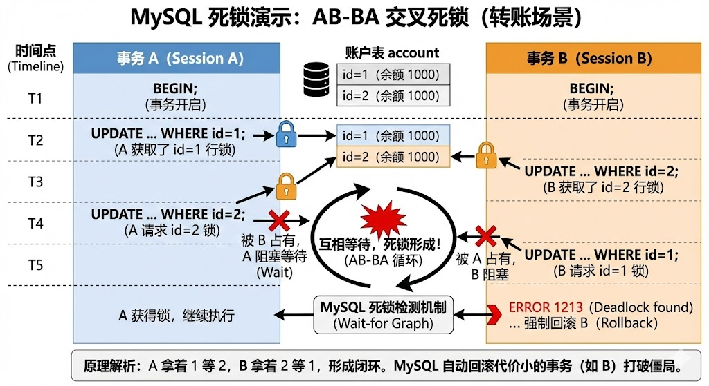

死锁的本质就是**两个或多个事务在执行过程中，因争夺资源而造成的一种“互相等待”的僵局**。

最经典的死锁案例，就是“AB-BA 交叉死锁”。简单说就是：我拿着 A 等 B，你拿着 B 等 A，我不放手你也不放手，最后大家都动不了。



下面用一个最直观的“转账场景”来演示：

### 场景准备

假设有一张账户表 `account`，只有两行数据：

```
CREATE TABLE account (
  id INT PRIMARY KEY,
  balance INT
) ENGINE=InnoDB;

INSERT INTO account VALUES (1, 1000), (2, 1000);
```

### 死锁复现步骤

我们需要开启两个终端（Session A 和 Session B），模拟两个并发的事务。

| **时间点** | **事务 A (Session A)** | **事务 B (Session B)** | **状态说明** |
| --- | --- | --- | --- |
| **T1** | BEGIN; | BEGIN; | 事务开启 |
| **T2** | UPDATE account SET balance = balance - 100 WHERE id = 1; |  | **A 获取了 id=1 的行锁** |
| **T3** |  | UPDATE account SET balance = balance - 100 WHERE id = 2; | **B 获取了 id=2 的行锁** |
| **T4** | UPDATE account SET balance = balance + 100 WHERE id = 2; |  | A 想要锁 id=2，但被 B 占着。<br>A 进入阻塞等待 (Wait) |
| **T5** |  | UPDATE account SET balance = balance + 100 WHERE id = 1; | B 想要锁 id=1，但被 A 占着。<br>死锁形成！ |
| **Result** | (等待中...) | **ERROR 1213 (40001): Deadlock found...** | MySQL 检测到死锁，强制回滚其中一个事务（通常是回滚 B） |

### 原理解析

- **T2 时：** 事务 A 锁住了 `id=1`。
- **T3 时：** 事务 B 锁住了 `id=2`。
- **T4 时：** 事务 A 想要申请 `id=2` 的锁，但是 `id=2` 在 B 手里，所以 A 只能等。
- **T5 时：** 事务 B 想要申请 `id=1` 的锁，但是 `id=1` 在 A 手里。
- **结局：** A 等 B，B 等 A，形成闭环。InnoDB 的死锁检测机制（wait-for graph）会立马发现这个环，为了打破僵局，它会选择回滚代价较小的那个事务（这里通常是 B），让 A 执行下去。

---

### 面试标准回答

最典型的死锁案例是 **‘资源交叉引用’（AB-BA 死锁）**。

举个例子：

假设有两个事务，事务 A 先锁住了记录 1，然后尝试去锁记录 2；

与此同时，事务 B 先锁住了记录 2，然后尝试去锁记录 1。

这样两个事务就分别持有了对方需要的锁，同时又在等待对方释放锁，从而形成了一个死循环，这就是死锁。

**在 MySQL 中，这种场景通常会触发 InnoDB 的死锁检测机制，数据库会主动回滚其中一个事务来打破僵局。**

**为了避免这种情况，我们在开发中通常采用以下策略**：

1. **固定顺序加锁**：比如所有事务都必须按照 id 从小到大的顺序去更新数据（先锁 id=1，再锁 id=2），这样就不会出现交叉等待。
2. **大事务拆小**：尽量缩短持有锁的时间，减少冲突概率。
3. **一次性锁定**：如果业务允许，尽可能一次性申请所有需要的资源（虽然在数据库层面很难做到，但在代码层可以用分布式锁实现）。
