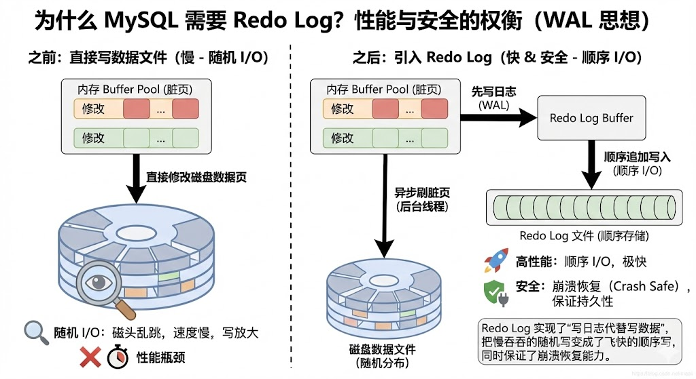

简单直接的回答是：**直接写数据文件太慢了，慢到无法接受。Redo Log 的存在，本质上就是用“顺序 I/O”来替代“随机 I/O”，从而极大提升写入性能，同时保证数据不丢失。**

具体原因可以从以下两个核心维度来拆解：

1. **性能维度：顺序写 vs 随机写**
    1. **如果不像 Redo Log 那样做（直接写库）：**
        - MySQL 的数据是按页（Page，默认 16KB）存放在磁盘的不同位置的。
        - 你可能只修改了某一行里的一个整数（比如余额 +1），也就是几个字节。
        - 但为了保存这几个字节，你必须把整个 16KB 的页都写回磁盘。
        - 更要命的是，这些页在磁盘上是**分散**的。如果你同时修改了 10 个不同页的数据，磁盘磁头就得满盘乱跳，这是典型的**随机 I/O**，速度极慢。
    2. **有了 Redo Log 之后：**
        - Redo Log 是一个**追加写**的文件。
        - 不管你改了哪个页，我只需要把“修改记录”挨个追加到日志文件的末尾就行了。
        - 这是典型的**顺序 I/O**。在机械硬盘时代，顺序写比随机写快几十倍；即使在 SSD 时代，顺序写的性能优势依然巨大。
        - **结论：** Redo Log 实现了**“写日志代替写数据”**，把慢吞吞的随机写变成了飞快的顺序写（这也是 **WAL** 技术的核心）。
2. **安全维度：Crash Safe（崩溃恢复）**
    1. **持久性的要求：** 事务一旦提交，数据绝对不能丢。
    2. **矛盾点：**
        - 如果为了快，只改内存（Buffer Pool），不写磁盘，那一旦断电，内存数据全没了（丢数据）。
        - 如果为了安全，每次提交都把 Buffer Pool 里的脏页刷到磁盘，又回到了第一点的“慢”的问题。
    3. **Redo Log 的解法：**
        - 策略是：**先写日志，后写磁盘（WAL）**。
        - 只要 Redo Log 落盘成功，事务就算成功了。
        - 至于真正的数据页，可以慢慢地（异步）由后台线程在空闲时刷回去。
        - **万一断电了？** 没事，重启后 MySQL 会读取 Redo Log，把那些还没来得及刷盘的操作**“重做”**一遍，保证数据完全一致。

---

### 面试标准回答

为什么需要 Redo Log，而不直接把数据写回磁盘？核心原因在于**性能**和**数据安全性**的权衡，这也就是数据库领域经典的 **WAL** 思想。

**主要原因有两点：**

第一，为了解决‘随机 I/O’导致的性能瓶颈（核心原因）：

MySQL 的数据页在磁盘上是随机分布的。

如果每次修改数据都直接将数据页刷盘，会触发大量的随机 I/O。而且即使只修改了一个字节，也需要写入整个 16KB 的页，存在严重的写放大问题，性能极差。

而 Redo Log 是顺序追加写入的，利用顺序 I/O 极高的吞吐量，可以极大提升数据库的写入速度。

第二，为了保证崩溃恢复能力：

内存中的脏页是异步刷新到磁盘的。如果数据库突然宕机，内存数据会丢失。

有了 Redo Log，只要保证事务提交前日志落盘，即使数据库崩溃，重启后也能通过重放 Redo Log 来恢复数据，从而保证了事务的持久性。
