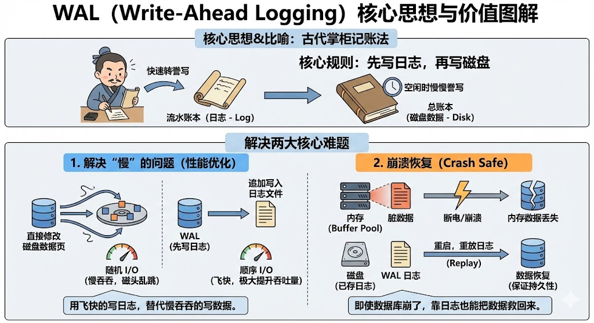

WAL（Write-Ahead Logging），翻译过来就是“预写日志”。

简单总结：**它的核心规则只有一条——“先写日志，再写磁盘”。** 在你对数据库进行任何修改时，必须先把“修改记录”写到日志文件里（落盘），哪怕真正的数据文件还没来得及写，这个事务也算提交成功了。

它就像是古代掌柜的“记账法”**：有客人来赊账，掌柜的先在手边的**“流水账本”**（Log）上快写一笔，等晚上打烊了空闲了，再慢慢把这些账誊写到**“总账本”上去。

具体来说，WAL 技术主要解决了数据库的两大核心难题：

1. **解决“慢”的问题（性能优化）**
    1. **痛点：** 数据库的数据页（Page）在磁盘上是乱序分布的。如果每次修改都要直接去改磁盘上的数据页，那是**随机 I/O**，磁头要到处乱跳，速度极慢。
    2. **WAL 解法：** 日志文件（比如 Redo Log）是**追加写入**的。不管你改了哪里的数据，我都只是在日志末尾加一行记录。这是**顺序 I/O**，速度比随机 I/O 快几十倍。
    3. **效果：** 用飞快的写日志，替代了慢吞吞的写数据，极大提升了并发吞吐量。
2. **崩溃恢复**
    1. **痛点：** 为了快，我们通常只改内存（Buffer Pool），不立刻刷盘。但如果这时候断电了，内存里的脏数据就全丢了。
    2. **WAL 解法：** 因为日志已经先写进磁盘了（Write-Ahead）。所以即使数据库崩了，重启的时候，只要把日志拿出来，从头到尾重做一遍，数据就全都回来了。
    3. **效果：** 保证了事务的**持久性（Durability）**，实现了 Crash-Safe。

---

### 面试标准回答

WAL（Write-Ahead Logging）是数据库系统中一种关键的数据安全与性能优化技术，其核心思想是：**在将数据变更写入到数据文件之前，必须先将变更记录写入到日志文件中。**

**它主要带来了两个巨大的收益：**

第一，极大提升写入性能（核心）：

直接修改磁盘上的数据页通常需要进行随机 I/O（因为数据分布分散），性能较差。

而 WAL 技术将随机写转换为了日志文件的顺序 I/O（追加写）。数据库只需保证日志落盘即可返回事务成功，真正的脏数据页可以由后台线程异步、批量地刷回磁盘（CheckPoint），从而避开了慢速的磁盘随机寻址。

第二，保证数据的持久性（Crash Safe）：

因为日志先于数据落盘，即使数据库发生宕机，内存中的脏页丢失，重启后依然可以通过重放 WAL 日志（如 MySQL 的 Redo Log）来恢复数据，确保已提交的事务绝不丢失。
