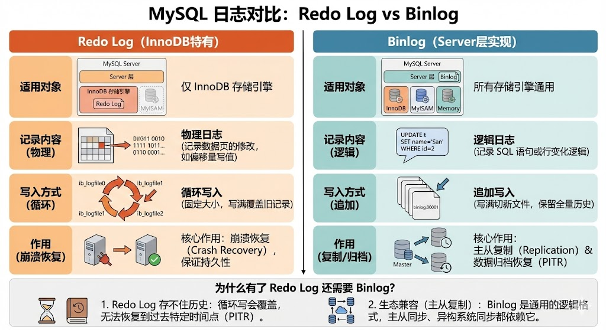

简单总结：**Redo Log 是物理日志，负责让数据库崩溃后能活过来；Binlog 是逻辑日志，负责把数据同步给别人（主从复制）或者恢复到以前的某个时间点。**

具体区别可以从以下 **4 个维度** 来拆解：

1. **适用对象不同**
    1. **Redo Log：** 是 **InnoDB 存储引擎特有** 的。如果你用 MyISAM 引擎，是没有 Redo Log 的。
    2. **Binlog：** 是 **MySQL Server 层** 实现的。不管你用 InnoDB、MyISAM 还是 Memory 引擎，只要开了 Binlog，都能记录。
2. **记录内容不同（物理 vs 逻辑）**
    1. **Redo Log（物理日志）：** 记的是“在哪个数据页上做了什么修改”。比如：“把第 3 页偏移量 100 的地方改成 'A'”。它非常底层，跟磁盘结构绑定。
    2. **Binlog（逻辑日志）：** 记的是“语句的原始逻辑”。比如：“给 ID=2 的行，Name 字段改成 'ZhangSan'”。
3. **写入方式不同（循环 vs 追加）**
    1. **Redo Log：** 是**循环写**的。文件大小固定（比如 4 个文件，每个 1GB）。写满了就回到开头覆盖写。这意味着它**无法保存所有的历史记录**。
    2. **Binlog：** 是**追加写**的。写满一个文件就创建一个新的，文件会越积越多。只要你不删，它能保存 10 年前的数据。
4. **作用不同**
    1. **Redo Log：** 核心作用是 **Crash Recovery（崩溃恢复）**。断电了，重启后靠它恢复内存里的脏页。
    2. **Binlog：** 核心作用是 **Replication（主从复制）** 和 **Data Recovery（数据归档恢复）**。

---

### 有 Redo Log 为什么还需要 Binlog？

既然 Redo Log 也能恢复数据，为啥不干脆把 Binlog 删了？主要有这两个原因：

1. Redo Log 存不住历史（主要原因）：
    1. Redo Log 是循环写的，写一圈就覆盖了。如果你想把数据库恢复到“上个月的某一天”，Redo Log 早就被覆盖八百遍了，根本做不到。这时候必须靠 Binlog 这种全量归档日志。
2. 生态兼容（主从复制）：
    1. MySQL 不只有 InnoDB 一个引擎。为了让主库的数据能同步给从库，或者同步给 Hadoop、ElasticSearch 等异构系统，必须依赖一种通用的、逻辑的日志格式，那就是 Binlog。

---

### 面试标准回答

Binlog 和 Redo Log 都是 MySQL 中的关键日志，但它们的定位完全不同：

**第一，实现层级不同**：

- **Binlog** 是 MySQL **Server 层**实现的，所有存储引擎通用。
- **Redo Log** 是 **InnoDB 引擎特有**的。

**第二，记录内容不同**：

- **Binlog** 是**逻辑日志**，记录的是 SQL 语句的原始逻辑或行变化。
- **Redo Log** 是**物理日志**，记录的是数据页上的具体修改。

**第三，写入方式不同（关键点）**：

- **Binlog** 是**追加写**，文件写满后会切换新文件，保留全量历史。
- **Redo Log** 是**循环写**，空间固定，用完后会覆盖旧记录。

**至于为什么有了 Redo Log 还需要 Binlog？**

1. **Redo Log 无法存储历史数据**：因为它会覆盖写入，无法用于恢复到过去的某个特定时间点（PITR），也不能用于全量备份恢复。
2. **主从复制依赖 Binlog**：Binlog 是 MySQL 生态通用的数据同步格式，主从同步、数据迁移都依赖它。
