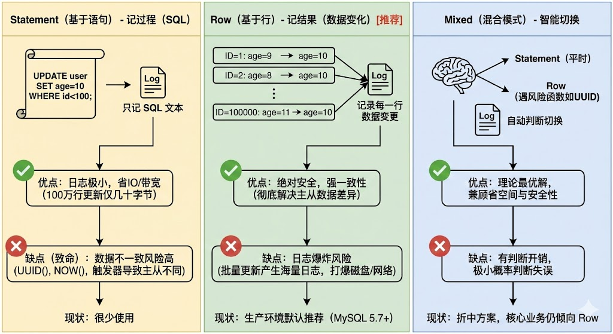

这三种格式的本质区别，就在于“你到底是记过程（SQL），还是记结果（数据变化）”。

简单总结：**Statement 省空间但容易数据不一致；Row 最安全但日志容易爆炸；Mixed 是想兼得熊掌和鱼，但现在生产环境基本都无脑上 Row 模式了。**

具体优缺点拆解如下：

1. **Statement（基于语句）**
    1. **原理：** 记录原本的 SQL 语句。你执行 `UPDATE user SET age=10`，它就在日志里原封不动记下这句话。
    2. **优点：****日志文件极小**。不管你这条 SQL 影响了 10 行还是 100 万行，日志里只占几十个字节（只记 SQL 文本）。这也意味着主从复制时的网络带宽占用很少。
    3. **缺点（致命）：****数据不一致风险高**。
        - 如果 SQL 里包含了动态函数，比如 `UUID()`、`NOW()`、`RAND()`。主库执行时是一个值，从库回放这条 SQL 时又是另一个值，导致主从数据对不上。
        - 如果使用了触发器、存储过程，也容易出现执行顺序差异导致的不一致。
2. **Row（基于行）**
    1. **原理：** 记录每一行数据的变化细节。你执行 `UPDATE` 影响了 10 万行，它就会在日志里记录 **10 万条**“A 变成了 B”的具体事件。
    2. **优点：****绝对安全**。它不关心上下文，只关心数据本身变成了什么样。彻底解决了 `UUID`、触发器等导致的主从不一致问题。
    3. **缺点：****日志体积可能会爆炸**。
        - 比如你做一个全表更新 `UPDATE table SET status=1`，如果表有 1000 万行，Statement 模式只有几十字节，而 Row 模式会产生几个 G 的日志，瞬间打爆磁盘 IO 和网络带宽。
        - *注：MySQL 5.7 之后已经是默认 Row 格式了。*
3. **Mixed（混合模式）**
    1. **原理：** 平时用 Statement（省空间），一旦发现 SQL 里包含 `UUID`、`User Defined Function` 等可能导致不一致的操作时，自动切换成 Row 模式。
    2. **优点：** 理论上的最优解，既省空间又保安全。
    3. **缺点：** 系统判断需要开销，而且有时候判断不准（该切 Row 的没切），依然有极小概率出问题。

---

### 面试标准回答

Binlog 主要有三种日志格式，它们的权衡点在于**日志大小**与**数据一致性**：

第一种，Statement（语句模式）：

它只记录 SQL 语句原文。

- **优点**是日志体积非常小，IO 压力低。
- **缺点**是存在严重的数据一致性隐患。例如使用 `UUID()`、`NOW()` 等函数时，主从库执行结果可能不一致，因此现在很少使用了。

第二种，Row（行模式 - 推荐）：

它记录每一行数据的具体变更（Before Image 和 After Image）。

- **优点**是保证了**强一致性**，不会出现主从数据差异。
- **缺点**是日志量较大，特别是在批量 Update 或 Alter Table 时，会导致 Binlog 暴涨。
- **但是**，随着现在网络和存储成本的降低，为了数据的准确性，**生产环境通常都强制设置为 Row 模式**（也是 MySQL 5.7+ 的默认值）。

第三种，Mixed（混合模式）：

它是前两者的折中。MySQL 会自动判断，普通操作用 Statement，有风险的操作（如 UUID）自动切为 Row。虽然看起来很美，但为了避免潜在的判断失误风险，核心业务中我们依然倾向于直接使用 Row。
