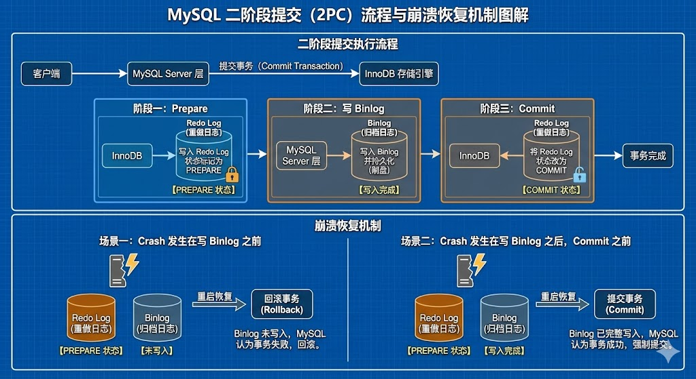

二阶段提交（Two-Phase Commit, 2PC）是 MySQL 内部为了保证 **Redo Log（重做日志）** 和 **Binlog（归档日志）** 这两份日志逻辑一致性而设计的一种原子提交机制。

简单总结：**它把 Redo Log 的写入拆成了两个步骤（Prepare 和 Commit），中间夹着 Binlog 的写入。要么两个都成功，要么两个都失败，绝不允许“一个有一个没有”的情况发生。**

具体流程和设计原因如下：

### 一、 具体的执行流程

假设你要执行一条 `UPDATE` 语句，在最后提交事务的时候，内部流程是这样的：

1. **阶段一：Prepare 阶段（InnoDB 做准备）**
    1. InnoDB 将此次事务的修改写入 **Redo Log**，并将 Redo Log 的状态标记为 `**PREPARE**`。
    2. 这时候，数据虽然写了日志，但还处于“待定”状态，不可见。
2. **阶段二：写 Binlog（Server 层记录）**
    1. MySQL Server 层将 SQL 语句或行记录写入 **Binlog** 文件，并确保刷盘（持久化）。
3. **阶段三：Commit 阶段（InnoDB 最终确认）**
    1. InnoDB 收到通知说 Binlog 写好了，于是把 Redo Log 的状态改为 `**COMMIT**`。
    2. 事务正式完成。

### 二、 为什么要搞这么麻烦？

如果不用两阶段提交，无论你是“先写 Redo Log 再写 Binlog”，还是“先写 Binlog 再写 Redo Log”，一旦在中间断电，都会出大问题：

1. **假设先写 Redo Log，再写 Binlog**
- **场景：** Redo Log 写完了，数据库崩了，Binlog 还没来得及写。
- **后果：**
    - **主库（Master）：** 重启后依靠 Redo Log 把数据恢复了，主库里有这笔数据。
    - **从库（Slave）：** 因为 Binlog 没写，从库根本不知道这笔更新。
    - **结局：****主从数据不一致**。
1. **假设先写 Binlog，再写 Redo Log**
- **场景：** Binlog 写完了，数据库崩了，Redo Log 还没来得及写。
- **后果：**
    - **从库（Slave）：** 收到了 Binlog，把数据同步过去了，从库里有这笔数据。
    - **主库（Master）：** 重启后因为 Redo Log 没写，刚才的修改全丢了。
    - **结局：****主从数据不一致**（这次是从库多，主库少）。
1. **二阶段提交怎么解决的？**
- 如果 Crash 发生在 **Prepare 之后，写 Binlog 之前**：
    - 重启恢复时，发现 Redo Log 是 Prepare 状态，且 Binlog 没记录。MySQL 认为事务失败，**回滚**。
- 如果 Crash 发生在 **写 Binlog 之后，Commit 之前**：
    - 重启恢复时，发现 Redo Log 是 Prepare 状态，但 Binlog 里**有**完整的记录。MySQL 认为事务成功，**提交**。

---

### 面试标准回答、

、MySQL 的二阶段提交（2PC），是为了保证 **Redo Log** 和 **Binlog** 在崩溃场景下的逻辑一致性而设计的。

**因为 Redo Log 决定了主库的数据，Binlog 决定了从库的数据。如果两者不一致，就会导致主从同步异常。**

**具体的实现机制是将事务提交过程分为三个步骤：**

1. **Prepare 阶段**：InnoDB 写入 Redo Log，并将状态设为 Prepare。
2. **Binlog 阶段**：Server 层写入 Binlog 并刷盘。
3. **Commit 阶段**：InnoDB 将 Redo Log 状态设为 Commit。

**通过这种机制，在数据库崩溃重启恢复时：**

- 如果 Binlog 没写完，引擎会回滚事务（保证主库也没数据）。
- 只要 Binlog 写完了（哪怕 Redo Log 还没来得及标 Commit），引擎也会通过扫描 Binlog 来强制提交事务（保证主库有数据）。
