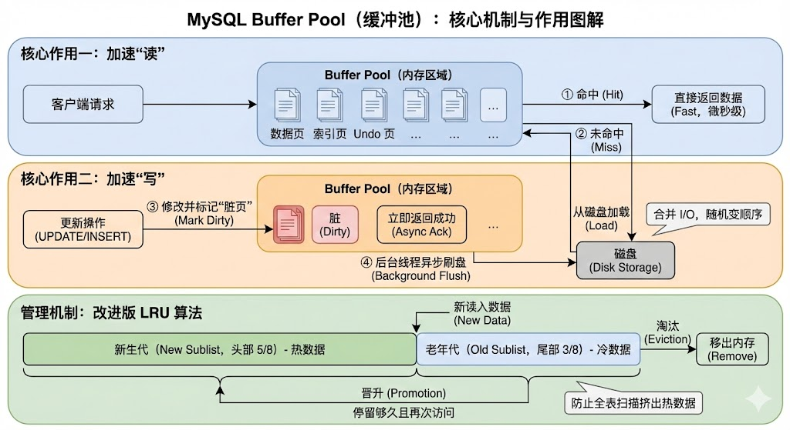

Buffer Pool（缓冲池）是 MySQL（InnoDB 存储引擎）中**最核心、最宝贵**的内存组件。

简单一句话总结：**它是数据库在内存里构建的一道“防线”，核心目的是为了用“内存的速度”来弥补“磁盘的龟速”。**

如果没有它，你的每一次 `SELECT` 都要去读硬盘，每一次 `UPDATE` 都要去写硬盘，那 MySQL 的性能至少要下降几个数量级。

具体来说，它主要负责两件事以及一套管理机制：

1. **加速“读”：缓存数据页**
    1. 当你需要查数据时，MySQL 不会傻傻地直接去磁盘找。
    2. 它会先看 Buffer Pool 里有没有。
        - **命中（Hit）：** 如果有，直接返回，这是微秒级的操作（内存速度）。
        - **未命中（Miss）：** 如果没有，才去磁盘加载数据页到 Buffer Pool 中，然后再返回。
    3. **存什么：** 不仅存数据，还存索引、Undo 页（实现事务回滚用的）、锁信息等。
2. **加速“写”：变随机写为顺序写**
    1. 当你执行 `UPDATE` 时，MySQL 并不是立刻把数据写回磁盘。
    2. 它只是修改 Buffer Pool 里的数据页，把这个页标记为“脏页”，然后立马告诉你“更新成功”。
    3. 后台会有专门的线程，找机会把这些脏页慢慢地刷回磁盘（Flush）。
    4. **好处：** 它可以把多次对同一个页的修改合并成一次 I/O，或者把多个不连续的页写入合并成一次批量的 I/O。
3. **怎么管理：改进版的 LRU 算法**
- 内存是有限的，装满了怎么办？必须淘汰不常用的。
- 普通的 LRU（最近最少使用）算法有个死穴：**全表扫描**。如果偶尔扫一次大表，会把热点数据全部挤出去。
- **InnoDB 的优化：** 它把 LRU 链表分成了“新生代”**（New Sublist，头部 5/8）和**“老年代”（Old Sublist，尾部 3/8）。
    - 新读入的数据只放在“老年代”的头部。
    - 只有当它在“老年代”里待够了时间且再次被访问，才会被晋升到“新生代”。这样就防止了冷数据把热数据“洗”出内存。

---

### 面试标准回答

Buffer Pool 是 InnoDB 存储引擎在内存中划分的一块区域，是 MySQL 性能优化的关键。它的核心作用是**通过内存缓存来减少昂贵的磁盘 I/O 操作**。

**它主要承担了两个职责：**

第一，缓存读取（读加速）：

在查询数据时，引擎会优先查找 Buffer Pool。如果命中缓存则直接返回（内存速度）；如果未命中，则从磁盘加载并缓存。它不仅缓存数据页，还缓存索引页和 Undo Log 等。

第二，缓冲写入（写加速）：

在修改数据时，引擎只修改 Buffer Pool 中的页面，将其标记为‘脏页’，然后通过后台线程异步将脏页刷回磁盘。这不仅通过合并 I/O 提升了性能，还避免了大量的随机磁盘写入。

关于淘汰策略：

既然是缓存，空间是有限的。InnoDB 使用了改进版的 LRU 算法来管理内存。

它将链表分为 New（热数据） 和 Old（冷数据） 两部分。新读取的数据默认只进入 Old 区，只有满足特定条件（如再次访问且停留一定时间）才能进入 New 区。这样做是为了防止全表扫描等偶然性大查询将真正的热点数据挤出缓存，从而保证缓存的命中率。
