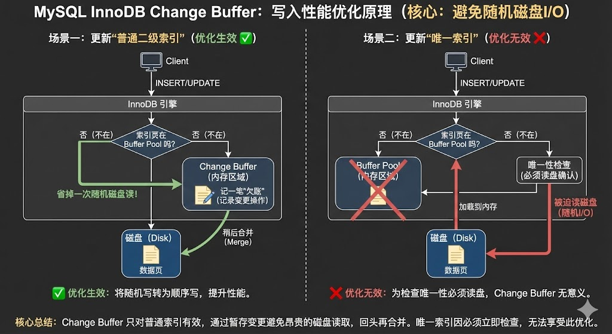

Change Buffer 是 InnoDB 为了**极致提升写入性能**而设计的一个“缓存区”。

简单一句话总结：**当你要更新一个非唯一索引的数据时，如果这个索引页刚好不在内存里，为了不产生昂贵的磁盘 I/O 去把页读上来，就先在缓存里记一笔“欠账”，回头空闲了再慢慢补回去。**

为了讲清楚，我们需要拆解为 两个维度：

## **它的核心作用：将“随机写”变成“顺序写”**

- **场景：** 比如你执行 `INSERT INTO user ...`。
- **理想情况：** 相关的索引页都在 Buffer Pool（内存）里，直接改内存，很快。
- **现实情况：** 索引表很大，数据很分散。你要改的那个索引页大概率在磁盘上。
- **没有 Change Buffer：** 必须先把那个死沉死沉的数据页从磁盘读进内存（一次随机 I/O），修改它，然后再刷回磁盘。
- **有了 Change Buffer：** MySQL 一看：“哎，这个页不在内存里。算了，我不去读磁盘了，太慢。我直接在 Change Buffer 里记录一下‘我要对第 X 页做一个插入操作’。”
- **结果：** 省掉了一次读磁盘的开销。等到下次有人真的要查这个页，或者后台线程空闲时，再把这个“欠账”合并（Merge）进去。

## 只对“普通二级索引”有效

这是面试最爱考的细节点。Change Buffer 不能用于 唯一索引（Unique Index），也不能用于 主键索引（这也是一种唯一索引）。

- **只对：** 普通索引（Non-Unique Secondary Index）有效。
- **无效于：** 唯一索引（Unique Index）。
1. **为什么对唯一索引无效？（核心逻辑）**
    1. **唯一索引的宿命：** 它的核心任务是保证**数据不重复**。
    2. **冲突点：** 当你插入一条数据 `id=10` 时，唯一索引必须**立刻、马上**去确认一下数据库里是不是已经有个 `id=10` 了。
    3. **后果：** 怎么确认？必须把那个数据页**读到内存里**来看一眼。
    4. **结论：** 既然你为了检查唯一性，已经被迫把数据页读进内存了，那直接更新内存里的页面就好了，还要 Change Buffer 干嘛？这就叫“脱裤子放屁——多此一举”。

---

### 面试标准回答

Change Buffer 是 InnoDB Buffer Pool 中的一块特定区域，主要用于优化 SQL 变更（Insert/Update/Delete）时的性能。

它的核心逻辑是：

当需要变更的数据页不在 Buffer Pool 中时，InnoDB 不会直接去磁盘加载这个页（避免一次随机磁盘读），而是将变更记录缓存到 Change Buffer 中。等到后续有查询操作访问该页，或者后台线程空闲时，再将变更合并（Merge）到真正的数据页中。

关于它适用的索引类型，有明确限制：

Change Buffer 只对‘普通二级索引’有效，对‘唯一索引’（包括主键）是无效的。

原因在于：

唯一索引在插入或更新时，必须先判断唯一性约束（Duplicate Key Check）。这要求必须将数据页读入内存进行比对。

一旦数据页已经被读入内存，直接更新内存中的数据页即可，Change Buffer ‘避免磁盘读取’的优化意义就不复存在了。

**总结**：对于写多读少的业务，且使用普通索引的场景，调大 Change Buffer 可以显著提升写性能。
