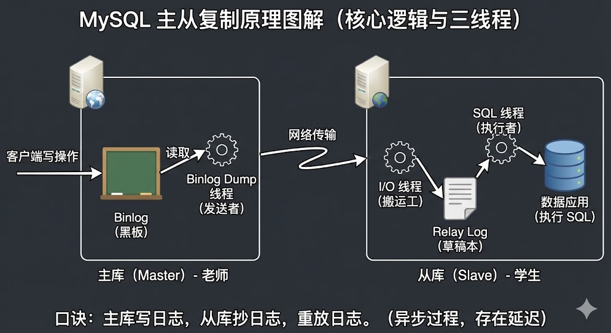

MySQL 主从复制的核心逻辑非常简单，一句话概括就是：**“主库写日志，从库抄日志，重放日志。”**

这就好比老师（主库）在黑板（Binlog）上写解题步骤，学生（从库）先把它抄到自己的草稿本（Relay Log）上，然后再自己在脑子里算一遍（执行 SQL）。

整个过程完全依赖于 **Binlog**，并且由 **3 个核心线程** 来完成这场接力赛：

1. **主库（Master）的动作：记录与发送**
    1. **记录 Binlog：** 主库发生数据修改（写操作）时，会把这些改动记录到二进制日志（Binlog）里。
    2. **Dump 线程（发送者）：** 当从库连接上来时，主库会创建一个 **Binlog Dump Thread**。它的任务就是要把 Binlog 的内容发给从库。
2. **从库的动作：接收与暂存**
    1. **I/O 线程（搬运工）：** 从库会启动一个 **I/O Thread**。它连上主库，请求读取 Binlog。收到数据后，它不直接执行，而是先把这些数据写入到本地的一个文件中，叫 **中继日志（Relay Log）**。
        - *为什么要有个中继日志？* 为了解耦。网络传输和 SQL 执行的速度不一样，先存下来，这就成了“生产者-消费者”模型。
3. **从库的动作：重放与执行**
    1. **SQL 线程（执行者）：** 从库还有一个 **SQL Thread**。它专门盯着 Relay Log，发现有新内容了，就读出来，解析成 SQL 语句，在从库上重新执行一遍。
    2. **结果：** 执行完后，从库的数据就和主库一样了。

---

### 面试标准回答

MySQL 的主从复制是基于 **Binlog（二进制日志）** 实现的异步复制过程。

**它的核心流程可以概括为‘一主两从三线程’：**

第一步，主库记录与传输：

主库在事务提交时，将数据变更记录到 Binlog 中。

当从库连接主库时，主库会创建一个 Binlog Dump Thread，负责将 Binlog 的内容发送给从库。

第二步，从库接收（I/O 线程）：

从库启动一个 I/O Thread，负责连接主库并接收 Binlog 日志。

接收到的日志并不会立即执行，而是先写入到从库本地的 Relay Log（中继日志） 中，这样就实现了网络接收与 SQL 执行的解耦。

第三步，从库回放（SQL 线程）：

从库还会启动一个 SQL Thread，它会读取 Relay Log 中的日志事件，将其解析并重放应用到从库的数据中，从而实现主从数据的一致性。

**（补充）**：由于这个过程默认是**异步**的，所以主从之间难免会存在一定的**延迟（Replication Lag）**。
