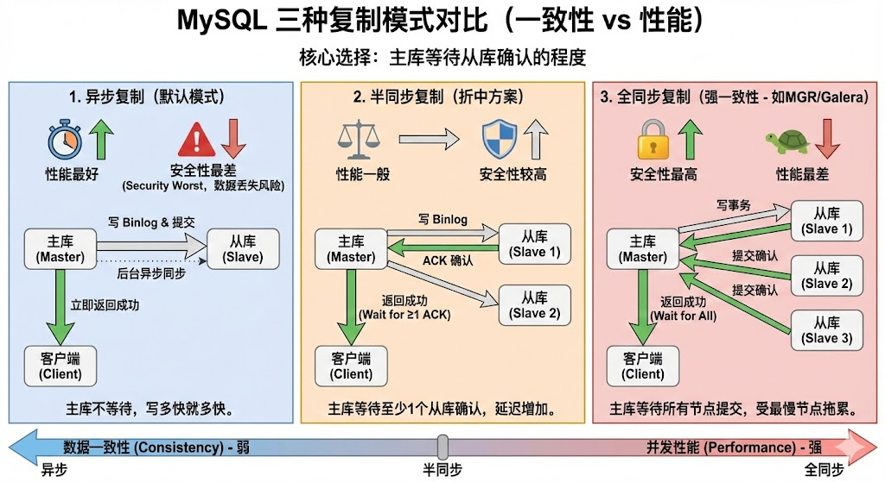

这三种复制模式，本质上是在做一道“数据一致性”**与**“并发性能”的选择题。

核心区别就在于：**主库（Master）写完数据后，到底要等从库（Slave）多久，才敢跟客户端说“操作成功”？**

我们可以把这三种模式比作“发快递”的不同服务：

1. **异步复制—— 默认模式**
- **机制：** 主库自己写完 Binlog，提交事务，**立马**给客户端返回“成功”。它根本不管从库有没有收到数据，只是由后台线程慢慢去同步。
- **特点：**
    - **性能最好：** 主库毫无拖累，写多快就多快。
    - **安全性最差：** 如果主库刚写完就宕机了， Binlog 还没传给从库，这部分数据就彻底丢了。
1. **半同步复制—— 折中方案**
- **机制：** 主库写完 Binlog 后，**必须等待**。等到至少有 **1 个**从库收到了 Binlog（并写入 Relay Log），给主库回了一个 `ACK` 确认包，主库才敢给客户端返回“成功”。
- **特点：**
    - **性能一般：** 增加了一个网络往返的延迟（RTT）。
    - **安全性较高：** 保证了至少有一个从库有数据，大大减少了数据丢失的风险（MySQL 5.7 的 `AFTER_SYNC` 模式下可以做到不丢数据）。
1. **全同步复制—— 强一致性**
- **机制：** 主库写完，必须等待**所有**从库都提交了事务，才能返回成功。
- **注：** 标准的 MySQL 原生复制不支持这个（太慢了）。通常指 **MGR (MySQL Group Replication)** 或 **Galera Cluster** 这种基于 Paxos/Raft 协议的集群方案。
- **特点：**
    - **性能最差：** 任何一个节点慢，整个集群就慢；一个节点挂了，整个集群可能不可用。
    - **安全性最高：** 保证所有节点数据完全一致。

---

### 面试标准回答

MySQL 的三种复制模式，主要区别在于**主库等待从库确认的程度**不同，这直接决定了系统的数据一致性和写入性能：

第一，异步复制（默认）：

主库在执行完事务后，不等待从库的反馈，直接返回成功。

- **优势**是性能最高，主库无等待延迟。
- **劣势**是存在数据丢失风险，一旦主库宕机，未同步的 Binlog 就会丢失。

第二，半同步复制：

主库在提交事务后，必须等待至少一个从库将 Binlog 写入 Relay Log 并返回 ACK 确认，才算完成。

- **优势**是极大地保证了数据一致性（RPO 接近 0）。
- **劣势**是会增加网络延迟，写入性能受从库网络影响。这是目前生产环境做高可用（如 MHA、Orchestrator）时的**首选模式**。

第三，全同步复制：

类似于 Paxos 协议，要求多节点对事务达成一致才能提交。

- **优势**是实现了强一致性。
- **劣势**是写性能最差，受限于最慢的节点，通常用于对一致性要求极高的金融级场景。
