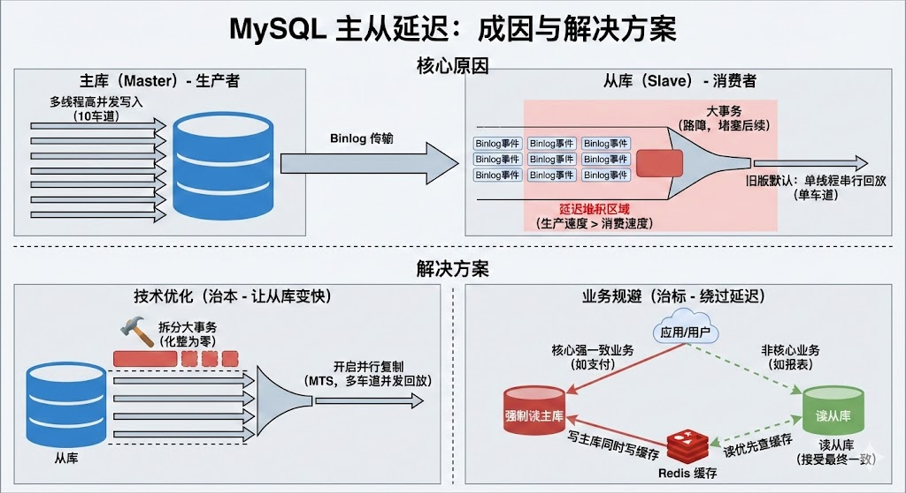

简单总结：**主从延迟的本质是“生产速度大于消费速度”。主库是多线程并发写，从库默认是单线程串行回放，这中间的时间差就是延迟。**

要彻底解决这个问题，我们得先知道为什么慢，再对症下药：

### 一、 为什么会有延迟？（核心原因）

除了网络抖动、机器配置差（从库不如主库）这些硬件原因外，软件层面最大的两个锅是：

1. **并发能力的维度打击（最根本原因）**
- **主库：** 业务并发极高，成百上千个线程同时在写。
- **从库（早期版本）：** 负责回放的 SQL 线程只有 **1 个**。
- **结果：** 就像主库是“10 车道”的高速公路，到了从库这里突然合并成了“单车道”，必定堵车。虽然后来的 MySQL 版本引入了并行复制，但配置不当依然会慢。
1. **大事务（Big Transaction）是“路障”**
- **场景：** 你在主库执行了一条 `DELETE` 语句，删了 1000 万行数据，耗时 10 分钟。
- **后果：** 这个事务同步到从库后，从库的 SQL 线程也得老老实实跑 10 分钟。在这 10 分钟里，后续所有的 Binlog 都得排队等着，延迟直接飙升到 600 秒以上。

### 二、 如何解决？（4 种方案）

解决思路分为两类：一类是“让从库变快”**（治本），一类是**“业务上绕过”（治标）。

1. **开启并行复制**
    1. **原理：** MySQL 5.7 之后，官方终于支持了真正的并行复制。
    2. **做法：** 在从库设置 `slave_parallel_workers > 0`，让从库也开启多条车道并行回放 Binlog。
    3. **效果：** 这是目前解决延迟最有效、最通用的技术手段。
2. **拆分大事务 —— 开发规范**
    1. **做法：** 严禁在线上执行大批量的 `DELETE` 或 `UPDATE`。
    2. **优化：** 把“一次删 100 万行”拆成“循环 1000 次，每次删 1000 行”。
    3. **效果：** 这样从库回放时，中间可以穿插执行别的事务，不会造成长时间的拥堵。
3. **业务代码层面的妥协 —— 强制读主**
    1. **场景：** 刚注册完用户，立马要登录查用户信息。如果这时候有延迟，查从库会报错“用户不存在”。
    2. **做法：** 对于这种“强一致性”**的数据，代码里直接指定**去查主库。
    3. **策略：** 只有那些对延迟不敏感的数据（比如报表、历史记录）才去查从库。
4. **架构层面的缓存辅助**
    1. **做法：** 写主库的同时，把数据顺手写一份到 **Redis**。
    2. **读取：** 读的时候先读 Redis，Redis 里没有再查从库。
    3. **效果：** 既然数据库同步慢，那就用缓存来兜底。

---

### 面试标准回答

主从延迟是 MySQL 异步复制机制下的经典问题。其根本原因在于**主库的并发写入能力**远强于**从库的单线程回放能力**。

**要解决主从延迟，通常有技术优化和业务规避两个方向：**

**第一，技术层面（降低延迟）**：

1. **开启并行复制（MTS）**：这是最核心的方案。MySQL 5.7+ 引入了基于组提交（Group Commit）的并行复制，将从库的 SQL 线程多线程化，极大提升了回放速度。
2. **杜绝大事务**：在开发规范中严禁大批量的 DELETE/UPDATE 操作。将大事务拆解为多个小事务，防止单线程回放时阻塞后续 Binlog。
3. **提升硬件**：确保从库的硬件配置（CPU/IO）不低于主库。

第二，业务层面（规避影响）：

即便做了优化，延迟也无法 100% 消除。

- 对于**核心业务（强一致性要求）**，比如支付结果、刚注册的账号，我们在代码层面强制**读主库**。
- 对于**非核心业务**，接受数据的最终一致性，走从库查询。

**总结**：解决延迟的最佳实践是：**‘MTS 并行复制 + 严控大事务 + 核心读主’**。
