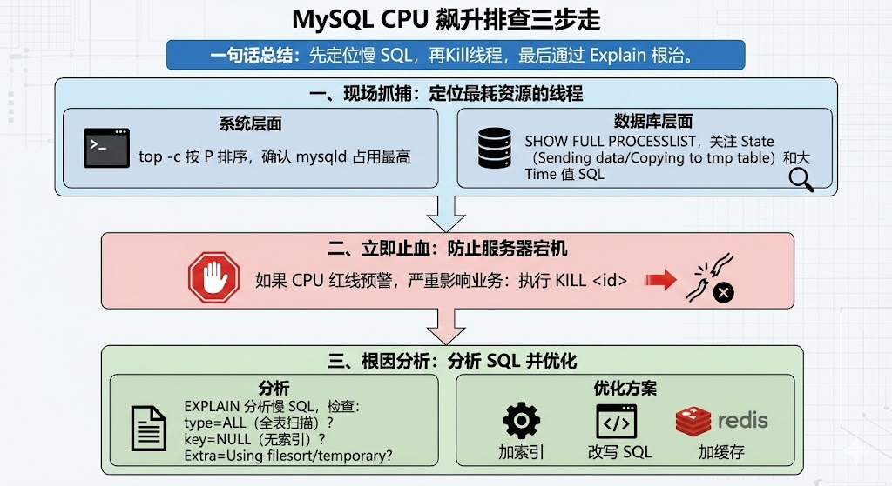

一句话总结排查思路：**先由外而内定位深哪条 SQL，再立刻Kill 线程，最后通过分析执行计划（Explain）做根治。** 90% 的 CPU 飙升都是由于 **慢 SQL（全表扫描、索引失效）** 导致的。

具体排查步骤遵循以下 **3 步走**：

1. **现场抓捕：定位最耗费资源的线程**
- **系统层面：** 登录服务器，执行 `top -c`，按下 `P` 键按 CPU 排序。确认占用率最高的进程确实是 `mysqld`。
- **数据库层面：** 连上 MySQL，执行 `**SHOW FULL PROCESSLIST**`。
    - 这是最关键的一步。你要盯着 `**State**` 这一列。
    - 如果看到大量的 `**Sending data**`、`**Copying to tmp table**`、`**Sorting result**`，或者看到某条 SQL 的 `Time` 值非常大，那它就是凶手。
1. **立即止血：防止服务器宕机**
- 如果 CPU 已经红线预警，严重影响业务了，不要犹豫。
- 直接执行 `KILL <id>`（这个 id 就是 processlist 里的 id），先把这个耗资源的线程杀掉，让 CPU 降下来，保证其他正常业务能跑。
1. **根因分析：分析 SQL 并优化**
- 拿到刚才那条“凶手 SQL”，用 `**EXPLAIN**` 分析它的执行计划。
- **检查点：**
    - `type` 是不是 `ALL`（全表扫描）？
    - `key` 是不是 `NULL`（没走索引）？
    - `Extra` 里有没有 `Using filesort` 或 `Using temporary`？
- **解决方案：** 加索引、改写 SQL（去掉子查询、拆分大查询）、或者因为数据量太大，考虑加缓存（Redis）。

---

### 面试标准回答

排查 MySQL CPU 飙升 100% 的问题，通常遵循‘定位-止血-根治’的思路：

第一步，定位（Locate）：

首先登录服务器使用 top 命令确认是 mysqld 进程导致的高负载。

然后进入 MySQL，使用 SHOW FULL PROCESSLIST 查看当前正在运行的线程。重点观察 State 状态为 Sending data 或 Copying to tmp table 的连接，以及 Time 执行时间较长的 SQL。通常 CPU 飙升都是由慢 SQL（全表扫描）或死锁引起的。

第二步，止血（Mitigate）：

如果情况紧急，严重阻塞了核心业务，我会先记录下这条慢 SQL，然后果断使用 KILL 命令结束该线程，优先释放系统资源，恢复业务可用性。

第三步，分析与优化（Root Cause Analysis）：

拿到慢 SQL 后，使用 EXPLAIN 分析执行计划。

- 如果是**索引失效**（type=ALL），则添加或优化索引。
- 如果是**数据量过大**，检查是否可以拆分查询或增加 Redis 缓存。
- 如果是**并发过高**，考量是否需要限流或读写分离。

**（补充）**：如果现场没抓到（比如是偶尔飙升），我会去分析 **慢查询日志（Slow Query Log）**，利用 `mysqldumpslow` 工具找出历史上最耗时的 SQL 进行专项优化。
