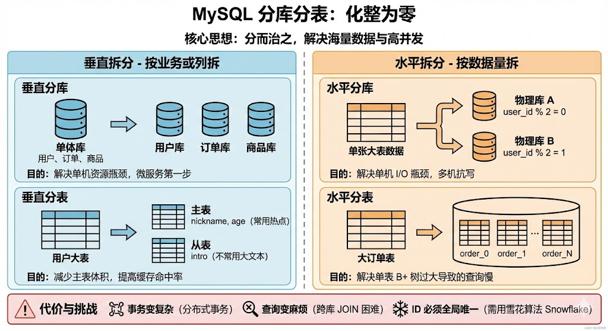

分库分表，用四个字概括就是“化整为零”。

它是解决 MySQL 性能瓶颈的终极手段。当单表数据量达到千万级，或者单库的并发扛不住的时候，我们通过把数据**拆分**到多个数据库或多张表中，来分摊压力。

具体拆法主要分为“垂直拆分”**和**“水平拆分”两大流派：

1. **垂直拆分（按业务或列拆）**
    1. **垂直分库：** 按照**业务模块**来拆。
        - 比如以前所有表都在一个大库里，现在拆成“用户库”、“订单库”、“商品库”。
        - **目的：** 解决单机 CPU 和内存瓶颈，这通常是微服务改造的第一步。
    2. **垂直分表：** 按照**字段的热度**来拆。
        - 比如一张用户表，把常用的 `nickname`、`age` 放在主表；把不常用的 `intro`（自我介绍，这是一个大文本）拆到从表里。
        - **目的：** 减少主表的体积，让 Buffer Pool 能缓存更多热点行数据。
2. **水平拆分（按数据量拆）**
    1. **水平分库：** 把同一个表的数据，按一定规则（如 `user_id % 2`）拆到不同的**物理数据库**实例上。
        - **目的：** 解决单机 I/O 瓶颈，让多台机器一起抗写流量。
    2. **水平分表：** 在同一个库里，把一张大表拆成 `order_0`, `order_1` ... `order_N`。
        - **目的：** 解决单表 B+ 树过大导致的查询慢问题。
3. 代价是什么？

分库分表虽然爽，但也会带来巨大的技术成本，不到万不得已不要用：

    1. **事务变复杂了：** 以前简单的本地事务，变成了**分布式事务**（跨库原子性难保证）。
    2. **查询变麻烦了：** 以前一个 `JOIN` 搞定，现在跨库不能 `JOIN`，得在代码里做两次查询再组装。
    3. **ID 必须全局唯一：** 自增 ID 不能用了（会重复），得用**雪花算法（Snowflake）**。

---

### 面试标准回答

分库分表是 MySQL 应对海量数据和高并发的常用扩展方案，核心思想是**分而治之**。它主要分为垂直拆分和水平拆分两个维度：

**第一，垂直拆分**：

- **垂直分库**：是基于**业务领域**的拆分，比如将单体库拆分为用户库、订单库。它解决了数据库连接数不足和单机资源瓶颈问题。
- **垂直分表**：是基于**字段活跃度**的拆分，将大字段（如 Text）或冷字段拆分到扩展表中，目的是为了减少单行数据体积，提高内存缓存命中率。

**第二，水平拆分**：

- 当单表记录超过一定阈值（如 500 万行或 1000 万行）导致 B+ 树层级变高时，我们会进行水平拆分。
- 通常根据分片键（Sharding Key）进行 Hash 取模或 Range 范围切分，将数据分散到不同的库或表中。它主要解决的是单表数据量过大和单机 I/O 瓶颈问题。

（关键补充）：

分库分表虽然能提升性能，但也会引入分布式事务、跨库 JOIN、全局唯一 ID 等复杂问题。因此，在业务初期，我们通常优先考虑索引优化或读写分离，分库分表是最后的手段。
