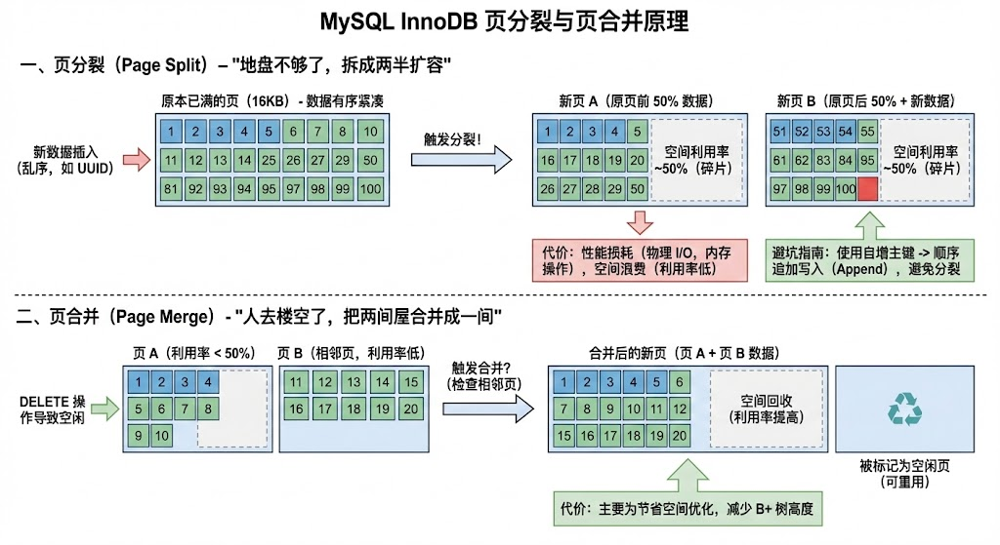

用最通俗的大白话讲：**页分裂就是“地盘不够了，拆成两半扩容”；页合并就是“人去楼空了，把两间屋合并成一间”。**

InnoDB 的数据是按“页（Page）”（默认 16KB）为单位管理的。为了保证 B+ 树查询效率极高，它必须保证数据在页内是有序的，且树的结构是紧凑的。

具体的技术细节如下：

1. **页分裂（Page Split）—— 为了“硬塞”数据**
    1. **触发场景：** 当你执行 `INSERT` 或 `UPDATE` 操作时，如果新的数据需要插入到某个已满的数据页中，而这个页已经**没有空闲空间**了。
    2. **怎么办：** InnoDB 只能申请一个新的空页，把原来那个页里**约 50%** 的数据挪到新页里，再把新数据插进去。
    3. **代价：**
        - **性能损耗：** 申请新页、移动数据、修改指针，这些都是物理 I/O 和内存操作，很慢。
        - **空间浪费：** 分裂后，两个页都只有 50% 的利用率（原本是 100%），产生了“碎片”。
    4. **<u>避坑指南：</u>** <u>这就是为什么</u>**<u>强烈建议使用自增主键</u>**。
        - 自增主键永远是往最后一个页的末尾追加写入（Append），写满了直接开新页，**不会触发中间页的分裂**。
        - 而 UUID 这种乱序 ID，会导致频繁的页分裂，写入性能极差。
2. **页合并（Page Merge）—— 为了回收空间**
    1. **触发场景：** 当你执行 `DELETE` 或 `UPDATE` 操作时，如果一个页的数据被删得只剩一点点（默认阈值是 **50%**，由 `MERGE_THRESHOLD` 控制）。
    2. **怎么办：** InnoDB 会去检查它的**左邻右舍**（相邻的页）。如果发现相邻页的数据加上当前页的数据，总和能塞进一个页里，就会把它们**合并**成一个页。
    3. **代价：** 这是一个主要为了节省空间的优化，合并后的空页会被标记为可重用。

---

### 面试标准回答

页分裂和页合并是 InnoDB 为了维护 B+ 树索引结构的**平衡性**和**有序性**而产生的物理操作。

第一，关于页分裂：

当我们向一个已经写满的数据页插入新记录时，如果该记录的主键值不是有序追加的（比如 UUID），而是需要插入到页面中间，就会触发页分裂。

InnoDB 会申请一个新页，将旧页中约一半的数据移动到新页。

影响：页分裂会导致大量的磁盘 I/O 开销，并且会导致索引页的利用率下降（约为 50%），形成数据碎片。这也是为什么我们推荐使用自增主键的原因，因为顺序写可以最大程度避免页分裂。

第二，关于页合并：

它是页分裂的逆过程。当我们删除数据，导致数据页的空间利用率低于阈值（默认为 50%）时，InnoDB 会尝试将该页与相邻的页进行合并。

影响：这是一种空间回收机制，可以减少 B+ 树的高度和磁盘占用。
