### 知识点讲解

Transformer 是 Google 在 2017 年论文《Attention Is All You Need》中提出的模型。

**核心逻辑是：抛弃循环，拥抱****并行****与全局**

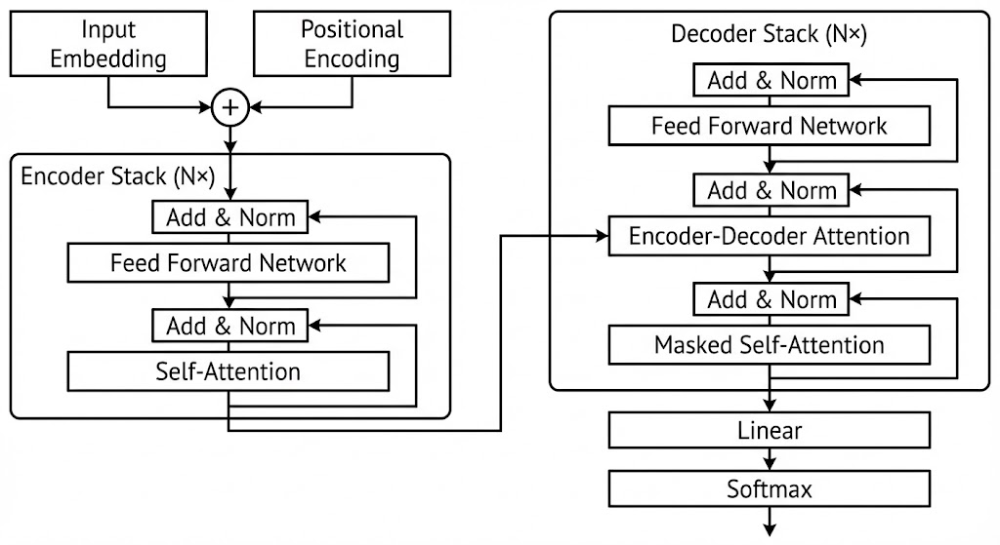

#### **传统模型的问题是什么？**

在 RNN / LSTM 时代，模型是**按顺序一个词一个词处理的**：

- 第 1 个词 → 传给第 2 个词
- 第 2 个词 → 传给第 3 个词
- …

这会带来两个核心问题：

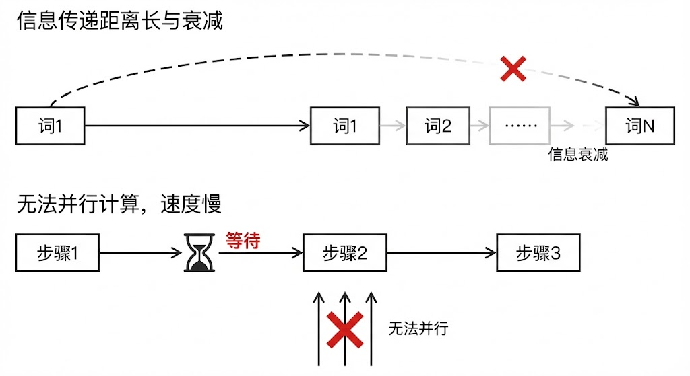

1. **信息传递距离长**
2. 如果句子很长，前面的信息要“传很多跳”才能影响后面的词
3. 即使有 LSTM / GRU，也依然存在信息衰减问题
4. **无法并行计算**
5. 必须等前一个时间步算完，才能算下一个
6. 训练和推理速度都慢

#### **Self-Attention 是怎么解决的？**

Self-Attention 的核心思想只有一句话：

**在处理当前词时，直接查看句子中所有其他词，并计算“它们对我有多重要”。**

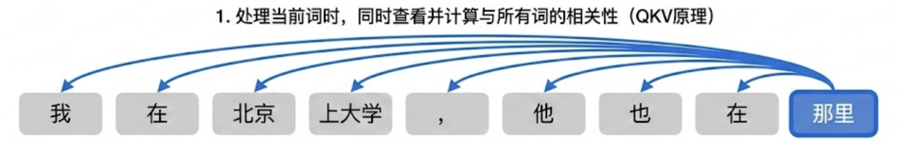

公式本质上在做三件事：

1. 用 **Q（Query）** 表示“我在找什么”
2. 用 **K（Key）** 表示“我有什么信息”
3. 用 **V（Value）** 表示“我真正提供的内容”

通过$$\text{softmax}(\frac{QK^T}{\sqrt{d_k}}) $$计算出**当前词与其他所有词的相关性权重**，再加权求和得到新的表示。

这一步带来的“真正优势”是**天然全局建模能力**

不管两个词在句子里相隔多远，都可以**一步建立联系**

“我在北京上大学，他也在那里”

- “那里”可以直接对齐到“北京”

其次是：**彻底摆脱距离限制**

- 不再有“长距离依赖难学”的问题
- 长文本建模能力大幅提升

并且可以**高度并行化**

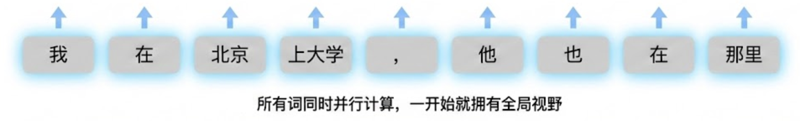

- 所有词的 Attention 可以同时算
- 这是 Transformer 能大规模训练的关键原因之一

它让每个词在一开始就拥有“全局视野”，而不是被困在时间顺序里。

#### **Multi-Head Attention**

这个机制的核心思想是：**不是看一次，而是“从多个角度同时看”**

如果只有一个 Attention：

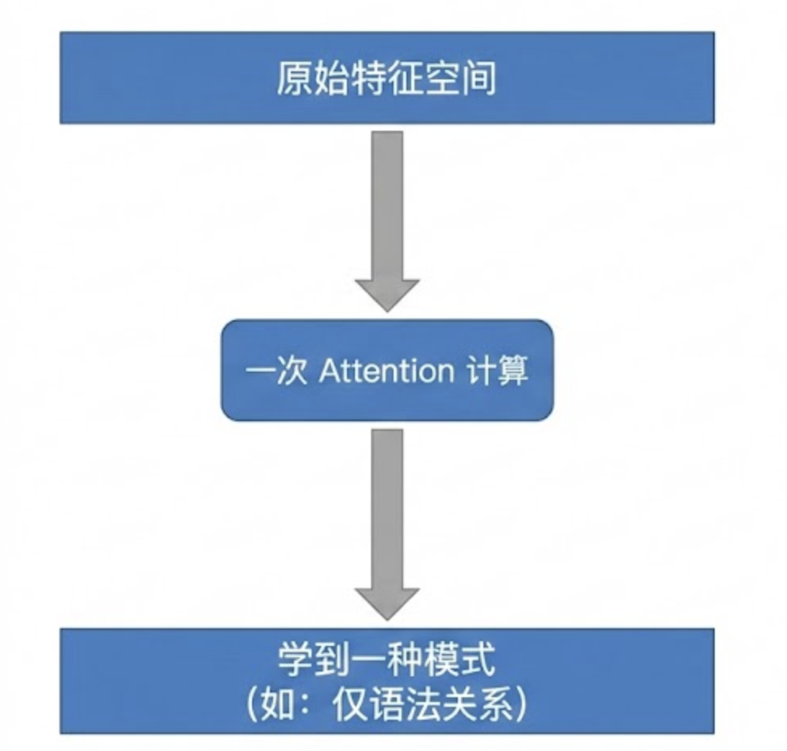

- 模型在**同一个空间里**计算相关性
- 容易“只学到一种关系模式”

但语言里的关系是**多维度的**：

- 语法关系（主谓宾）
- 指代关系（他 / 她 / 它）
- 语义相似性
- 逻辑关系

Multi-Head Attention 的做法是：

1. 把原始特征空间 **拆成多个子空间**
2. 每个子空间 **独立做一次 Attention**
3. 最后再拼接起来

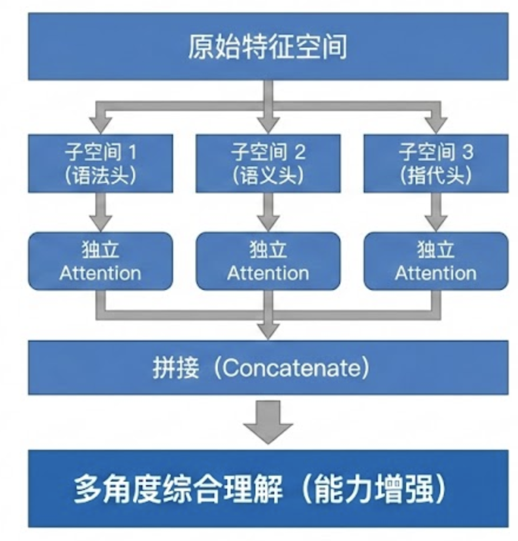

**这一步带来的优势：**

1. **自动学习多种关系模式**
- 有的头专注语法结构
- 有的头专注语义相似
- 有的头学会指代消解
1. **表达能力显著增强**
- 单个 Attention 只能给出“一个视角”
- 多头 Attention 可以给出“立体理解”

它让模型不是“看一次就下结论”，而是从多个角度综合理解一句话。

#### **Positional Encoding**

1. **Transformer 的先天缺陷**

Transformer 的 Attention 本质是：

- 一个 **集合（set）计算**
- 对顺序**不敏感**

也就是说：

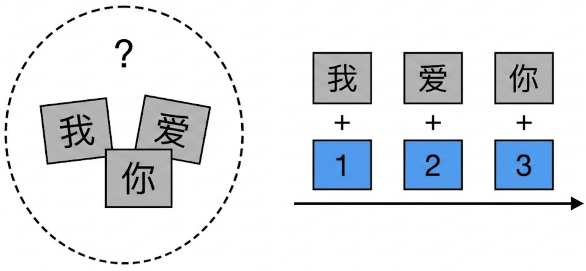

“我爱你” 和 “你爱我”

在没有位置信息的情况下，模型看到的是**同一堆词**

1. **Positional Encoding 的作用**

为了解决这个问题，Transformer **显式注入位置信息**：

- 每个位置都有一个位置向量
- 和词向量相加
- 让模型“知道谁在前，谁在后”

这个机制的好处非常明显：

1. **结构简单但效果直接**
- 不需要引入循环
- 不破坏并行计算
1. **位置关系可被 Attention 自由利用**
- Attention 可以学到：
    - 相邻关系
    - 相对距离
    - 位置模式

它用最小的结构成本，让 Transformer 同时具备“顺序感知”和“并行能力”。

#### **Add & Norm**

1. **深层网络的老问题**

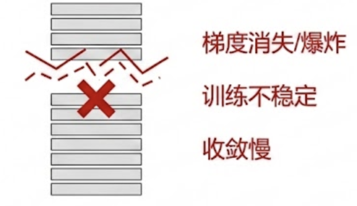

模型一旦变深，就会遇到：

- 梯度消失 / 梯度爆炸
- 训练不稳定
- 收敛慢
1. **Residual Connection（残差连接）的作用**

残差连接的形式是： $$x + \text{SubLayer}(x) $$

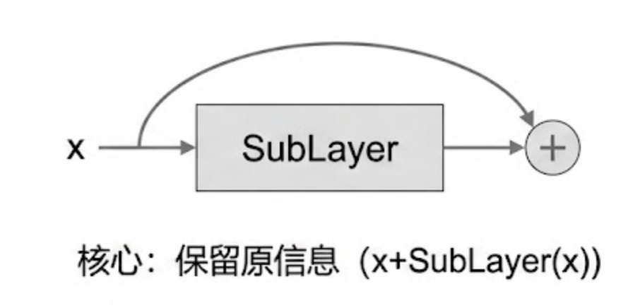

本质含义是：

**如果这一层学不好，至少别把原信息搞坏。**

这极大降低了深层网络的训练难度。

1. **Layer Normalization 的作用**

LayerNorm 的目标是：

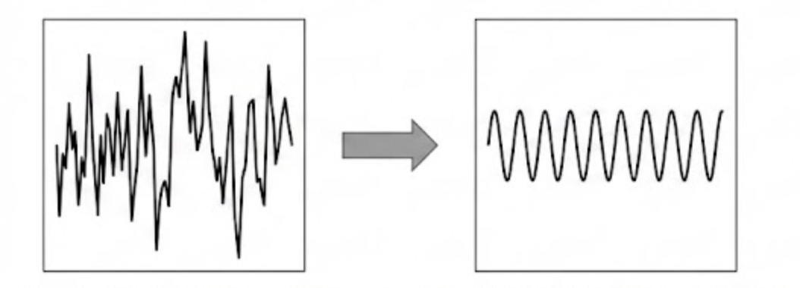

- 控制每一层输出的数值分布
- 减少训练震荡
- 提高收敛速度
1. **组合使用的优势**

**模型可以堆得很深**

**训练过程稳定可控**

**对超参数不那么敏感**

#### **Feed Forward Network（FFN）**

1. **Attention 的本质局限**

Attention 擅长的是：

- 建立词与词之间的关系
- 做线性加权

但它**本身几乎是线性的**。

1. **FFN 的作用**

FFN 做的是：

- 对每个位置**独立**
- 用非线性变换
- 强化特征表达

你可以理解为：

Attention 负责“理解关系”，

FFN 负责“消化和加工信息”。

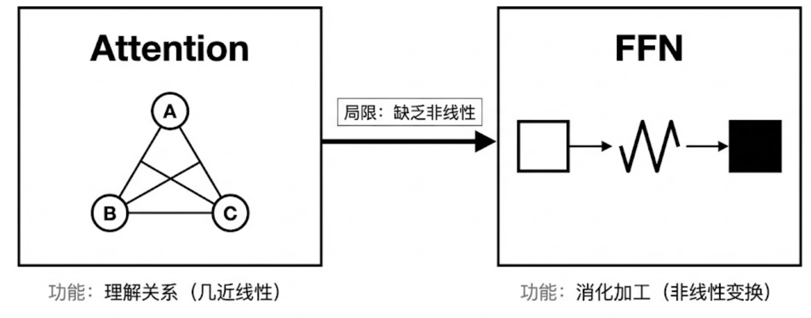

1. **为什么必须要有 FFN？**
- **引入非线性能力**
- **提升表示的抽象层次**
- **避免模型退化成线性系统**

#### **为什么它能成为主流（超越 RNN/LSTM）？**

主要有两点决定性的优势：

1. **并行计算能力：** 这是最大的突破。RNN 必须按时间步顺序计算，无法利用 GPU 并行加速；而 Transformer 的 Self-Attention 机制可以同时计算所有 Token 的相互关系，训练速度有数量级的提升，这使得在大规模数据集上训练超大模型成为可能（这也是后来 LLM 爆发的基础）。
2. **解决长距离依赖：** RNN 处理长序列时容易出现遗忘，信息传递路径过长。而 Transformer 任意两个 Token 之间的距离都是 1，无论句子多长，都能精准捕获全局上下文信息，特征提取能力远强于循环网络。

---

### 面试标准回答

Transformer 本质上是一个完全基于 **Self-Attention（自注意力）机制** 的 Sequence-to-Sequence 模型。它摒弃了传统的 RNN 循环结构。

Transformer 整体采用 Encoder-Decoder 架构

它的核心组件包含三个部分：

1. **Multi-Head Self-Attention：** 这是灵魂。通过 Query、Key、Value 的运算，让模型在处理每个 token 时都能捕捉它与句子中其他所有 token 的关联。多头机制则保证了模型能从不同语义子空间捕捉特征，提高了表达能力。
2. **Positional Encoding：** 因为模型是并行计算的，本身不具备时序感，所以必须引入位置编码来标记 Token 的绝对或相对位置。
3. **Add & Norm：** 引入残差连接和 Layer Normalization，这主要解决了深层网络的梯度消失问题，保证模型可以堆叠得很深从而学到更复杂的语义。

**为什么它能成为主流**

主要有两点决定性的优势：

1. **并行计算能力（效率）：** RNN 必须按时间步顺序计算，无法利用 GPU 并行加速；而 Transformer 的 Self-Attention 机制可以同时计算所有 Token 的相互关系，训练速度有数量级的提升，这使得在大规模数据集上训练超大模型成为可能。
2. **解决长距离依赖（效果）：** RNN 处理长序列时容易出现遗忘，信息传递路径过长。而 Transformer 任意两个 Token 之间的距离都是 1（通过 Attention 矩阵直连），无论句子多长，都能精准捕获全局上下文信息，特征提取能力远强于循环网络。
