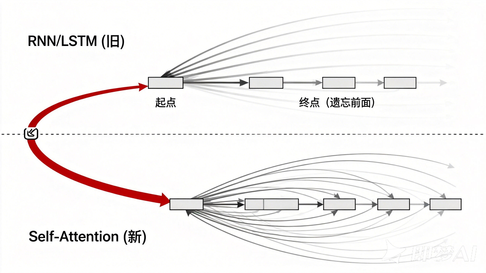
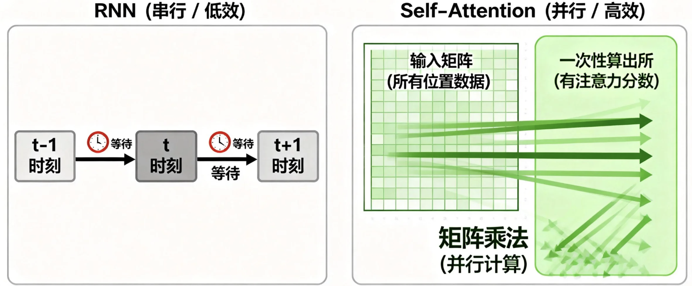

### 知识点讲解

Self-Attention（自注意力机制）本质上解决的是**序列数据处理中的“短视”和“低效”问题**。

#### 解决长距离依赖（全局视野）

在 Self-Attention 出现之前，RNN/LSTM 是处理序列的主流。但它们像是一个看书只能逐字阅读的人，读到这一页最后一句时，可能已经忘了第一句的具体细节（梯度消失/爆炸，信息在传递中衰减）。

Self-Attention 则像是一个拥有“上帝视角”的读者，它能同时看到这句话里的所有词。在处理任何一个词时，它都会把这个词和句子里所有其他词进行一次“相关性计算”。如果两个词逻辑上紧密相关（比如代词“它”指代前面的“小狗”），无论它们在句子里相隔多远，Self-Attention 都能给它们分配很高的权重，从而直接捕捉到这种联系。

#### 实现并行计算（高效）

RNN 必须等 t-1 时刻算完才能算 t 时刻，是串行的，效率低。

Self-Attention 的输入是一个矩阵，通过矩阵乘法，它能一次性并行计算出所有位置之间的注意力分数。这意味着训练速度得到了数量级的提升，才让我们有了现在动辄千亿参数的大模型。

#### 特征提取（Q, K, V）

它通过 Query（查询）、Key（键）、Value（值）三个矩阵的运算，动态地让模型明白：在当前语境下，哪些词是重要的，哪些是可以忽略的。

---

### 面试标准回答

关于 Self-Attention 的作用，主要体现在**捕捉长距离依赖**和**提升计算效率**这两个核心点上。

首先，从模型效果上来说，它解决了传统 RNN 结构无法有效处理长距离依赖的痛点。

Self-Attention 能够让序列中的任意两个位置进行直接交互。它不依赖时间步的传递，而是通过计算 Query 和 Key 的点积来得出注意力分数。这意味着，无论两个词在句子中间隔多远，模型都能直接捕捉到它们之间的语义关联，真正做到了关注“全局信息”。

其次，从工程性能上来说，它实现了训练的并行化。

不像 RNN 需要按时序串行计算，Self-Attention 基于矩阵运算，可以同时计算所有位置的输出。这极大地利用了 GPU 的并行计算能力，显著缩短了模型的训练时间。
