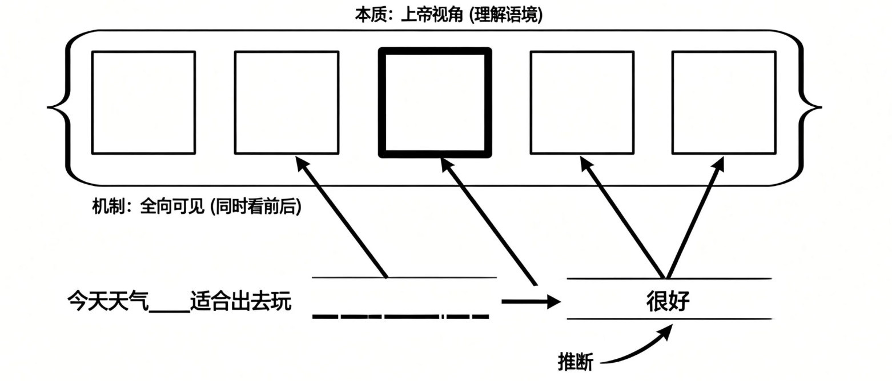
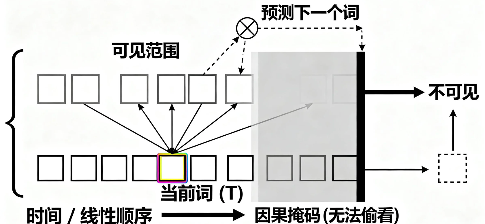

## 知识点讲解

要真正理解 Encoder-only 和 Decoder-only 的区别，不能只背“一个是 BERT 一个是 GPT”，核心在于注意力机制的**“可视范围”**和**预训练目标**的不同。

#### 核心差异：Attention Mask（注意力掩码）

- **Encoder-only (双向注意力):**

**机制：** 它采用的是**全向可见**。在处理一个 token 时，它能同时看到这句话里“前面”和“后面”的所有词。

**本质：** 这是一种上帝视角，目的是**“理解”**整句话的语境。比如填空题：“今天天气____，适合出去玩”。Encoder 会同时看前后的词来推断中间是“很好”。

- **Decoder-only (单向/因果注意力):**

**机制：** 它采用的是**因果掩码**。在处理当前 token 时，它只能看到“自己”和“前面”的词，严格看不到后面的词。

**本质：** 这是一种线性时间视角，目的是“预测”。因为它必须模拟人类说话或写字的顺序，在这个词出现之前，不能偷看下一个词是什么，否则就无法进行自回归生成。

#### 预训练目标的差异

- **Encoder (如 BERT):** 主要使用 **MLM**。随机挖掉句子里的词，让模型根据上下文填空。这使得模型对语义理解、句法分析非常强，擅长判别式任务（分类、实体抽取）。
- **Decoder (如 GPT 系列):** 主要使用 **CLM，**也就是 Next Token Prediction，根据上文预测下一个字。这使得模型具备了强大的生成能力和连贯性。

#### 为什么现在大模型多选 Decoder-only？

虽然 Encoder 理解能力更细致，但在极大规模数据下，Decoder-only 架构被证明具有更强的 **Zero-shot/Few-shot**能力和涌现能力。而且将所有任务都统一为“生成任务”，比专门为了分类而设计的 Encoder 架构通用性更强。

---

## 面试标准回答

**第一，架构与注意力机制的区别。**

Encoder-only 模型使用的是双向注意力机制。这就好比它是拥有上帝视角的，在计算某个词的特征时，能同时利用其上下文的所有信息。

而 Decoder-only 模型使用的是单向因果注意力机制。它受到 Mask 的限制，在预测当前词时，只能看到上文，严格不可见下文，这是为了满足自回归生成的要求。

**第二，代表模型与核心能力的区别。**

Encoder-only 的典型代表是 BERT 和 RoBERTa。由于它能充分利用双向语境，它在 自然语言理解 领域表现极佳，非常适合做文本分类、情感分析、命名实体识别等判别式任务。

Decoder-only 的典型代表是 GPT 系列和 LLaMA。它的核心能力是 自然语言生成 ，也就是预测下一个 token。它非常适合做文本生成、对话系统以及逻辑推理任务。

**第三，行业趋势。**

早期我们通常认为“Encoder 懂理解，Decoder 懂生成”。但随着 LLM 的发展，我们发现当模型参数量大到一定程度后，Decoder-only 架构通过海量数据的 Next Token Prediction 训练，不仅生成能力强，其理解能力也已经能覆盖绝大多数 Encoder 的场景。因此，目前主流的基础大模型几乎都转向了 Decoder-only 架构，以此来统一理解和生成任务。
