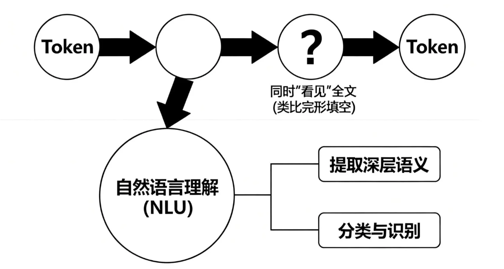
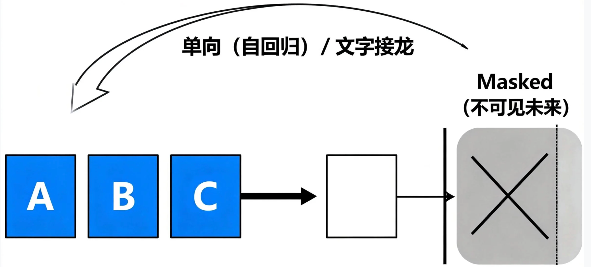
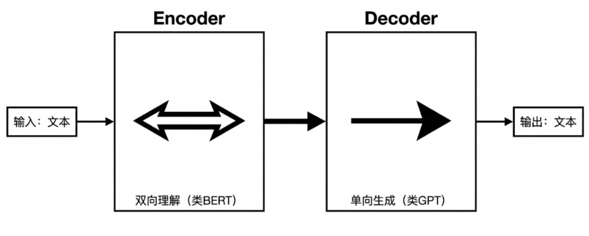

#### 一、 知识点讲解

Transformer 原生架构包含两个部分：**Encoder（****编码器****）** 和 **Decoder****（****解码器****）**。

这三类模型其实就是对这两部分的排列组合，导致了它们在“注意力机制”和“预训练目标”上的根本不同。

#### **BERT** **(****Bidirectional Encoder Representations from Transformers****)**

**结构归属**：**Encoder-only**（仅编码器结构）。

**核心逻辑**：它是**双向**的。因为只有编码器，它在处理文本时，每一个 Token 都能同时“看见”上下文所有的信息。

就像在做完形填空，你可以同时看前文和后文来推测中间被盖住的词。这种结构让它在理解句子语义、文本分类、实体识别等 自然语言理解 任务上极强，因为它能提取深层的上下文依赖关系。

#### **GPT** **(****Generative Pre-trained Transformer****)**

**结构归属**：**Decoder-only**（仅解码器结构）。

**核心逻辑**：它是**单向**（自回归）的。虽然它也是 Transformer，但它使用了 Masked Self-Attention，强制模型在预测下一个词时，**只能看见前面的词，看不见后面的词**。

这就是标准的“文字接龙”。因为不能“剧透”后面的内容，它被迫学会了强大的预测生成能力。这种结构天生适合 自然语言生成 任务，稍微弱化了对全文双向信息的融合，但强化了生成的连贯性。

#### **T5 (Text-to-Text Transfer Transformer)**

**结构归属**：**Encoder-Decoder**（完整的编码器-解码器结构，类似原版 Transformer）。

**核心逻辑**：它试图把所有 NLP 任务都统一成“文本到文本”的形式。Encoder 负责双向理解输入（比如一句英文），Decoder 负责单向生成输出（比如翻译后的中文）。

T5 是个集大成者。它保留了 BERT 的理解能力（Encoder 端）和 GPT 的生成能力（Decoder 端）。在做机器翻译、文本摘要这种序列到序列（Seq2Seq）的任务时，结构优势最明显。

---

#### 二、 面试标准回答（高分话术）

关于这三个模型的结构差异，本质上是它们对 Transformer 架构中 **Encoder** 和 **Decoder** 的取舍不同，这也直接决定了它们的注意力机制和适用场景。

**第一，结构组成不同：**

- **BERT** 采用的是 **Encoder-only** 结构。它保留了 Transformer 的编码器部分。
- **GPT** 采用的是 **Decoder-only** 结构。它保留了 Transformer 的解码器部分，但去掉了中间的 Cross-Attention 层（因为没有 Encoder 传输入）。
- **T5** 则保留了完整的 **Encoder-Decoder** 结构，是 Transformer 架构延续。

**第二，注意力机制不同：**

- **BERT 是双向的**。在 Self-Attention 中不进行 Mask，每个 Token 都能看到完整的上下文，这让它具备了极强的上下文建模能力。
- **GPT 是单向自回归的**。它使用了 Masked Self-Attention，严格限制当前词只能关注左边的历史信息，看不到右边的未来信息，这是为了模拟生成的线性过程。
- **T5 是混合的**。Encoder 端是双向可见（类似 BERT），Decoder 端是单向可见（类似 GPT），中间通过 Cross-Attention 连接。

**第三，对下游任务的适配性不同：**

- 基于上述结构，**BERT** 最强项在于 **理解** 任务，比如情感分析、NER，因为它‘懂’全文。
- **GPT** 的天职是 **生成**，虽然理解能力稍逊（尤其是早期版本），但在自由文本生成上效果最好。
- **T5** 则通过‘Text-to-Text’的框架，最擅长 **Seq2Seq** 任务，比如翻译、摘要，或者需要同时兼顾理解输入和生成输出的场景。
