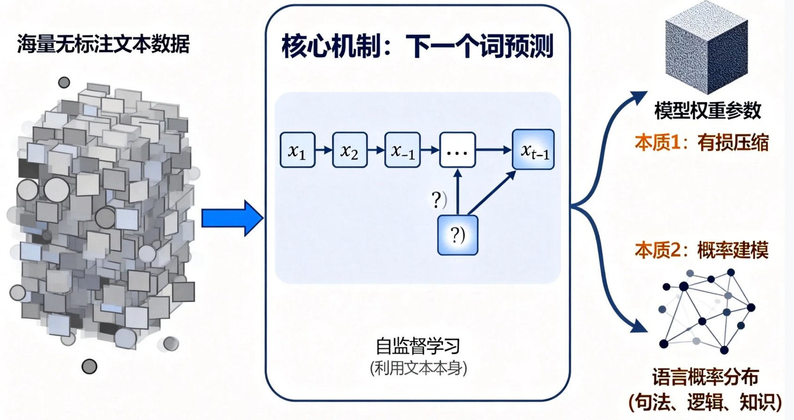

### 一、 知识点讲解

#### 预训练在做什么？

从操作层面看，预训练是在海量、无标注的通用文本数据（如 Common Crawl, Wikipedia, Github 代码）上进行的大规模训练。

核心机制：**Next Token Prediction（下一个词预测）**

绝大多数 Decoder-only 架构（如 GPT 系列、Llama）的预训练任务是自监督学习。

模型不需要人工打标签，而是利用文本本身作为监督信号。给定一个文本序列 ，模型的目标是最大化给定前文 的情况下，预测当前词  的概率：

**本质是：****数据压缩****与概率建模**

**压缩：** 如果模型能准确预测下一个词，说明它掌握了语言内部的规律。预训练本质上是在对人类已有的海量文本信息进行“有损压缩”，将巨大的信息量存储在模型的权重参数中。

**概率分布建模：** 模型在学习人类语言的高维概率分布。它不仅仅是记忆搭配，而是在学习字面背后的句法结构、逻辑推理链条以及世界知识。

#### 为什么有效？

预训练之所以能成为大模型的基石，主要基于以下三个维度的有效性：

**表征学习**

预训练将离散的词语映射到了连续的向量空间中。在这个空间里，语义相似的词距离更近，复杂的逻辑关系变成了向量运算。模型不再是机械地匹配关键词，而是“理解”了上下文的语义表征。

**从“随机初始化”到“通用初始化”**

在没有预训练之前，做特定任务（如情感分析、翻译）时，模型参数是随机初始化的，需要从零开始学。

预训练提供了一个极佳的参数初始化状态。这个状态已经包含了通用的语言理解能力。在这个基础上进行微调，相当于站在巨人的肩膀上，只需要少量数据就能迅速收敛到特定任务的最优解。

**Scaling Law与涌现**

当数据量和参数量达到一定规模时，量变引起质变。简单的“预测下一个词”任务，迫使模型为了降低 Loss，不得不去学习更高阶的抽象能力（如算术、逻辑推理、代码理解）。这些能力不是显式编程进去的，而是为了更好地完成预测任务而**涌现**出来的副作用。

---

### 二、 面试标准回答

简单来说，预训练就是一个自监督学习的过程。

在操作上，我们把海量的无标注文本喂给模型，让它只做一件事：预测下一个词。

虽然任务看起来很简单，但它的本质是在做信息压缩和概率分布建模。模型为了能准确预测下一个字，它必须从海量数据中提取出语言的语法结构、世界知识甚至是逻辑推理模式，并将这些信息压缩到模型的千亿参数里。

**为什么它这么有效？**

我认为核心在于它解决了通用性和初始化的问题，主要体现在三点：

1. **利用了无限的无监督数据：** 也就是 Scaling Law 的胜利。因为不需要人工标注，我们能利用的数据量级是指数级的。海量数据让模型见识了足够多的样本，从而学到了极其鲁棒的语言表征。
2. **极佳的参数初始化：** 以前做具体任务，模型是随机初始化的，是从零开始学。但经过预训练的 LLM，它的参数已经处于一个“懂语言、懂逻辑”的状态。这相当于给下游任务提供了一个非常高的起点，这时候再做微调，就是典型的迁移学习，效率和效果都会指数级提升。
3. **涌现能力的产生：** 这一点比较关键。当我们在极大规模下强迫模型做“预测”时，为了把 Loss 降到最低，模型被迫学会了推理、代码生成等高阶能力。这些能力是预训练带来的“副产品”，也是大模型有效的核心原因。
