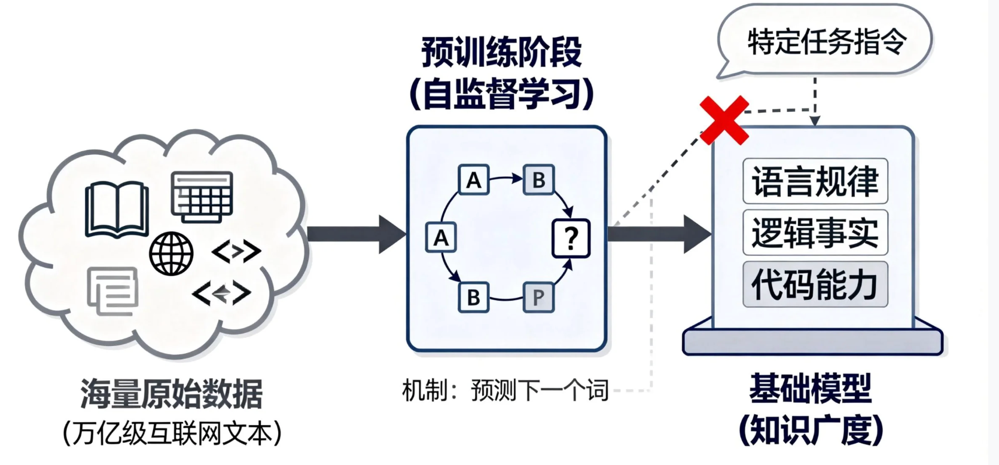
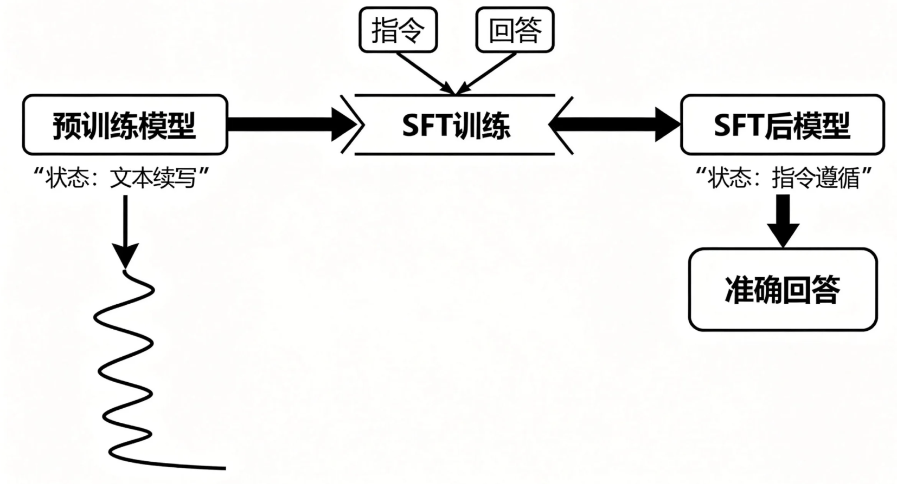

### 知识点讲解

#### 预训练

核心是：从海量数据中学习“常识”

预训练是模型学习的第一阶段，本质上是一个“自监督学习”过程。模型在数以万亿计的互联网文本（网页、书籍、代码等）上通过预测下一个词来学习。目的是**让模型掌握语言规律、逻辑推理、事实知识和代码能力。**

在这个阶段，模型学到的是“知识的广度”。它像是一个博览群书但没有接受过特定指令训练的学者，知道如何续写文本，但不知道如何针对具体指令进行特定的任务响应。

#### SFT

SFT 是在预训练模型的基础上，使用高质量、人工标注的“指令-回答”对进行训练。核心目的是将模型从“文本续写器”转化为“指令遵循者”。

模型在这个阶段学习的是“对话的格式”和“任务的边界”。例如，它学会了当用户问一个问题时，它应该给出准确、礼貌且符合人类偏好的答案，而不是顺着问题往下编故事。

#### **联系**

SFT 严重依赖预训练阶段积累的能力。如果预训练没做好，SFT 阶段也无法凭空产生逻辑和知识。

SFT 并不主要用于灌输新知识，而是通过少量的精选数据，“激活”预训练阶段学到的海量知识，并将其映射到特定的对话范式中。

---

### 面试标准回答

预训练使用的是海量的、非结构化的文本数据，主要通过自监督学习的方式让模型在大规模语料中获取语言能力和百科知识。而 SFT 使用的是经过人工精选、高质量的指令对数据，规模远小于预训练，但对数据的多样性和准确性要求极高。

预训练的目标是建立模型的‘底层认知’，解决的是模型‘知不知道’的问题，让模型具备强大的文本生成能力。而 SFT 的目标是‘对齐’，解决的是模型‘听不听话’的问题，通过微调让模型理解人类的指令意图，并以规范的对话格式输出。

总体来说，预训练是 SFT 的基石。SFT 阶段实际上是在‘激活’预训练模型中潜藏的知识，而不是单纯学习新知识。如果预训练阶段模型没有见过相关的逻辑或知识，仅靠 SFT 阶段的少量数据是很难补齐这种底层能力的。
