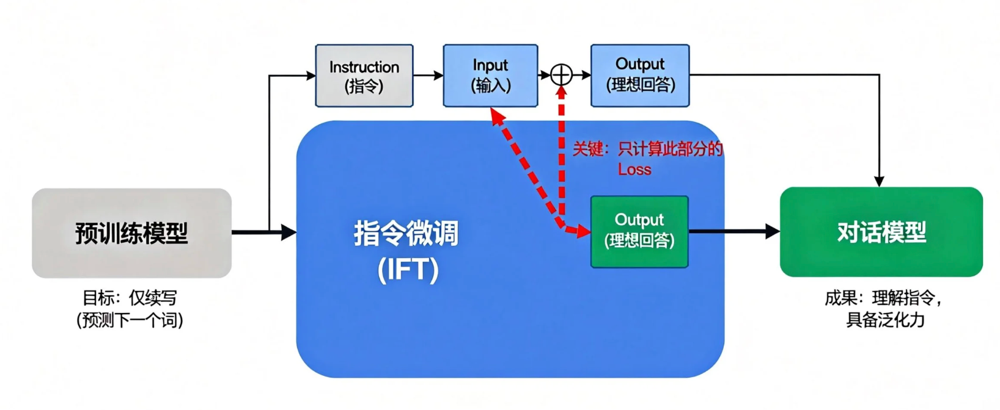

## 知识点讲解

**指令****微调** 是将预训练后的通用语言模型转化为能够理解并执行特定人类指令的对话模型的关键过程。

预训练阶段的目标是“续写”，即给定上文预测下一个 Token。

虽然模型学到了海量知识，但它并不理解“什么是任务”。比如你问它“请写一首诗”，基座模型可能会返回“请写一个散文”或者“这是某某学校的作文题”。指令微调通过 **&lt;指令, 输入, 输出>** 的三元组数据训练模型，让模型建立起“指令”与“预期行为”之间的映射关系。

### 关键要素

**数据集构建：**

这是 IFT 的灵魂。数据集通常包含：

- **Instruction：** “翻译这段话”、“总结全文”、“写一段代码”。
- **Input****：** 具体需要处理的文本内容。
- **Output****：** 理想的回答。

**训练目标：** 依然采用交叉熵损失函数，但计算 Loss 时通常只针对 Output 部分，忽略 Instruction 和 Input。

**泛化能力：** IFT 的强大之处在于，即便是在训练集中没见过的新指令，经过微调后的模型也能根据学习到的语义规律进行泛化处理。

### 为什么需要它？

单纯的预训练模型虽然“博学”但“不听话”。指令微调解决了模型与人类意图的初步对齐，它是通往 RLHF的必经之路。

---

## 面试标准回答

指令微调是大型语言模型从“基座模型”向“对话模型”转化的核心步骤。

其本质是在预训练的基础上，通过结构化的指令数据对模型进行有监督微调，使其能够理解并遵循人类的自然语言指令，从而完成特定的任务。

我们可以从以下三个维度来理解指令微调：

1. **数据结构：** 不同于预训练阶段的无监督文本，指令微调采用的是形式的数据对。数据集涵盖了问答、创意写作、代码实现、逻辑推理等多种任务场景。通过这种格式，模型学习到的不再是概率上的文本续写，而是“输入指令-输出结果”的对应模式。
2. **训练目标：** 在技术实现上，指令微调依然遵循语言模型的自回归训练方式，但在计算损失函数时，我们会通过 Mask 掉 Prompt 部分，仅让模型对 Target 输出部分产生的预测误差进行反向传播。这样能确保模型参数向“生成正确答案”的方向优化，而不是学习如何复述问题。
3. **核心价值：** 指令微调最大的价值在于 **“激发泛化能力”**。实验证明，模型在经过一定规模的多样化指令训练后，能够对从未见过的新任务表现出极强的零样本执行能力。它是解决模型输出与人类意图对齐的第一步，也为后续的 RLHF 对齐奠定了基础。
