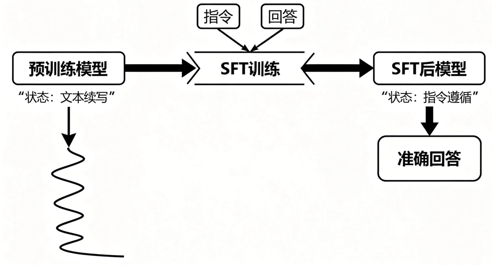
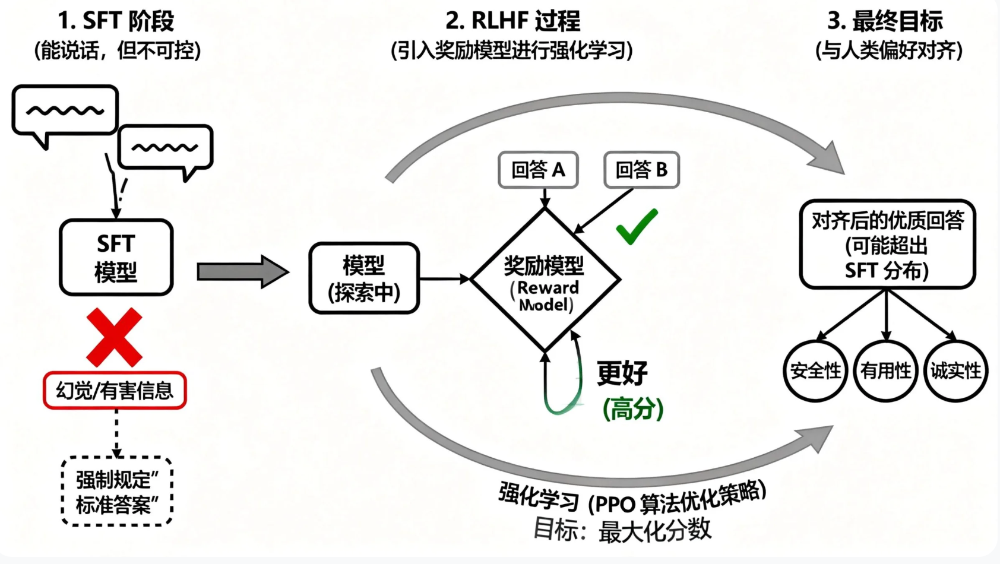

### 一、 知识点讲解

在大模型训练的 Pipeline 中，SFT 和 RLHF 处于 预训练之后的两个不同阶段，它们本质上是在解决两个层面的问题：**“学会做事”** 和 **“符合人类价值观”**。

#### SFT

SFT 的核心目的是让模型**学会“遵循****指令****”和特定格式**。

预训练后的基座模型虽然有海量知识，但它本质上是一个“续写机”。SFT 通过高质量的 `(Prompt, Response)` 对，强行调整模型的参数分布，使其学会：当用户提问时，应该回答问题，而不是续写问题。

这本质是一种**模仿学习**。模型试图最大化与 标准答案的一致性。

但是，模型的上限被限制在标注数据的质量上。如果标注员写得不好，模型学得也不好；而且 SFT 很难量化“好与坏”的细微差别（例如：这个回答是对的，但那个回答语气更礼貌）。

#### RLHF

RLHF 的核心目的是**将模型的输出与人类的偏好对齐**。

SFT 让模型能说话，但模型可能还是会出现幻觉或者输出有害信息。RLHF 引入了**奖励模型**，不再强制规定“标准答案”，而是告诉模型“哪种回答更好”。

这本质上是一种**强化学习**。通过 PPO等算法，让模型在探索中优化策略，以最大化 Reward 分数。

RLHF 允许模型生成出超出 SFT 训练集分布的、更好的答案（只要 Reward Model 认为它好）。它解决的是 安全性、有用性 和 诚实性 的问题。

---

### 二、 面试标准回答

**关于 SFT 和 RLHF 的区别，主要体现在数据形态、优化目标以及最终解决的问题这三个维度上。**

**第一，从数据形态上来看：**

SFT 依赖的是高质量的指令-回复对，它告诉模型“对于这个输入，标准答案是什么”，这本质上是一种全监督的训练。

而 RLHF 依赖的是偏好数据，通常是对同一个 Prompt 的不同回答进行排序（比如 A 优于 B）。我们用这些数据先训练一个奖励模型，再用 RM 去指导主模型的训练。

**第二，从优化目标和损失函数来看：**

SFT 的核心是最大化似然估计，使用的是交叉熵损失。它要求模型输出的每一个 Token 都尽可能和训练数据一模一样，属于“模仿学习”。

而 RLHF 的核心是最大化期望奖励。在 PPO 阶段，我们优化的目标是让生成的回答在 Reward Model 上得分更高，同时通过 KL 散度约束模型不要偏离 SFT 模型太远，防止“模型崩塌”。

**第三，从解决的问题来看：**

SFT 主要是为了激发模型的能力，让模型学会遵循指令和特定的输出格式。它解决的是“懂不懂”和“会不会做”的问题。

而 RLHF 更多是为了对齐，即解决“好不好”和“安不安全”的问题。它能显著降低模型的有害性、幻觉，并让回答更符合人类的偏好。
