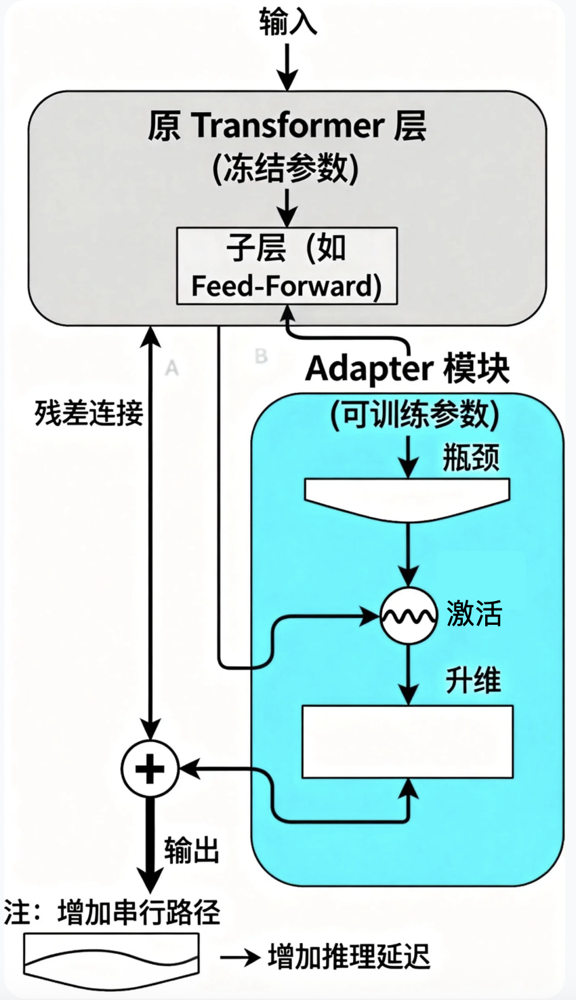
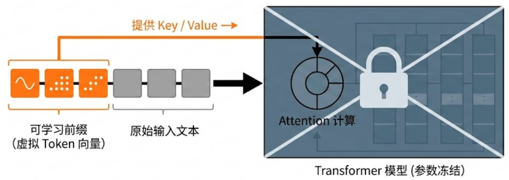
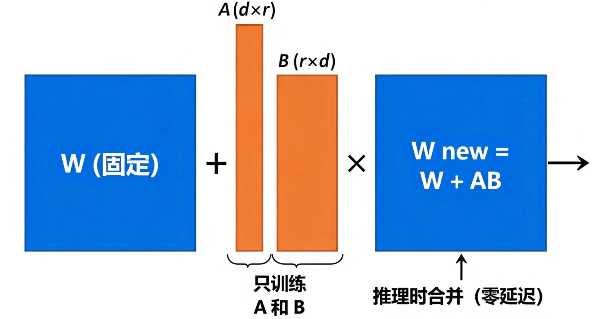

这三者都属于 **PEFT (Parameter-Efficient Fine-Tuning)** 技术。

随着大模型参数量爆炸，全量微调成本太高且容易导致灾难性遗忘。

PEFT 的核心就是在**冻结****预训练模型****大部分参数**的前提下，通过**增加少量可训练参数**或**只训练部分参数**，以极小的代价适配下游任务。

---

### **一、****Adapter**

#### **知识点讲解**

Adapter 是这一波 PEFT 技术的“鼻祖”之一（源自 2019 年 Google 的论文）。

它的设计思路非常直观：“既然原模型动不了，那我就往里面插积木”。

它通常被嵌入在 Transformer 的层与层之间（具体来说，是在 Self-Attention 层和 Feed-Forward 层之后）。

Adapter 模块通常是一个“瓶颈”结构。输入数据先通过一个**降维**的全连接层，经过非线性激活函数，再通过一个**升维**的全连接层恢复到原来的维度，最后与原输入做一个残差连接。

训练过程就是**冻结住原本 Transformer 的所有参数，只训练这两个小小的投影层。**

虽然参数量少了，但因为它实实在在地增加了模型的层数（增加了串行计算链路），在推理时会**增加额外的延迟**。

#### **面试标准回答**

Adapter 的核心思想其实就是“插拔式微调”。

它的做法是在预训练模型的每一层 Transformer Block 里，**串行嵌入**一些轻量级的神经网络模块，也就是 Adapter 层。

具体实现上，它采用了一个**瓶颈结构，**先把高维特征**压缩**（降维），通过非线性激活后，再**还原**（升维）。我们在微调时，把原模型参数全部冻结，只更新这些新插入的 Adapter 参数。

这个方法的优点是参数量确实很小，通常只有原模型的 3% 左右。但它有一个比较明显的工程痛点，就是**增加了推理延迟**。因为是串行插入的，模型变深了，必须要等 Adapter 算完才能走下一步，这对线上高并发场景不太友好。

---

### **二、Prefix Tuning**

#### **知识点讲解**

Prefix Tuning 的灵感来源于 提示词工程。我们知道，给模型不同的 Prompt，它的输出就不一样。

那能不能**把 Prompt 变成可学习的参数**呢？

核心操作是：它不是像 Adapter 那样往模型内部“插层”，而是在输入序列的最前面，生硬地加上一串“虚拟 Token”。

本质上这些虚拟 Token 并不是真实的单词（如 "Translation:"），而是**连续的向量**。

训练过程就是**冻结 Transformer 的所有参数，只优化这些前缀向量**。模型在计算 Attention 时，会把这些前缀向量作为 Key 和 Value 的一部分参与计算。

#### **面试标准回答（话术版）**

Prefix Tuning 本质上是“提示词工程的自动化版”。

传统的 Prompt 是我们要人工去写一段话给模型，而 Prefix Tuning 是在输入序列前面加了一组**可训练的连续向量**，我们可以把它们看作是**“虚拟 Token”**。

它的关键点在于：我们不改变模型原本的权重，而是通过训练这些前缀向量，来“引导”模型的注意力分布，让模型适应新的任务。而且，它不仅仅是在输入层加，通常是在 Transformer 的**每一层**都拼接了这样的前缀参数。

这种做法的好处是完全不改变模型结构，但难点在于**优化比较困难**，训练很不稳定，对超参数敏感，而且占用了原本属于输入序列的长度窗口。

---

### **三、LoRA**

#### **知识点讲解**

LoRA 是目前最主流、工业界应用最广的微调方案。它的切入点是**矩阵分解**。

大模型虽然参数很多，但在适应特定任务时，权重矩阵的更新量（）其实具有“低秩性”。也就是说，不需要满秩更新，只更新很少的信息量就够了。

**实现原理**：

假设原预训练权重为 W，我们要学习一个增量权重 。LoRA 把  分解为两个小矩阵的乘积： 。

A 是降维矩阵（维度 ），B 是升维矩阵（维度 ）。其中 r（秩）远小于 d。训练时，只训练 A 和 B。

**Lora的核心优势是零延迟推理，**训练完后，因为 ，我们可以直接把  的结果加回到原权重 W 中。这样在推理时，模型结构完全没变，**没有任何额外的推理延迟**。

#### **面试标准回答**

LoRA 是目前最好用的微调方案，它的核心在于“低秩分解”和“旁路更新”。

它的理论基础是：大模型在微调时，参数的更新量其实是**低秩**的。所以 LoRA 并没有直接去更新那个巨大的原始权重矩阵 W，而是把更新量  分解成了两个极小的矩阵 A 和 B 相乘的形式。

具体流程是：

1. 冻结原模型权重 W。
2. 在旁边增加两个小矩阵 A 和 B，一个负责降维，一个负责升维。
3. 训练时只更新 A 和 B。

最大的优势在于“推理零延迟”。

不像 Adapter 需要增加额外的层，LoRA 训练完之后，我们可以直接把矩阵 B 和 A 乘起来，加回到原权重 W 里去。这样上线推理的时候，它就是原本那个模型，没有任何额外的计算开销，解决了落地的性能问题。
