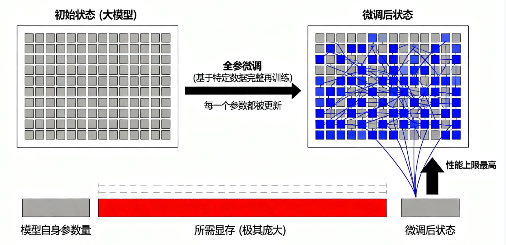
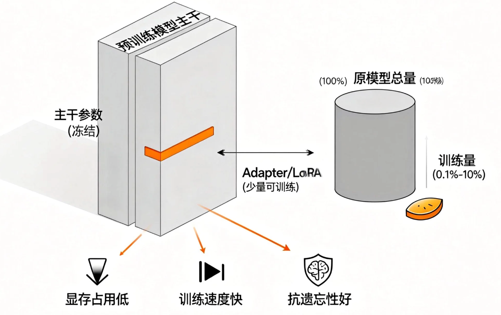

## 知识点讲解

在实际大模型落地过程中，**全参微调（FFT）** 与 **参数高效微调（PEFT）** 的选择，本质上是在**性能上限**与**训练成本**之间做权衡。

### 核心机制差异

- **全参微调**

原理：更新模型中的**每一个**参数（权重）。这就好比把原本的大模型看作一个初始化状态，在特定数据上进行完整的再训练。

需要极其庞大的显存（通常是模型参数量的 3-4 倍用于存梯度和优化器状态），但它能最大程度地改变模型的行为，理论上的**性能上限最高**。

- **参数高效微调**

原理：冻结预训练模型的主干参数，只在特定的层（如 Attention 层）中插入少量的可训练参数（Adapter）或引入低秩矩阵（如 LoRA）。

训练参数量通常仅为原模型的 0.1% - 10%。显存占用极低，训练速度快，且不易破坏原模型的通用能力（抗遗忘性好）。

### 如何选择？

我们在做选择时，通常依据以下三个维度进行排查：

- **维度一：算力资源**

这是最直接的限制。如果你的团队只有消费级显卡或者少量的 A10/A100，跑 7B 以上模型的全参微调几乎是不可能的。此时，PEFT（主要是 LoRA）是唯一选择。

- **维度二：任务难度与领域跨度**
    - **微调：** 如果你的任务是让模型学会某种格式（JSON输出）、某种语气（客服对话）或遵循特定指令，PEFT 绰绰有余。
    - **注入知识：** 如果你要让模型学会它从未见过的领域知识（比如企业内部私有代码库、极其冷门的医学分支），或者彻底改变语言习惯（如古文），PEFT 可能会出现“欠拟合”，因为它的参数量太小，无法承载巨大的信息增量。此时全参微调效果更好。
- **维度三：数据量级**
    - **小样本（&lt;1k）：** 全参微调极易过拟合，PEFT 反而更稳健。
    - **海量数据（>100k - 1M）：** 随着数据量的增加，全参微调的优势会逐渐显现，因为大量数据需要更多的参数空间来编码。

---

## 面试标准回答

关于全参微调和 PEFT 的选择，需要结合**算力成本**、**数据规模**以及**任务目标**这三个维度来进行综合决策。

**第一，看算力预算**。如果在资源受限的场景下，直接选择 PEFT。它能将显存需求降低到全参的 1/3 甚至更低，且训练速度快，便于快速迭代验证想法。

**第二，看任务的“领域跨度”和“复杂度”。**如果我们的目标是**“激发”**模型已有的能力，比如让它学会某种特定的输出格式、语气风格，或者是做指令微调，**PEFT 的效果通常已经能够逼近全参微调**，且通用能力保留得更好，不易出现灾难性遗忘。但如果任务涉及**“注入”大量新知识**，或者是领域跨度极大的任务，PEFT 可能会遇到瓶颈，这时候如果算力允许，我会倾向**于**全参微调，以获得更高的性能上限。

**第三，看数据量级。**如果是小样本数据（比如几百条），全参微调非常容易过拟合，这时候用 PEFT 相当于加了正则化，效果反而更好。只有在数据量达到一定规模（比如 10万+级别），全参微调对于数据的吸收能力优势才会明显体现出来。
