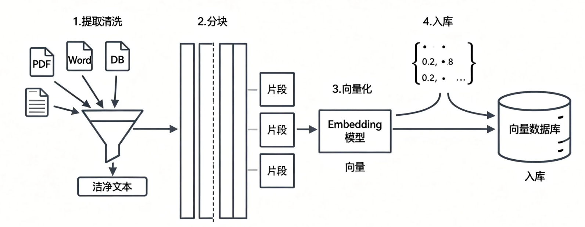
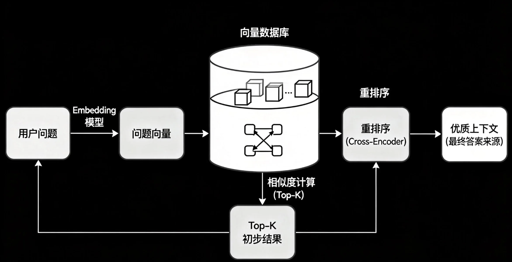

### 知识点讲解

RAG的核心逻辑在于解决大模型的**幻觉问题**和**知识时效性问题**。

它并不是重新训练一个模型，而是给大模型外挂了一个“知识库”。

RAG 的架构分为三个最关键的阶段，可以按照数据流向来理解：

#### 数据准备与索引阶段

我们需要把私有的、外部的文档变成机器能懂的格式存起来。

- **数据提取与清洗：** 从 PDF、Word、数据库中提取文本，去掉无关字符。
- **分块 ：** 由于 LLM 上下文窗口有限，不能把整本书塞进去，必须把长文本切分成小的片段。分块策略（固定字符数、语义分块等）直接影响检索效果。
- **向量化：** 使用 Embedding 模型将文本片段转化为高维向量。
- **入库：** 将向量和原始文本存入**向量数据库**中，以便后续进行相似度搜索。

#### 检索阶段

当用户发起提问时，系统如何找到答案所在的片段。

- **Query 处理：** 用户的自然语言问题，也需要通过同样的 Embedding 模型转化为向量。
- **相似度计算：** 在向量数据库中，计算“问题向量”与“文档向量”的距离（通常用余弦相似度），找出 Top-K 个最相关的文本片段。
- **重排序：** 向量检索只能看语义相似度，有时不精准。通常会引入一个 Cross-Encoder 模型对 Top-K 结果进行精细排序，筛选出最优质的上下文。

#### 生成阶段

- **Prompt 组装：** 将用户的**原始问题** + 检索到的**上下文片段**+ **系统提示词**拼装成一个完整的 Prompt。
- **LLM 推理：** 将这个包含丰富信息的 Prompt 发送给大模型。

---

### 面试标准回答

RAG 的核心本质是“检索 + 生成”，它通过外挂知识库的方式，让大模型在回答问题时能够参考外部的私有数据，从而解决大模型知识滞后和幻觉的问题。

从系统架构上，通常把它分为三个主要阶段：

**第一是“离线的数据索引阶段”。**

这部分主要是构建外部知识库。我们需要先把原始文档进行清洗和分块，这里分块的大小很关键，太小会丢失语义，太大又占 Token。切分好后，利用 Embedding 模型将文本向量化，最后存入向量数据库中建立索引。

**第二是“在线的检索阶段”。**

当用户提出问题时，系统会先把问题也变成向量，然后去向量数据库里做相似度匹配，召回最相关的 Top-K 个片段。在实际生产环境中，为了提高准确率，我们通常在召回后加一步重排序，用更精准的模型把最相关的上下文排在前面。

**第三是“生成阶段”。**

我们将用户的问题和检索回来的这些高质量上下文，按照特定的 Prompt 模板组装在一起，喂给大模型。大模型就像做阅读理解一样，基于这些事实信息生成最终的答案。
