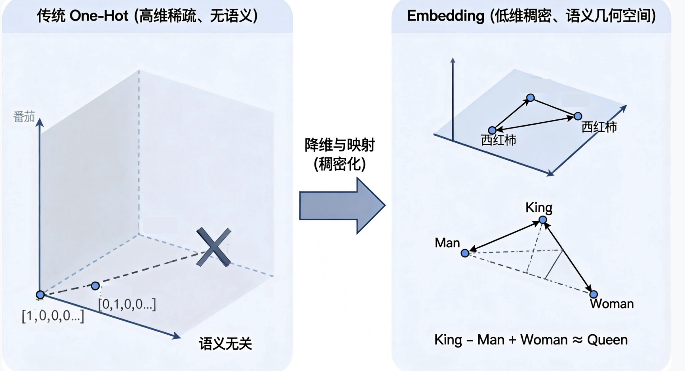

### 知识点讲解

#### **Embedding 的本质是“降维”与“语义空间映射”**

在计算机看来，文本、图片、音频本质上都是非结构化的离散数据。

传统的 **One-Hot 编码**存在两个致命问题：一是**稀疏性**（维度爆炸），二是**缺乏语义关联**（"番茄"和"西红柿"在 One-Hot 看来是两个完全正交、无关的词）。

**Embedding 做的事情就是：**

- **稠密化：** 将高维稀疏的离散数据，映射到一个低维、稠密的实数向量空间中。
- **语义几何化：** 这是 Embedding 的灵魂。在这个向量空间中，**语义相似的物体，距离更近**。
    - 例如：在空间坐标中， 。
    - 这使得计算机可以通过计算向量之间的距离（欧氏距离）或夹角（余弦相似度）来判断事物的相关性。

#### **向量搜索**

如果说 Embedding 是把数据“编码”成向量，那么向量搜索就是在这个巨大的向量空间中“找邻居”。

- **传统搜索**（如 Elasticsearch 的倒排索引）是基于**关键词匹配**。你搜 "手机"，它找包含 "手机" 这个词的文档。
- **向量搜索**是基于**语义匹配**。你搜 "可以拍照的通讯工具"，Embedding 模型把它转成向量，然后在向量数据库中找距离最近的向量。即使目标文档里没有 "通讯工具" 这个词，只要语义接近，也能搜出来。

#### **二者的关系**

在实际工程中，它们的关系是串行的：

1. **离线/写入阶段：** 使用深度学习模型将原始数据转化为 Embedding 向量，存入向量数据库。
2. **在线/查询阶段：** 将用户的 Query 也转化为 Embedding 向量。
3. **计算阶段：** 利用 ANN算法（如 HNSW, IVF）快速找出 Top-K 个最相似的向量。

---

### 面试标准回答

**首先，Embedding 是将非结构化数据进行语义量化的过程，而向量搜索则是基于这种量化结果进行语义检索的技术手段。**

**第一，Embedding 的核心价值在于“语义捕获”与“降维”。**

传统的 One-Hot 编码不仅维度灾难，而且无法表达词与词之间的联系。Embedding 通过神经网络（比如 Transformer 架构的模型）将离散的文本或图像映射到低维稠密的向量空间。在这个空间里，数据不再是孤立的符号，而是具备了数学属性——语义越相似，空间距离越近。这是计算机能够“理解”人类语言含义的前提。

**第二，向量搜索是 Embedding 的下游应用形式。**

当我们有了 Embedding 向量后，单纯的遍历计算距离在海量数据下是不可行的。向量搜索利用了 ANN算法，在牺牲极小精度的情况下，实现毫秒级的海量向量检索。它解决的是“在一个巨大的高维空间中，快速找到离查询点最近的 K 个点”的问题。

**第三，在实际业务链路中，它们是紧密耦合的。**

通常是一个 E-T-L 的过程：

1. 我们利用预训练模型将 Database 中的内容转化为 Embedding 并存入向量数据库；
2. 当用户发起搜索时，我们将 Query 实时 Embedding 化；
3. 最后通过计算 Query 向量与库中向量的**余弦相似度**或**欧氏距离**，召回语义最相关的 Top-K 结果。
