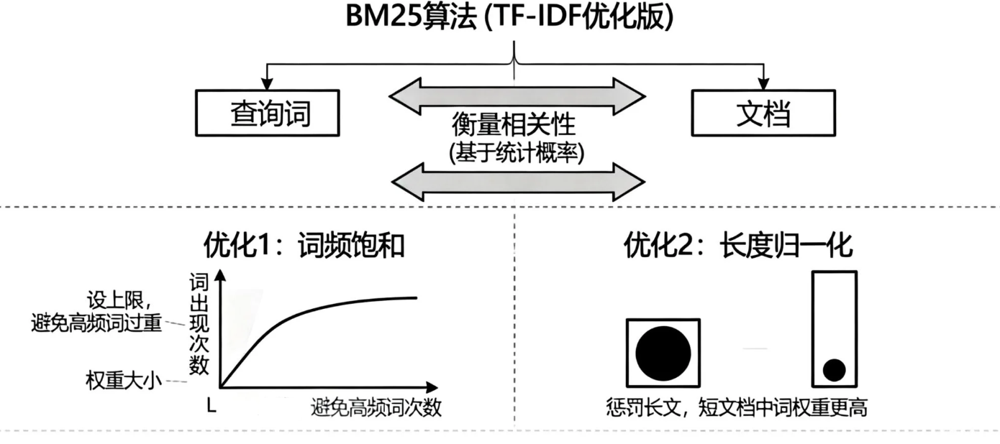
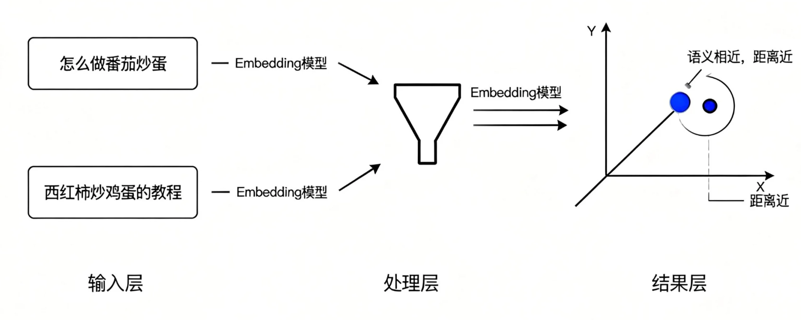

#### 一、 知识点讲解

要理解这两个概念，其实是在讨论搜索引擎发展的两个阶段：**从“字面匹配”到“语义理解”的跨越**。

#### BM25 (Best Matching 25)

BM25 是统搜索算法的方案， 本质上是 TF-IDF 的优化版。

它是基于**统计概率**的。它衡量的是“查询词”和“文档”之间的相关性。

相比粗糙的 TF-IDF，BM25 引入了两个重要参数（k1 和 b）。

**词频****饱和**：一个词出现 100 次不代表比出现 10 次重要 10 倍，BM25 给词频加了上限，避免长文里的高频词权重过大。

**长度****归一化**：它会惩罚过长的文档，保证短文档中出现关键词的权重更高。

**局限性**：它是**词法匹配**。如果你搜“苹果手机”，文档里只有“iPhone”，BM25 认为相关性为 0，因为它不认识同义词，也不懂上下文。

#### 向量检索

这是深度学习时代的产物。

它是基于**语义空间**的。通过 Embedding 模型，把一段文本压缩成一个高维向量。在向量空间里，意思相近的句子，距离会很近（通常用余弦相似度或点积计算）。

它解决了“语义鸿沟”。搜“怎么做番茄炒蛋”，能匹配到“西红柿炒鸡蛋的教程”，哪怕这俩句子的字面重合度很低。

#### 3.补充

在实战中，通常不会二选一，而是采用 混合检索。

1. 利用向量检索做**召回**，保证不漏掉语义相关的结果；
2. 利用 BM25 保证精确匹配的权重；
3. 最后通过 **RRF** 等算法进行加权融合。这样既能懂用户的“潜台词”，又能保证专有名词搜得准。

---

#### 二、 面试标准回答

这两者的核心区别在于：BM25 是基于概率统计的关键词（词法）匹配，而向量检索是基于深度学习的语义（稠密）匹配。 简单来说，BM25 解决的是“查得准”字面，向量检索解决的是“查得全”语义。

1. **从匹配原理上看：**
    1. **BM25** 是稀疏检索的代表。它主要关注查询词在文档中的出现频率、反向文档频率以及文档长度。它的优势是**完全可解释**，对专有名词、精确匹配（如人名、ID）非常强，计算开销极低。
    2. **向量检索** 是稠密检索的代表。它利用 Embedding 模型将文本映射到高维空间。它的优势是**泛化能力强**，能处理同义词、多模态甚至跨语言检索，解决了“词不达意”的问题。
2. **从局限上看：**
    1. BM25 的痛点是**语义鸿沟**。它无法理解“苹果”和“水果”的关联，也无法处理多词一义或一词多义的情况。
    2. 向量检索的痛点是**不可解释性**和**精确性丢失**。它是一个黑盒，有时候会召回看似相关但实际上错误的各种“幻觉”结果；而且它的索引构建成本和查询延迟通常高于倒排索引。
