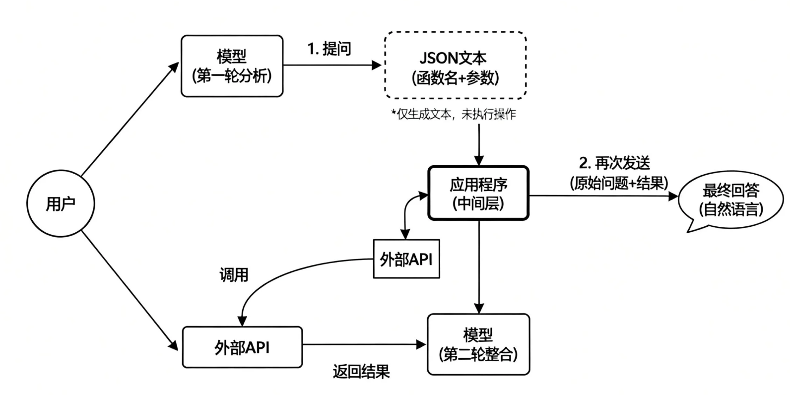

### 一、 知识点讲解

Function Calling 的核心本质，是**将大语言模型从单纯的“文本生成器”转变为“逻辑调度器”**。它解决的是 LLM 无法直接与外部世界（如 API、数据库、计算器）交互的问题。

#### 预定义 Schema 与 结构化推理

模型本身并不真的“运行”代码。开发者在向模型提问时，会同时给模型塞一份“说明书”（通常是 JSON Schema 格式），里面列出了有哪些工具可用（例如 get_weather），以及这个工具需要什么参数（例如 location）。模型经过专门的微调，能够理解这些 Schema。

#### 交互闭环

整个流程分为两轮对话：

- **第一轮（意图识别与参数提取）：** 用户提问。模型分析语义，如果判断需要使用工具，它**不会**直接回答问题，而是返回一个特殊的结构化数据（通常是 JSON），里面包含“我想调用的函数名”和“我提取出的参数”。
    - *注意：此时模型没有执行任何操作，它只是生成了一段文本（**JSON**）。*
- **中间层（外部执行）：** 你的应用程序接收到这个 JSON，解析它，然后在你的代码里去真正调用那个 API（比如去查天气接口）。拿到结果后（比如“25摄氏度”）。
- **第二轮（结果整合）：** 应用程序把这个**执行结果**，作为一条新的消息追加到对话历史中，再次发给模型。模型结合用户的原始问题和这个执行结果，最终生成人类可读的自然语言回答。

---

### 二、 面试标准回答

简单来说，它是一种让大模型能够连接外部工具、实现结构化输出的机制。本质上，它是通过**“Schema 注入”和“多轮对话回调”**来实现的。

**第一，定义与感知阶段。**

在请求模型时，我们不仅传入用户的 Prompt，还会在 System Prompt 或者专门的 Tools 参数中，传入一组函数定义的 Schema（通常是 JSON 格式，包含函数名、描述、参数类型）。模型因为经过了特定的微调，它能够理解这个上下文，并根据用户的问题判断是否需要“挂起”文本生成，转而生成一个函数调用的请求。

**第二，推理与参数生成阶段。**

如果模型决定调用工具，它输出的不是自然语言，而是一个结构化的 JSON 对象（包含 function_name 和 arguments）。

模型本身并不执行代码。它只是是一个“参数提取器”和“决策机”，它生成完 JSON 后就暂停了，等待客户端的反馈。

**第三，执行与回填阶段。**

我们的业务代码捕获到这个 JSON，在本地或者服务端真正执行该函数（比如查询数据库、调用 API）。拿到结果后，我们将结果封装成一个 ToolMessage 或 FunctionMessage，追加到对话历史中，再次请求模型。模型结合之前的上下文和最新的执行结果，最终生成回复给用户的自然语言。
