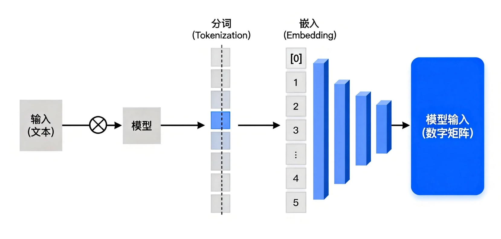
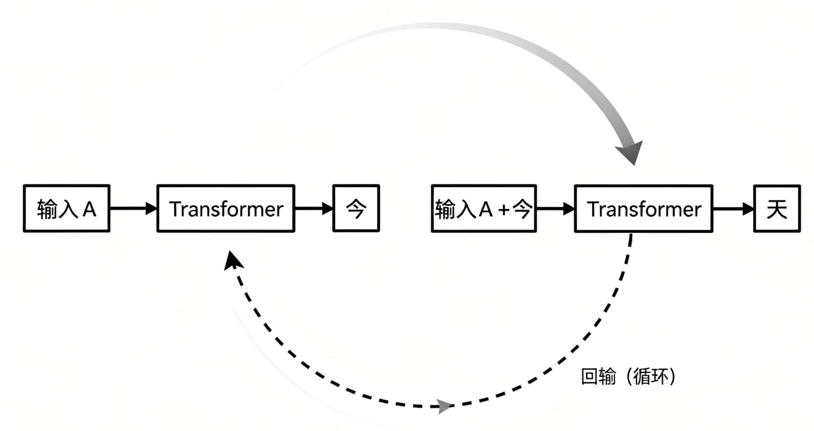
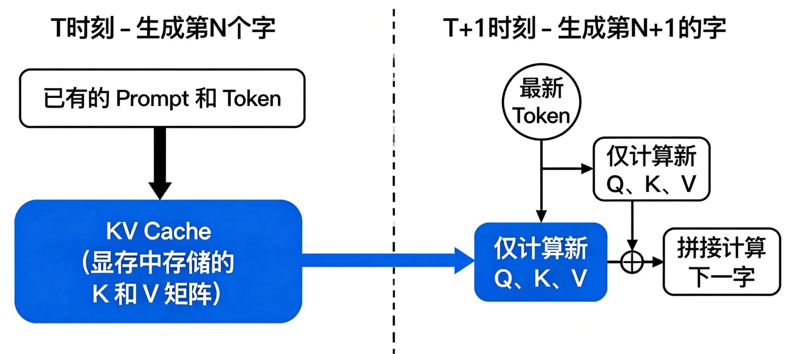
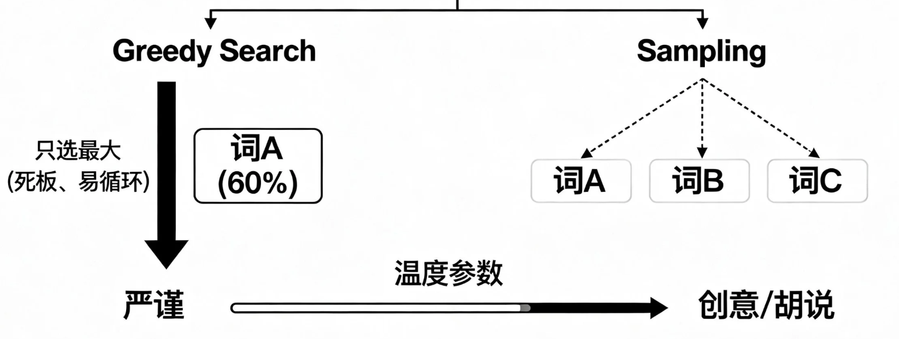

#### 一、 知识点讲解

简单来说，推理阶段就是模型利用**冻结的权重参数**，根据输入的 Prompt，一步步“预测”下一个字的过程。

这个过程核心包含以下四个步骤：

#### 输入处理与向量化

模型无法直接理解汉字或英文，它只认识数字。

- **Tokenization（分词）：** 将用户的输入切分成一个个 Token 。
- **Embedding（嵌入）：** 将这些 Token 转换成高维向量。此时，你的输入就变成了一个矩阵，模型开始对这个矩阵进行计算。

#### 自回归生成

模型并不是一次性吐出整段话，而是“逐字蹦”。

模型接收当前的输入序列，经过层层 Transformer的计算。计算的目标是得出**下一个 Token 出现概率的分布**。一旦生成了第一个字（比如“今”），这个字就会被加回到输入序列的末尾，形成新的输入（Prompt + “今”），然后再次送入模型去预测下一个字（比如“天”）。

这个过程循环往复，直到生成结束符或达到长度限制。

#### KV Cache

这是推理阶段最重要的性能优化点，也是面试常考点。

由于是“逐字生成”，每次预测新字时，前面的 Prompt 和已经生成的字其实是不变的。如果每次都重新计算前面所有字的 Attention 矩阵，计算量会呈平方级爆炸，速度极慢。**KV Cache** 的作用就是把前面已经算好的 Key 和 Value 矩阵存显存里，下一次计算只算最新那个 Token 的 Q、K、V，然后和缓存里的拼起来。这属于典型的“空间换时间”。

#### 解码策略

模型输出的是几万个词的概率分布，具体选哪个词作为输出，取决于解码策略：

- **Greedy Search：** 每次只选概率最大的那个（容易陷入循环，生成的文案比较死板）。
- **Sampling (Top-k / Top-p)：** 根据概率随机采样，引入“温度”参数。这决定了模型是在一本正经地胡说八道，还是严谨地回答问题。

---

#### 二、 面试标准回答

首先，从计算流程来看，推理本质上是一个**自回归**的生成过程。

当我们将 Prompt 输入模型后，模型权重的参数是冻结的，它不会再进行反向传播更新。模型会将输入转化为 Embedding，经过多层 Transformer 结构的前向传播，最终输出一个针对词表的概率分布。

接下来的核心逻辑是 模型根据当前的概率分布采样选出一个 Token，然后将这个 Token 拼接回输入序列的末尾，作为下一次计算的历史上下文。这个‘预测-拼接-再预测’的循环会一直持续，直到遇到结束符或者达到最大长度限制。

其次，在实际工程应用中，推理阶段有一个非常关键的优化技术叫 KV Cache。

因为在自回归过程中，输入序列的前缀在每一步都是重复的。为了避免重复计算这些已知 Token 的 Attention 权重，我们会将每一层的 Key 和 Value 矩阵缓存到显存中。这样，模型在生成第 N 个 Token 时，只需要计算当前这一个 Token 的 Q, K, V，然后与缓存中的 K, V 进行拼接计算即可。这虽然增加了显存的占用，但极大地降低了计算量，显著提升了推理速度。

最后，模型输出的质量还受**解码策略**控制。我们通过调整 Temperature、Top-P 等超参，来决定是让模型输出更确定性的结果，还是更多样化的结果。
