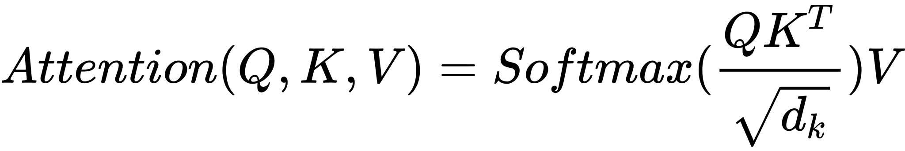
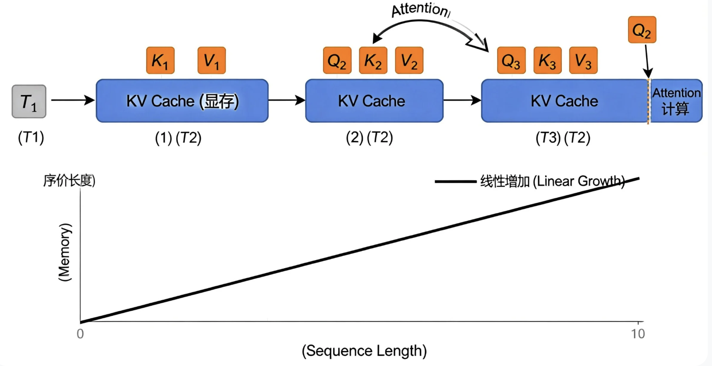
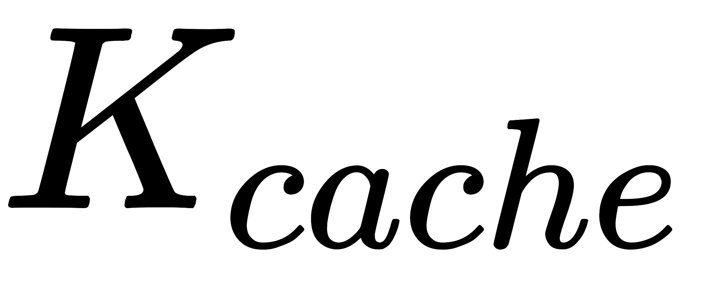
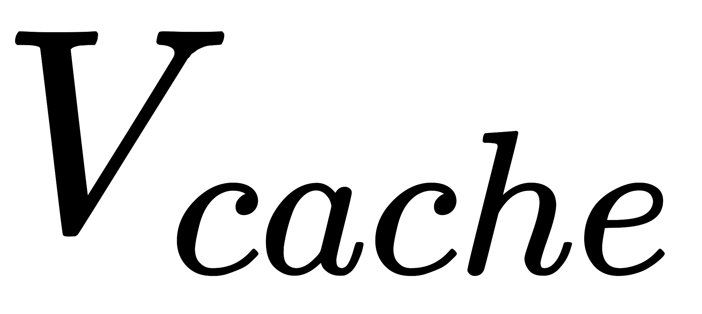
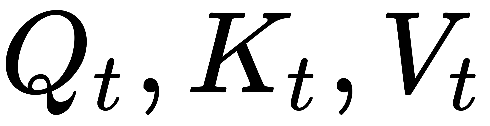
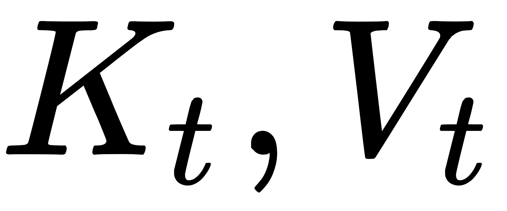

#### 知识点讲解

KV Cache 避免了对历史 Token 的 K 和 V 投影矩阵的重复计算。它将推理过程中的矩阵乘法复杂度，从随序列长度平方增长，降低到了线性增长。但代价是显存占用会随着序列长度线性增加（这也是长文本推理显存容易爆的原因）。

要理解 KV Cache，首先需要理解 Transformer 模型在**推理阶段的**自回归特性。

大模型生成内容是“一个字一个字”往外蹦的。例如生成这句话：“我爱人工智能”。

- 第一步：输入“我”，模型预测“爱”。
- 第二步：输入“我爱”，模型预测“人”。
- 第三步：输入“我爱人”，模型预测“工”...

**没有** **KV** **Cache 时发生了什么：**

在 Self-Attention 层中，计算的核心公式是 。

当你生成第三个字“工”时，你把“我爱人”三个字作为输入传进去。此时，模型会重新计算“我”的 K, V 向量，也会重新计算“爱”的 K, V 向量，尽管这些向量在第一步和第二步时已经算过且完全一样（因为前面的输入是固定的）。

这就导致了大量的重复矩阵运算。随着生成的序列变长，这种 O(N^2) 的重复计算会极其浪费算力。

**引入** **KV** **Cache 后发生了什么？**

KV Cache 的本质就是将前面步骤中计算好的 Key 和 Value 矩阵缓存下来，存在显存里。

- **当前时刻：** 当生成新 Token 时，我们只需要计算**当前这一个新 Token** 的 Query、Key 和 Value。
- **拼接：** 将新算出来的 Key 和 Value，拼接到显存中已有的  和  后面。
- **计算：** 用当前的 Q 去和拼接完整的 K、V 做 Attention 计算。

---

#### 面试标准回答

KV Cache 是 LLM 推理阶段最重要的一种优化技术，其核心原理是**利用显存空间换取计算时间**。

第一，原理层面。在 Transformer 的自回归推理过程中，模型是逐个 Token 生成的。在计算第 t 步的 Attention 时，需要用到 1 到 t 所有 Token 的 Key 和 Value 向量。

如果不使用 KV Cache，每生成一个新的 Token，模型都需要重新计算一遍所有历史 Token 的 K 和 V 投影，这包含了大量的冗余计算。

KV Cache 的做法是，将之前步骤计算好的 K 和 V 矩阵缓存在显存中。当生成第 t 个 Token 时，我们只需要计算这当前第 t 个 Token 的  ，然后把  拼接到缓存中，直接进行 Attention 计算。

第二，加速收益。KV Cache 极大地减少了矩阵运算量。它不仅避免了对历史 Token 的重复投影计算，而且在大模型推理中，通常是 受限于显存带宽而非 受限于算力。虽然 KV Cache 占用了更多显存空间，但它避免了重复加载权重进行计算，从整体的 End-to-End Latency 来看，它显著提升了推理速度和吞吐量。
