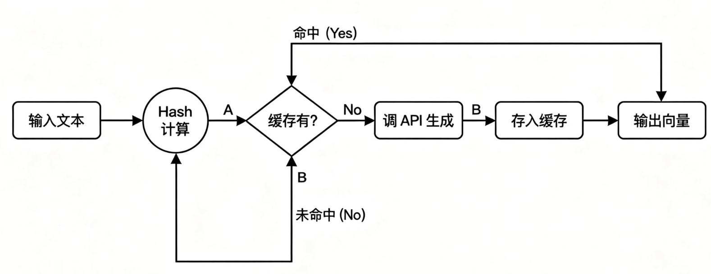
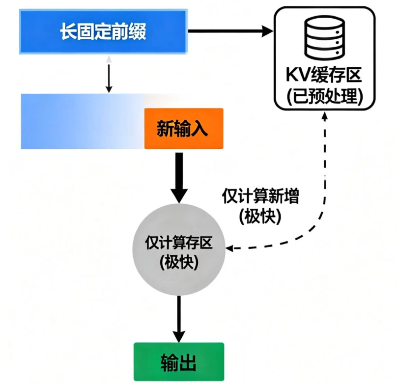
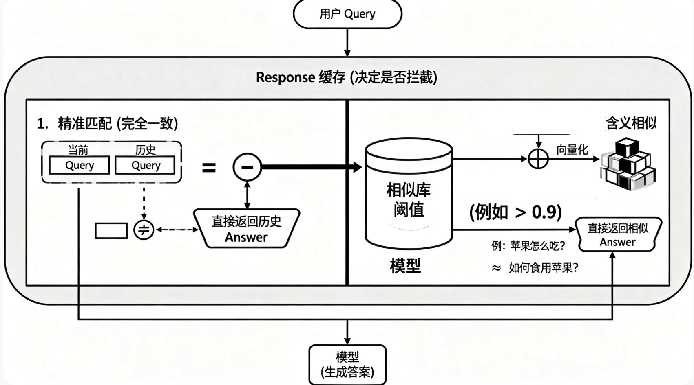

### 知识点讲解

在大模型应用开发中，缓存机制是降低成本（Token 费用）和提升用户体验（降低延迟、提高并发）最直接有效的手段。通常不会把所有请求都直接透传给模型，而是分层处理。

#### Embedding 缓存

在使用 RAG 时，我们需要将文本转化为向量。

- **原理：** 对于同一个 Embedding 模型，相同的输入文本产生的向量是确定且不变的。
- **做法：** 当系统接收到文本块时，先计算该文本的 Hash 值。查询缓存（如 Redis），看该 Hash 是否存在对应的向量数据。
    - **命中：** 直接返回向量，无需调用 Embedding API。
    - **未命中：** 调用 API 计算，存入缓存，再返回。
- **收益：** 大幅减少 Embedding API 的调用次数，对于索引构建阶段和高频查询场景效果极佳。

#### Prompt / Context 缓存

这层缓存主要解决“长文本重复输入”带来的计算浪费问题，特别是在 System Prompt 很长或 Few-shot examples 很多的情况下。

- **KV Cache：** 在模型推理过程中，Transformer 会产生 Key-Value 矩阵。对于相同的前缀，这部分计算是可以复用的。
- **做法：** 如果你的应用有固定的 System Prompt 或者挂载了巨大的知识库文档，可以通过将这部分内容预处理并缓存其 KV 状态。下一次请求如果包含相同的前缀，模型只需计算新追加的内容，无需重新计算整个上下文。

#### Response 缓存

这是最接近用户的缓存，直接决定是否需要模型生成答案。分为**精准匹配**和**语义匹配**。

- **精准匹配：**
    - 类似于传统 API 缓存。如果用户的 Query 字符串完全一致（Hash 碰撞），直接返回上次的 Answer。
    - **缺点：** 用户多打一个标点符号或换个语序，缓存就失效了。
- **语义缓存：**
    - **做法：** 将用户的 Query 向量化，然后在向量数据库中查找“语义高度相似”的历史 Query。
    - **判定：** 设定一个相似度阈值（如 Cosine Similarity > 0.9）。如果库里有个问题是“苹果怎么吃？”，用户问“如何食用苹果？”，两者语义向量极近，判定为命中，直接把“苹果怎么吃”的答案返回给用户。

---

### 面试标准回答

关于大模型开发中的缓存策略，在系统的三个不同层级进行优化：Embedding 层、Prompt 层和 Response 层。

**第一，Embedding 层的缓存。**

这层主要用于 RAG 或搜索场景。因为对于固定的模型，文本到向量的转换是幂等的。我的做法是利用 Redis 构建一个 Key-Value 存储，Key 是输入文本的 Hash 值，Value 是对应的 Vector。在做文本入库或者用户查询向量化之前，先查 Redis。这能显著降低 Embedding API 的 token 消耗，特别是在处理大量重复文本块的时候。

**第二，Prompt 和 Context 层的缓存。**

这主要针对长上下文场景。如果我们的 System Prompt 很长，或者携带了大量的 Few-shot examples，每次请求都重新计算这部分的 Attention 是巨大的浪费。

在自建推理服务时，利用 KV Cache 和 PagedAttention 机制，让相同前缀的计算状态驻留在显存中；如果使用商业 API，我会启用它们的 Context Caching 功能，把固定的长文档设为 Cache Checkpoint，这样后续请求只需为“增量”部分的 Token 付费，首字延迟也能大幅降低。

**第三，Response 层的语义缓存。**

这是应用层的核心。传统的完全匹配命中率太低，所以通常会引入语义缓存，比如使用 GPTCache 这种方案。

流程是：用户请求进来  向量化  在向量库搜索相似的历史问题。如果相似度超过设定的阈值（比如 0.9），就直接返回缓存的答案。这对于高频且通用的问答场景（比如客服机器人的常见问题）提升非常大。
