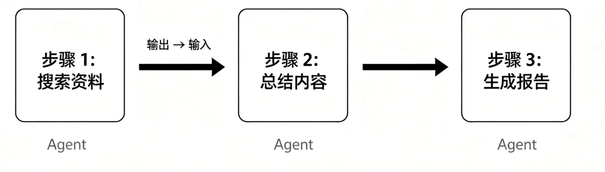
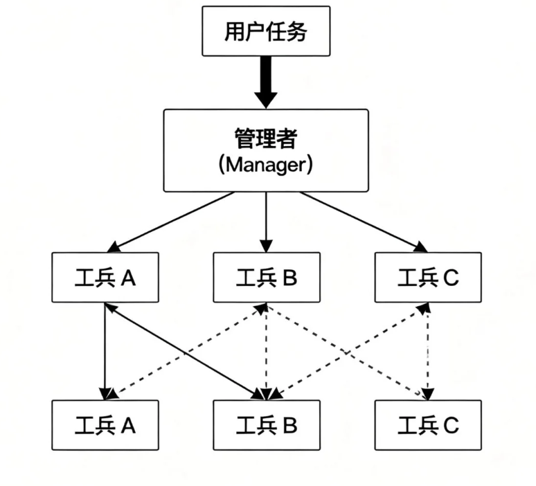
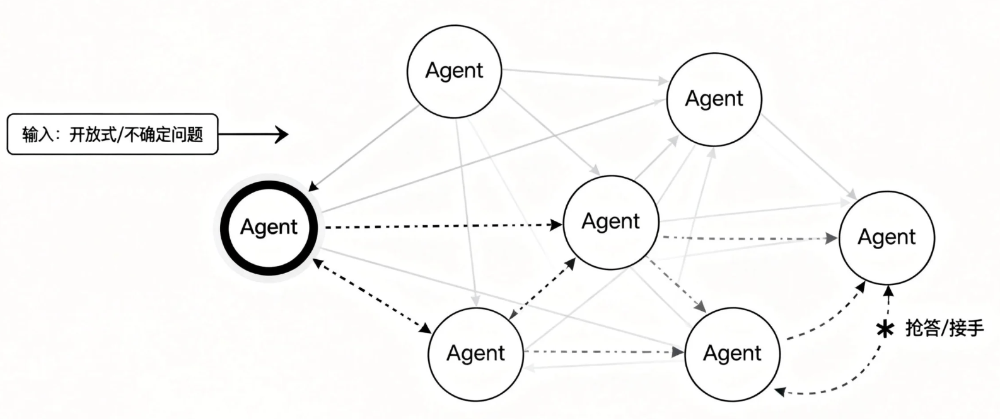
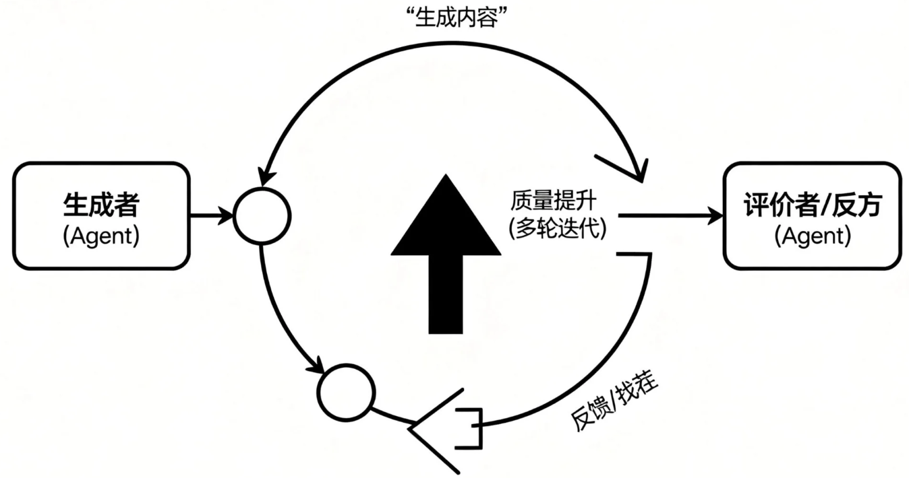

### 一、 知识点讲解

多 Agent 协作的核心逻辑，在系统设计上其实就是 **“****分治****”** 和 **“****SOP****化”**。

单个 LLM虽然全能，但在处理超长上下文、复杂逻辑推理或多步骤任务时，容易出现幻觉或逻辑断层。

多 Agent 协作就是将一个复杂的任务拆解，分配给不同角色的 Agent，让它们各司其职，通过特定的拓扑结构连接起来。

目前的协作模式主要可以归纳为以下四种主流架构：

#### **线性/顺序协作**

    - **逻辑：** 类似于流水线工厂。上一个 Agent 的输出，直接作为下一个 Agent 的输入。
    - **适用场景：** 任务链路清晰、步骤固定的场景。例如：先搜索资料 -> 再总结内容 -> 最后生成报告。

#### **层级/主从协作**

    - **逻辑：** 引入一个“管理者”角色。管理者不干具体的活，只负责拆解用户任务，分发给手下的“工兵”Agent，并负责汇总结果。
    - **适用场景：** 复杂且需要统一调度的任务。

#### **动态/网状协作**

    - **逻辑：** Agent 之间没有严格的上下级，而是根据当前的上下文，动态决定下一个由谁来接手，或者通过“举手/抢答”机制来决定谁处理。
    - **适用场景：** 开放式问题或由于中间结果不确定导致后续路径不确定的任务。

#### **对抗/辩论协作**

    - **逻辑：** 引入“评价者”或“反方”角色。一个 Agent 生成内容，另一个 Agent 负责找茬、提修改意见，通过多轮迭代提升质量。
    - **适用场景：** 代码生成（写代码 -> 跑单测报错 -> 修正代码）、创意写作。

**技术实现的关键点：**

- **共享记忆：** 所有 Agent 需要共享同一个上下文环境，确保信息同步。
- **结构化通信：** Agent 之间的交互不仅仅是自然语言，通常包含特定的 JSON 结构，用于指令控制和状态流转。

---

### 二、 面试标准回答

**关于多 Agent 如何协作，其本质是解决单个模型在长逻辑链条下能力衰减的问题。**

**在实际工程落地中，通常将其归纳为“流程编排”和“角色分工”两个维度，具体可以分为三种主要模式：**

第一是“流水线模式”。

这是最基础的协作方式。我们将任务 S.O.P. 化，拆解为 A、B、C 三个步骤，Agent A 负责检索，B 负责清洗，C 负责生成。这种模式下，Agent 之间是通过“提示词传递”来协作的，上游的 Output 严格作为下游的 Input，适合确定性强的任务。

第二是“层级调度模式"。

这种模式更像是一个项目组。我们需要引入一个 Controller（或 Manager）Agent。它的核心职责不是执行，而是规划和路由。它分析用户的复杂指令，拆解成子任务，分发给写代码、做图表等垂直领域的 Specialist Agents，最后由 Manager 汇总。这种架构能有效避免单一 Agent 上下文过载的问题，MetaGPT 就是典型的例子。

第三是“反馈迭代模式”。

这是提升生成质量的关键。我们引入 Reviewer 角色。比如 Agent A 写完代码后，Agent B 模拟运行环境或进行代码审查，将错误信息反馈给 A，强制 A 进行自我修正。这种**“执行-反馈-修正”**的闭环，是多 Agent 协作相比单 Agent 最大的优势所在。
