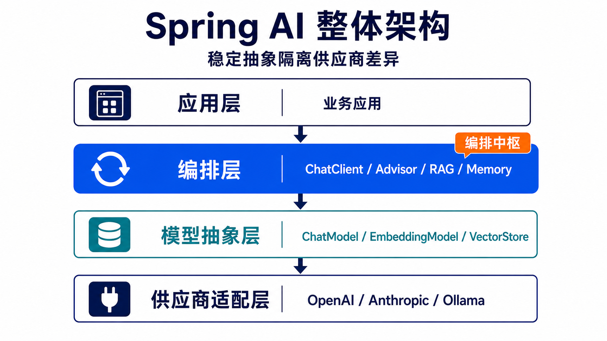
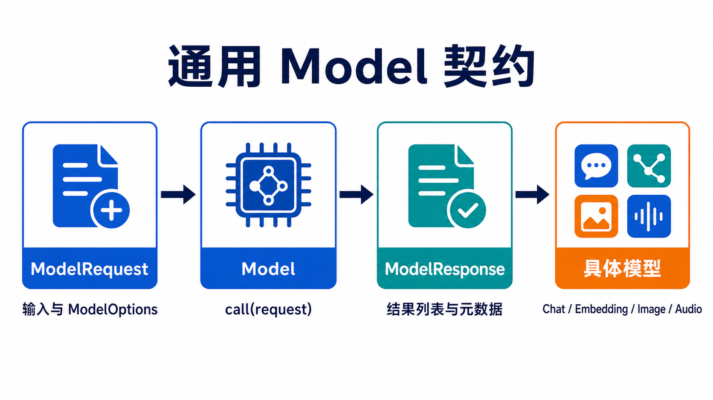
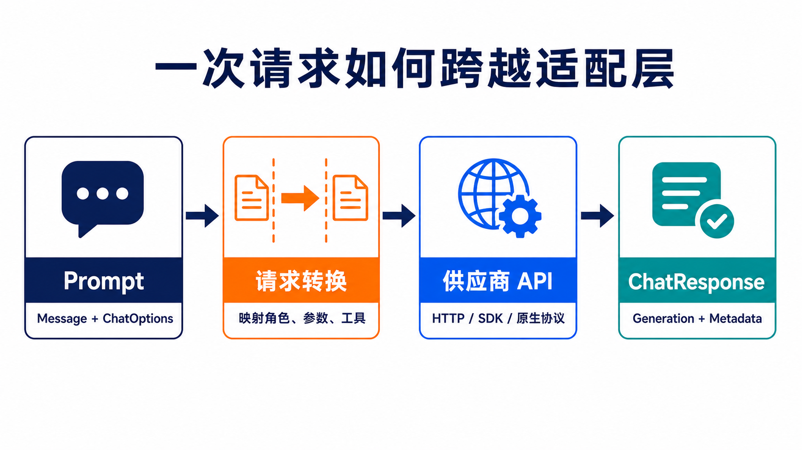
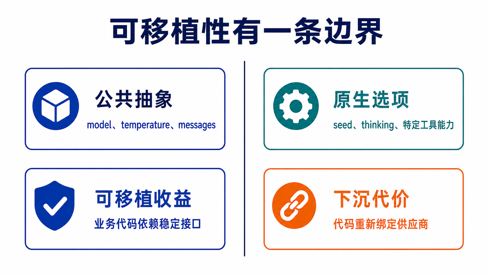

你在项目里接入过两个大模型，大概率会遇到一种熟悉的混乱。

同样是聊天，请求字段不一样；同样是流式输出，事件格式不一样；换成另一个供应商以后，连工具调用和错误码也得重新适配。

问题真的只是字段名不同吗？如果只是薄薄封装一层HTTP客户端，Memory、RAG和Tool又凭什么能够复用于所有模型？

于是很容易把Spring AI理解成“替我们封装HTTP请求的SDK”。这个说法不算错，但只说到了最外层。

**Spring AI真正要隔离的不是HTTP，而是AI能力变化与业务代码之间的耦合。**它用一组通用模型契约承接稳定部分，用供应商适配器处理差异，再把Memory、RAG、Tool等编排能力建立在稳定契约之上。

本文以Spring AI 2.0.0为基线，拆开这套架构。

我们会沿着两个问题往下走：哪些部分值得统一？哪些供应商差异必须保留？

## 如果只封装HTTP，为什么还需要一个框架？

假设订单助手最初使用OpenAI。业务代码直接构造请求JSON、调用接口、解析响应，也能跑起来。

真正的问题通常出现在第二阶段：

- 测试环境想改用Ollama；
- 海外和国内部署使用不同供应商；
- 普通问答用便宜模型，复杂推理用更强模型；
- 聊天之外还要增加Embedding、向量检索和工具调用；
- 所有调用都要接入重试、指标和链路追踪。

如果业务层直接认识每家供应商的请求对象，这些变化就会一路传到Controller、Service甚至领域逻辑。

Spring AI采用的是Spring生态很熟悉的做法：**先找出相对稳定的能力，再把易变实现放到接口后面。**



这张图最值得注意的是依赖方向。应用依赖ChatClient、Advisor或者ChatModel，而这些上层对象依赖通用接口；只有最下面的适配层需要理解某家供应商的协议。

这和JDBC很像。业务代码依赖`DataSource`与JDBC API，驱动负责把标准调用翻译成MySQL或PostgreSQL协议。不过类比到这里就该停下：大模型供应商的能力差异远比关系数据库SQL方言更大，因此Spring AI只能统一共同部分，不能抹平所有差异。

## 最底层的Model API统一了什么？

Spring AI先定义了一个非常小的通用契约。下面是根据官方接口简化后的示意，不是完整源码：

```java
// 简化示意：省略注解、泛型边界与其他方法
interface Model<Request, Response> {
    Response call(Request request);
}

interface StreamingModel<Request, ResponseChunk> {
    Flux<ResponseChunk> stream(Request request);
}
```

这个接口看起来简单，是因为它只负责描述最稳定的因果关系：

1. 应用准备一个标准请求；
2. 模型实现接收请求并执行调用；
3. 返回一个标准响应；
4. 流式模型则持续返回标准响应片段。



请求和响应也有公共骨架。`ModelRequest`携带输入以及`ModelOptions`；`ModelResponse`携带结果集合和响应元数据；单个结果通过`ModelResult`表达。

在这套骨架上，Spring AI再建立具体能力：

- `ChatModel`处理`Prompt`并返回`ChatResponse`；
- `EmbeddingModel`把文本或`Document`转换成浮点向量；
- Image、Audio等模型也遵循类似的请求—响应结构；
- `VectorStore`虽然不是模型，却提供跨向量数据库的写入和相似度检索抽象。

它不是强迫所有模型使用同一个请求类，而是让不同能力遵循同一种设计语言。

## ChatModel为什么既有call又有stream？

Spring AI 2.0.0中的`ChatModel`同时继承通用`Model<Prompt, ChatResponse>`和`StreamingChatModel`。因此同一个具体实现通常同时提供：

```java
ChatResponse response = chatModel.call(prompt);

Flux<ChatResponse> chunks = chatModel.stream(prompt);
```

两条路径共享`Prompt`和`ChatResponse`这些领域对象，但执行模型不同。`call()`等完整结果，`stream()`通过Reactor的`Flux`发布片段。

这项设计带来一个重要效果：上层的Advisor、可观测性和响应转换可以围绕标准对象工作，不需要先判断底层是OpenAI的chunk还是另一家供应商的事件。

不过，“接口相同”不表示运行成本相同。流式调用涉及事件流、取消、缓冲和响应式线程；同步调用则围绕一个完整值工作。后面的流式输出文章会单独拆这部分。

## 供应商适配器到底做了什么？

当`OpenAiChatModel`之类的具体实现收到`Prompt`时，并不是把这个Java对象原样发送出去。适配层至少要完成两次转换。



请求方向通常包括：

1. 把`SystemMessage`、`UserMessage`等通用消息映射成供应商角色；
2. 把`ChatOptions`的公共参数转换成供应商字段；
3. 加入工具定义、多模态内容和供应商特定配置；
4. 通过HTTP客户端或官方SDK发送请求。

响应方向则相反：

1. 读取供应商原生响应；
2. 提取文本、工具调用、停止原因和Token用量；
3. 转换成`Generation`与`ChatResponseMetadata`；
4. 最终组装成统一的`ChatResponse`。

所以当业务层调用`chatModel.call(prompt)`时，看到的是稳定对象；变化最大的协议翻译被留在边界处。

可以顺着一个具体请求再走一遍。应用创建两个Message，并给出公共Options：

```java
Prompt prompt = new Prompt(
    List.of(
        new SystemMessage("你是订单助手，只回答订单相关问题"),
        new UserMessage("查询订单 A-1024 的状态")
    ),
    ChatOptions.builder()
        .temperature(0.1)
        .build()
);

ChatResponse response = chatModel.call(prompt);
```

到了OpenAI适配器，System、User角色和temperature会被映射到OpenAI请求；换成Ollama实现，则由Ollama适配器生成它所需要的请求。返回时，两家供应商原本不同的完成结果都会被包装成`ChatResponse`。

业务仍需关注一个细节：公共Options只有在目标供应商支持且适配器能映射时才有共同语义。相同的temperature并不保证两个模型输出同样随机，更不保证答案等价。接口统一解决的是调用方式，不是模型数学行为。

## ChatClient为什么还要再包一层？

既然`ChatModel`已经能调用模型，为什么还需要`ChatClient`？

因为`ChatModel`解决的是“怎样调用一种模型能力”，而`ChatClient`解决的是“怎样组织一次应用级对话”。

它提供类似`WebClient`和`RestClient`的Fluent链式API，可以逐步加入：

- 默认或单次System、User消息；
- 模型选项；
- Advisor；
- 工具与工具上下文；
- 结构化输出目标类型；
- 同步/流式路径选择与结果提取方法。

这里要区分“选择路径”和“触发请求”。在ChatClient 2.0.0里，`.call()`或`.stream()`先选择同步/流式响应规范；随后调用`.content()`、`.chatResponse()`或`.entity()`等结果方法时，才真正执行并提取结果。

更关键的是，Memory、RAG与Tool Calling并不需要侵入每个`ChatModel`实现。它们通过ChatClient的Advisor链在模型调用前后工作。

这解释了Spring AI的三层职责：

- **Model API**：统一模型调用的输入输出契约；
- **Provider Adapter**：翻译某家供应商的真实协议；
- **ChatClient与Advisor**：组合应用级行为。

## 统一抽象是不是意味着可以无成本切换模型？

不能。Spring AI提供的是可移植性，不是完全等价性。



公共抽象适合表达各家都支持的能力，例如消息、模型名、temperature、最大输出Token等。业务只依赖这些字段时，切换供应商的改动会比较小。

但供应商仍可能拥有独占能力：

- 特定推理模式；
- 不同的结构化输出约束；
- 不同的多模态格式；
- 不同工具调用限制；
- 专有安全参数、缓存或路由能力。

Spring AI允许使用供应商专属Options访问这些能力。代价也很明确：代码从通用抽象下沉到供应商类型以后，可移植性会降低。

可以把下沉限制在一个模型网关组件里。例如领域服务只提交`OrderQuestion`，网关内部根据场景选择通用`ChatOptions`或某个供应商专属Options。将来更换模型时，修改集中在网关，而不是散落在所有业务Service中。

另一个常见误区是为了追求“零改动切换”，只使用最小能力交集。这样确实容易换供应商，却可能放弃结构化输出、缓存或推理模式等有价值能力。合理的抽象不是永远停在最高层，而是让下沉发生在看得见、可测试、可替换的边界。

一个实用决策是：

业务主路径优先依赖通用接口；只有某项原生能力带来明确收益时，才在边界明确的组件里下沉。

这样既不会为了“理论上的随时切换”放弃重要能力，也不会让整个系统都绑定某家供应商。

## 这套分层设计解决不了什么？

抽象只能隔离工程差异，不能消除模型本身的差异。

换模型以后，即便代码一行不改，输出质量、Token成本、提示词敏感度、工具选择准确率和延迟仍可能变化。因此模型切换必须配套评估，而不能只以“编译通过”为验收标准。

此外，通用接口通常只覆盖能力交集。当供应商协议快速演进时，适配层和上层API也会发生版本变化。本文使用的2.0.0行为不应被当成永远不变的事实。

这套架构还给测试提供了清晰切面。领域服务可以依赖`ChatModel`或更窄的应用网关，在单元测试中替换为可控实现；供应商适配器则通过集成测试验证请求转换、认证与响应解析。不要把“接口可替换”误解成随便Mock一个字符串就足够，工具调用、停止原因和Token元数据同样可能影响业务分支。

从设计原则看，Spring AI复用了Spring长期采用的套路：稳定接口放在中心，外部系统变化留在边缘，横切能力通过组合进入调用链。理解这个原则以后，再看ChatClient、Advisor、Memory和RAG，就不会把它们当成互不相关的功能按钮。

## 面试时怎样用一分钟讲清楚？

可以这样回答：

Spring AI采用分层抽象。底层用通用Model API统一请求、响应和同步/流式调用；每个供应商适配器负责把Prompt、Options转换成原生协议，再把响应转换回ChatResponse。上层ChatClient和Advisor负责Memory、RAG、Tool等应用编排。这样业务主要依赖稳定接口，但供应商特有能力仍可以通过专属Options下沉访问，所以它提供的是可移植性，而不是不同模型完全等价。

记住三个词就够了：**稳定契约、边界适配、上层编排。**

它们也是阅读后续源码时最有用的三条线索。

## 参考资料

- [Spring AI 2.0.0 Reference：API Overview](https://docs.spring.io/spring-ai/reference/api/)
- [Spring AI 2.0.0 Reference：Generic Model API](https://docs.spring.io/spring-ai/reference/api/generic-model.html)
- [Spring AI 2.0.0 Reference：Chat Model API](https://docs.spring.io/spring-ai/reference/api/chatmodel.html)
- [Spring AI官方仓库与版本兼容说明](https://github.com/spring-projects/spring-ai)
