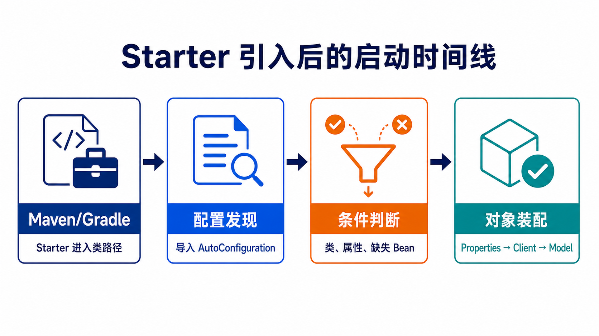
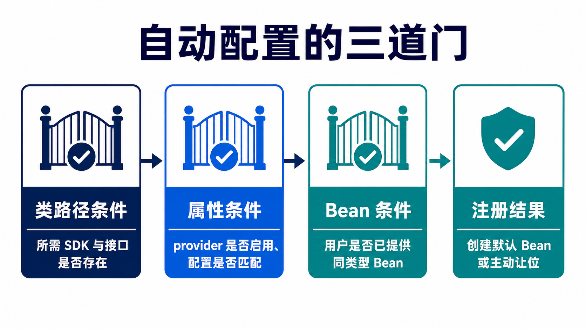
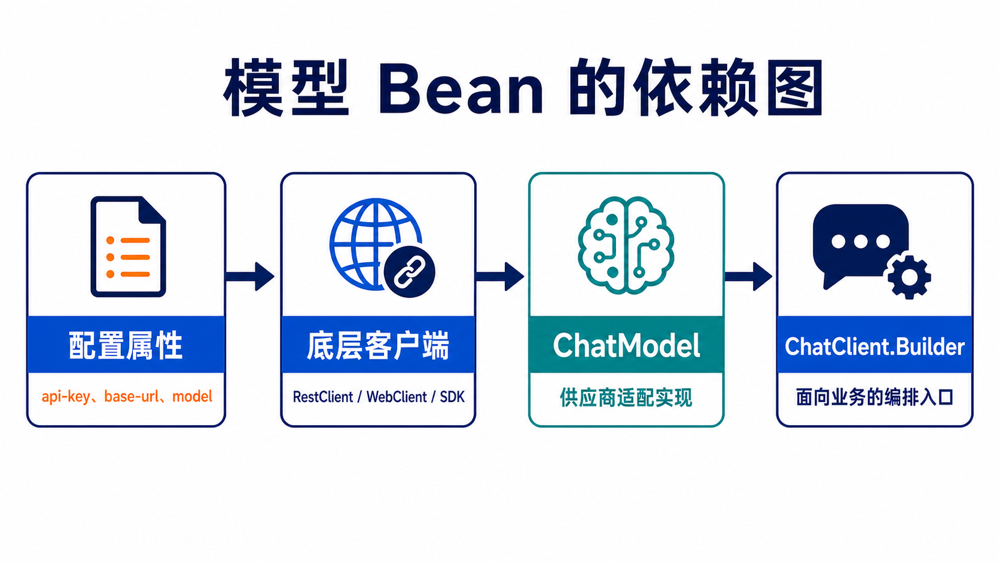
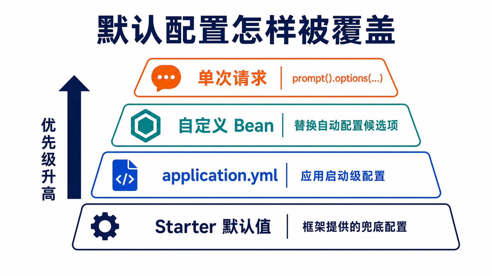

Spring AI最容易制造的一种错觉是：在`pom.xml`里加一个Starter，配置API Key，然后`ChatModel`和`ChatClient.Builder`就“自己出现了”。

当然没有Bean会凭空出现。

是谁发现了这些配置类？同一个项目引入两个模型以后，Spring又凭什么知道该创建哪一个？

再往前一步，如果默认客户端不符合要求，我们应该继续堆配置属性，还是直接声明自己的Bean？

**Starter负责把正确的依赖带进类路径，AutoConfiguration再根据类路径、配置属性和现有Bean，决定是否创建默认对象。**理解这条启动链，才能回答多模型冲突、配置为什么不生效、怎样替换默认客户端这些实际问题。

本文以Spring AI 2.0.0和Spring Boot 4.x为基线。

## Starter与AutoConfiguration是一回事吗？

不是。

Starter更像一张依赖清单。以某个模型Starter为例，它通常会传递引入：

- Spring AI的模型实现；
- 对应的自动配置模块；
- 必要的HTTP客户端或供应商SDK；
- 配置属性、观测等相关依赖。

AutoConfiguration才包含真正的装配逻辑。Spring Boot启动时发现这些自动配置候选项，再逐个判断条件。



把两者分开理解很重要。某个类已经能在IDE里导入，只能证明依赖存在；它对应的Bean是否注册，还要看条件是否成立。

Spring AI 2.0.0目前按组件提供独立的自动配置模块，例如模型、向量库和MCP分别拥有自己的`spring-ai-autoconfigure-*`模块。这样的组件化结构有助于减少不必要依赖以及底层库版本冲突。

## Spring Boot怎样发现这些配置？

在现代Spring Boot中，依赖包通过自动配置导入文件声明候选配置类。应用启动时，Spring Boot读取候选项，并把它们作为“可能需要加载的配置”处理。

注意“可能”两个字。

自动配置类通常会使用条件注解。下面是一个帮助理解的简化示意，并非Spring AI某个类的原样源码：

```java
// 伪代码：只展示自动配置思想
@AutoConfiguration
@ConditionalOnClass(SomeProviderClient.class)
@EnableConfigurationProperties(ProviderProperties.class)
class ProviderChatAutoConfiguration {

    @Bean
    @ConditionalOnMissingBean
    ChatModel chatModel(ProviderProperties properties) {
        return new ProviderChatModel(/* 根据属性构造 */);
    }
}
```

启动过程不会因为“看到配置类”就无条件创建对象。它要依次穿过条件门。



常见判断可以归纳为三类：

1. **类路径条件**：供应商模型实现、底层SDK等类是否存在；
2. **属性条件**：该模型类型或功能是否启用，配置值是否匹配；
3. **Bean条件**：容器里是否已经有用户提供的同类Bean。

任何关键条件不满足，默认Bean都可能不注册。这也是排查自动配置问题时应该先看Condition Evaluation Report，而不是立刻怀疑依赖注入失效的原因。

## 配置属性怎样一路变成ChatModel？

`application.yml`里的字符串不会直接参与每次聊天。它先绑定成强类型Properties对象，然后进入Bean构造过程。



可以把对象图理解成四层：

1. `spring.ai.<provider>.*`配置绑定到Properties；
2. Properties参与创建底层API客户端或SDK客户端；
3. 底层客户端与默认Options一起构造具体`ChatModel`；
4. `ChatModel`再用于创建面向业务的`ChatClient.Builder`。

例如API Key、Base URL更接近连接级配置；模型名、temperature等可以成为模型默认Options；到了单次请求，还能继续覆盖其中一部分。

这种分层意味着配置错误会在不同阶段暴露：

- 属性没有绑定，可能是前缀或字段名错误；
- 底层客户端没创建，可能是条件没匹配；
- `ChatModel`不存在，可能是多供应商选择或自定义Bean冲突；
- 请求仍使用旧模型，可能是单次Options覆盖了启动默认值。

## 同时引入两个聊天模型会怎样？

如果类路径中同时存在多个同类型模型供应商，容器就可能面对“该把哪一个当默认实现”的问题。

Spring AI提供按模型类型选择供应商的配置，例如升级说明中列出的：

```properties
spring.ai.model.chat=openai
```

具体可选值与版本、已引入模块有关。它的作用不是动态路由每一次请求，而是影响相关自动配置是否处于活动状态。

如果业务本来就需要多个`ChatModel`并存，更清晰的方式通常是显式声明Bean，并使用名称或`@Qualifier`表达意图：

```java
@Configuration
class AiModelConfiguration {

    @Bean("fastChatClient")
    ChatClient fastChatClient(
            @Qualifier("fastChatModel") ChatModel model) {
        return ChatClient.builder(model).build();
    }

    @Bean("reasoningChatClient")
    ChatClient reasoningChatClient(
            @Qualifier("reasoningChatModel") ChatModel model) {
        return ChatClient.builder(model).build();
    }
}
```

上面只展示多Bean组织方式，具体模型Bean名称应以你的配置为准。不要依赖自己没有验证过的自动生成Bean名称。

## 自定义Bean为什么能让自动配置“退后”？

Spring Boot自动配置遵循一个很重要的礼貌原则：**应用显式表达的意图优先。**

大量默认Bean带有`@ConditionalOnMissingBean`。如果应用已经注册了匹配类型的Bean，自动配置就不再创建第二个默认对象。



从作用范围看，可以分成四层：

- Starter或框架默认值提供兜底；
- `application.yml`给出应用启动级选择；
- 自定义Bean替换构造方式、底层客户端或默认选项；
- 单次请求Options只改变当前调用。

这里的“优先级”不是说所有字段都由同一段通用算法合并，而是描述控制权越来越靠近业务调用。特别要注意，低层`ChatModel.call(Prompt)`与高层`ChatClient`的Options语义并不完全相同：官方文档说明，直接调用ChatModel时，Prompt中的运行时Options会整体优先于模型启动Options；ChatClient则提供增量式定制。

## 为什么有时候API Key没配，应用仍能启动？

这取决于具体供应商、版本和自动配置条件，不能一概而论。

有的配置会在Bean创建阶段校验，缺失时启动失败；有的底层客户端允许对象先创建，直到第一次请求才因认证失败；还有的环境通过云平台身份、代理或自定义客户端提供凭据。

因此生产系统不应把“Spring容器启动成功”当成模型可用的证明。更可靠的做法包括：

- 启动后执行轻量健康检查，但避免产生高额调用成本；
- 在部署流水线验证关键配置存在；
- 为模型调用建立超时、重试与明确的认证错误告警；
- 不在日志中打印API Key或完整Authorization头。

API Key也不应该硬编码在`application.yml`并提交到仓库。配置文件可以引用环境变量或密钥管理系统，再由不同Profile选择Base URL、模型和超时。自动配置只负责绑定最终可见的值，并不会替应用判断密钥来源是否安全。

如果使用配置中心动态修改属性，还要确认目标Bean是否支持运行时刷新。许多模型客户端在启动时读取属性并构造为普通单例，配置中心里的值变了，不代表已经存在的客户端会自动重建。密钥轮换方案应通过对应组件文档和实际测试验证。

## 自动配置问题应该怎样排查？

可以按下面顺序，避免上来就盲目加Bean：

1. 确认Spring AI、Spring Boot和Starter版本兼容；
2. 查看依赖树，确认所需Starter和AutoConfiguration模块真的存在；
3. 检查属性前缀、环境变量展开和Profile；
4. 查看Condition Evaluation Report，找到未匹配条件；
5. 列出同类型Bean，检查是否被用户Bean替换或出现歧义；
6. 最后再检查单次请求Options是否覆盖启动配置。

Spring AI 2.x对应Spring Boot 4.x；1.1.x对应Spring Boot 3.5.x。跨基线硬凑依赖，可能在自动配置执行前就出现类或方法不兼容。

例如“已经引入OpenAI Starter，却注入不到`ChatModel`”，可以先在条件报告里定位OpenAI聊天自动配置。如果报告显示模型选择属性没有匹配，就检查是否同时引入了另一个聊天供应商、`spring.ai.model.chat`是否选对；如果自动配置已经匹配但Bean仍不同，则继续检查是否存在自定义`ChatModel`让`@ConditionalOnMissingBean`退让。

反过来，如果Bean存在但第一次调用返回401，说明对象装配链大概率已经完成，问题更接近认证配置、环境变量或Base URL。把“启动装配失败”和“运行时远端调用失败”分开，排查范围会小很多。

还可以写一个最小上下文测试验证装配结果：

```java
@SpringBootTest
class AiContextTest {

    @Autowired
    ApplicationContext context;

    @Test
    void shouldCreateChatModel() {
        assertThat(context.getBeansOfType(ChatModel.class))
            .isNotEmpty();
    }
}
```

这个测试只证明容器中存在模型Bean，不会证明远端服务一定可访问。网络、认证和模型名仍需要独立的集成测试；不要为了验证装配就让所有单元测试真实消耗模型Token。

## 面试时怎样回答“Starter为什么能开箱即用”？

可以这样组织：

Starter本身主要负责依赖聚合。Spring Boot启动时发现其中声明的AutoConfiguration，再根据类路径、配置属性和已有Bean判断是否创建Properties、底层客户端、具体ChatModel以及ChatClient.Builder。默认Bean通常使用ConditionalOnMissingBean，所以用户显式Bean可以让自动配置退让。多个模型供应商同时存在时，还需要按模型类型选择或显式使用Qualifier，避免默认实现歧义。

一句话记忆：**Starter把零件送进来，自动配置根据现场条件把零件组装起来。**

再补一个容易得分的边界：自动配置追求“有合理默认值时少写代码”，不等于隐藏所有细节。需要多个供应商、特殊代理、定制HTTP客户端或严格安全策略时，显式Bean往往比继续叠加属性更清楚。能解释何时退出自动配置，通常比只会背注解更接近真实工程能力。

还有一个判断方法：如果差异只是环境值，例如API地址、模型名或超时，优先使用外部化配置；如果差异已经涉及对象创建方式、路由策略、连接器或生命周期，就应考虑显式配置类。把结构性差异硬塞进几十个属性，最后往往比写清楚一个Bean更难维护。

## 参考资料

- [Spring AI 2.0.0 Reference：API Overview](https://docs.spring.io/spring-ai/reference/api/)
- [Spring AI 2.0.0 Upgrade Notes](https://docs.spring.io/spring-ai/reference/upgrade-notes.html)
- [Spring AI 2.0.0 Javadoc](https://docs.spring.io/spring-ai/docs/current/api/index.html)
- [Spring AI官方仓库：Spring Boot版本兼容说明](https://github.com/spring-projects/spring-ai)
