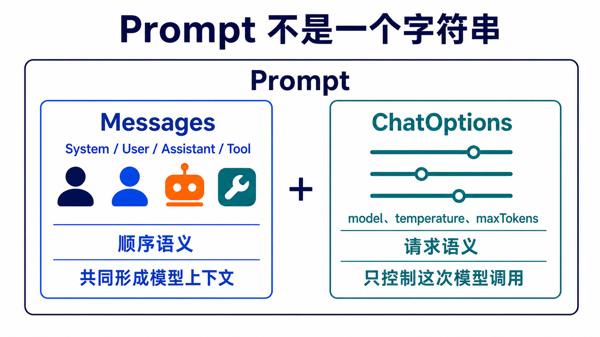
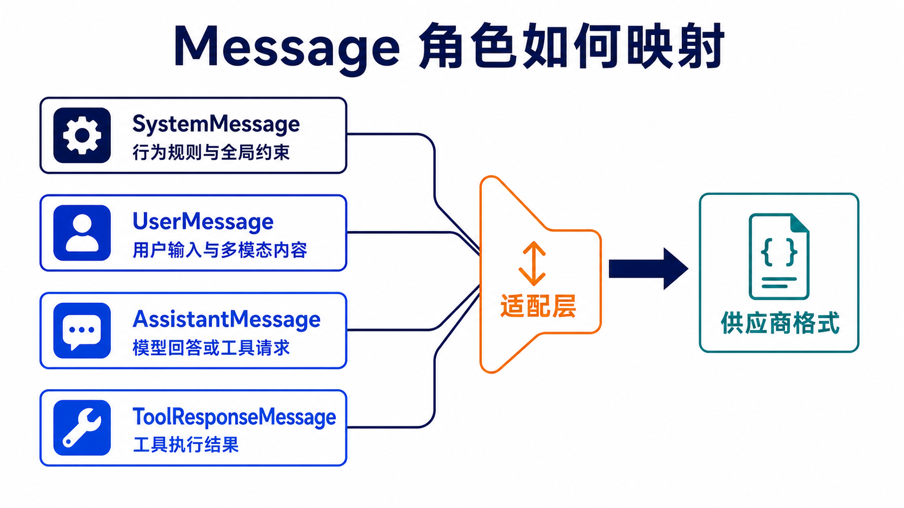
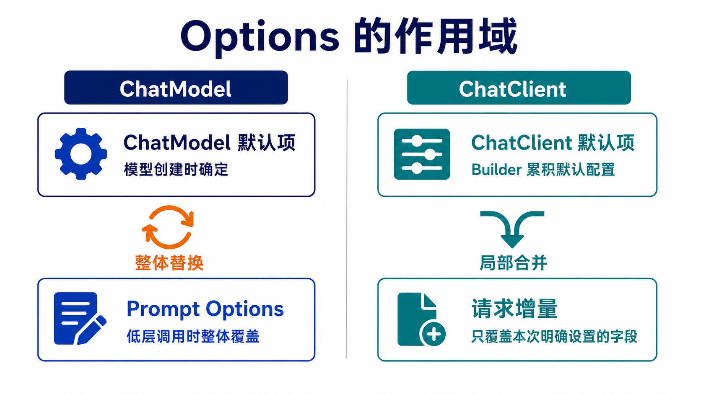
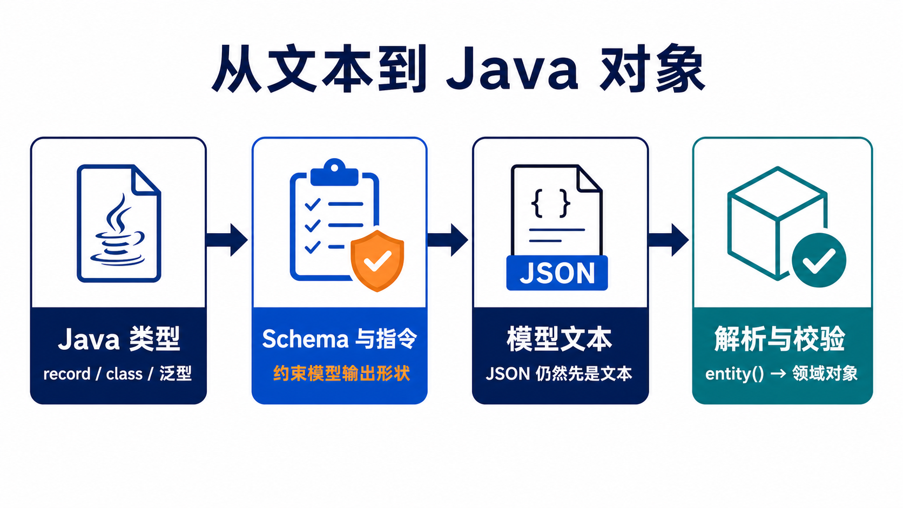

第一次调用大模型时，我们往往只传一句话：

```java
String answer = chatModel.call("解释一下索引下推");
```

这很容易形成一个印象：Prompt就是一段字符串，模型再返回另一段字符串。

可一旦要加入系统规则、多轮历史、图片、模型参数，最后还要把答案落成Java对象，这个解释就不够用了。字符串只描述了“说什么”，却没有表达**谁说的、按什么顺序说、这次怎样生成、返回结果要满足什么形状**。

**在Spring AI 2.0.0里，Prompt的核心是“有序Message集合＋本次请求的ChatOptions”；结构化输出则在这条链路上再增加格式约束、文本解析和可选校验。**

下面沿着一次“生成面试题”的请求，把这些对象逐层拆开。

## Prompt为什么不能只设计成String？

先看一个真实的业务需求：让模型根据主题生成三道面试题，难度固定为中等，回答必须转换成Java对象。

这次请求至少包含四种不同信息：

- 系统约束：你是一名Java面试官，不要给出虚构API；
- 用户任务：围绕Spring事务生成三道题；
- 对话上下文：此前已经讨论过事务传播行为；
- 生成参数：使用哪个模型、temperature多大、最多生成多少Token。

如果把它们都拼成一段字符串，当然也可能工作。但业务代码会同时承担角色标记、消息排序、供应商格式和参数传递，换模型时很难判断哪些内容是业务语义，哪些只是某家接口的协议细节。

Spring AI把它们收进`Prompt`：

```java
// 根据Spring AI 2.0.0 API简化的结构，不是完整源码
public class Prompt implements ModelRequest<List<Message>> {
    private final List<Message> messages;
    private ChatOptions modelOptions;
}
```



图中左右两部分不要混在一起理解。`Messages`决定模型这次看见的上下文和角色顺序；`ChatOptions`决定这次调用采用怎样的生成策略。二者共同构成请求语义，但职责不同。

这也解释了为什么`chatModel.call(String)`只是便捷入口。官方API明确说明，真实应用更常使用接收`Prompt`并返回`ChatResponse`的`call(Prompt)`：后者才容得下完整请求。

那是不是只要把多段文字放进List就够了？还不够，列表中的每一项还需要明确自己在对话里扮演什么角色。

## Message的角色究竟改变了什么？

`Message`不只是带一个`text`字段。它同时包含文本、元数据和`MessageType`；支持多模态的消息还会携带`Media`集合。

常见实现可以这样理解：

- `SystemMessage`：描述模型在本次会话中的行为规则和全局约束；
- `UserMessage`：承载用户输入，也可以包含图片、音频等媒体；
- `AssistantMessage`：表示模型此前的回答，也可能包含模型发起的工具调用；
- `ToolResponseMessage`：承载工具执行结果，供模型继续推理和组织最终答案。



这张图展示的重点不是四个类名，而是**角色翻译发生在供应商适配层**。业务代码构造Spring AI通用消息，具体`ChatModel`再把它们转换成供应商认识的`system`、`user`、`assistant`、工具结果等原生结构。

为什么角色不能只写进文本，例如手动拼成`SYSTEM: ... USER: ...`？

因为角色本身是协议级结构。供应商可能用独立字段处理系统指令，用特殊结构表示工具调用，也可能对不同角色采用不同的安全策略。手动拼文本会让模型“读到一个角色标签”，却不一定等价于“接口把它识别为该角色”。

顺序同样重要。以下两组消息拥有相同的文本，却不是同一个Prompt：

```java
Prompt normal = new Prompt(List.of(
    new SystemMessage("回答必须简洁"),
    new UserMessage("什么是事务传播？")
));

Prompt reversed = new Prompt(List.of(
    new UserMessage("什么是事务传播？"),
    new SystemMessage("回答必须简洁")
));
```

消息列表描述的是一段按顺序展开的上下文。历史消息插在哪里、工具结果跟在哪个工具调用之后，都会改变供应商最终收到的请求。

不过角色也不是跨模型的绝对统一语义。某些模型没有完全相同的角色体系，适配器只能做合理映射；模型对System指令的遵循程度也不由Spring AI保证。**通用Message统一的是应用侧表达，不是不同模型的行为效果。**

消息解决了“给模型看什么”，那“这一次怎样生成”放在哪里？这正是ChatOptions的职责。

## ChatOptions何时生效，为什么最容易配错？

`ChatOptions`表达多家模型都能识别的一组常用参数，例如模型名、temperature、最大输出Token、top-p以及停止序列。具体供应商还可以提供专属Options，承载通用接口没有覆盖的参数。

要理解选项优先级，需要先区分两条调用路径。

第一条是直接调用低层`ChatModel`。官方2.0.0文档明确说明：模型创建时可以有启动默认选项；如果传入的`Prompt`含运行时Options，那么这组Options需要是完整配置，并整体优先于启动选项。若Prompt的Options为`null`，才使用模型默认值。

第二条是使用高层`ChatClient`。它允许在Builder里设默认Options，再在单次请求中提供“增量定制”。也就是说，业务可以只改这次请求关心的字段。



图中最值得记住的是中间的边界：**不要把ChatClient的字段级增量合并想当然地套到直接调用ChatModel的Prompt上。**

例如，业务希望默认使用稳定输出，只有创意题临时提高temperature：

```java
ChatClient chatClient = builder
    .defaultOptions(ChatOptions.builder()
        .model("my-chat-model")
        .temperature(0.2)
        .maxTokens(800)
        .build())
    .build();

String result = chatClient.prompt()
    .user("为“线程池”设计一道开放题")
    .options(ChatOptions.builder()
        .temperature(0.8)
        .build())
    .call()
    .content();
```

在ChatClient语境里，单次配置的目的就是覆盖本次明确给出的增量，而不是要求业务重复所有默认字段。

还有一个常见误区：把temperature解释成“答案正确率”。它控制的是生成分布相关行为，具体支持范围和效果由供应商决定；即便设为相同数值，不同模型也不会得到等价输出。Spring AI负责传递和适配参数，不负责把模型行为标准化。

## 从Prompt到Java对象，中间到底发生了什么？

假设我们希望模型返回下面的对象：

```java
record InterviewQuestion(
    String question,
    String answer,
    List<String> keyPoints
) {}
```

使用ChatClient时，调用看起来很短：

```java
InterviewQuestion result = chatClient.prompt()
    .system("你是一名严谨的Java面试官")
    .user("生成一道关于Spring事务传播的中等难度面试题")
    .call()
    .entity(InterviewQuestion.class);
```

短并不意味着模型直接创建了Java对象。默认的结构化输出链路仍然经历四步。



第一步，`BeanOutputConverter`根据目标Java类型生成JSON Schema与格式说明。第二步，ChatClient把格式要求加入请求，引导模型返回符合形状的JSON。第三步，模型输出到达应用时仍是文本。第四步，转换器使用JSON映射器把文本反序列化成目标对象。

这套机制可以从官方接口看得更清楚：

```java
public interface StructuredOutputConverter<T>
        extends Converter<String, T>, FormatProvider {
}
```

`FormatProvider#getFormat()`负责“告诉模型应该怎样输出”；`Converter<String,T>#convert()`负责“把已经返回的文本转换成对象”。因此结构化输出不是一次神奇的类型转换，而是**生成前约束＋生成后解析**。

对于`List<InterviewQuestion>`这类泛型，不能只传`List.class`，否则运行时会丢失元素类型。应使用`ParameterizedTypeReference`：

```java
List<InterviewQuestion> questions = chatClient.prompt()
    .user("生成三道Spring事务面试题")
    .call()
    .entity(new ParameterizedTypeReference<List<InterviewQuestion>>() {});
```

如果既想得到领域对象，又要保留Token用量、停止原因等模型元数据，Spring AI 2.0.0还提供`responseEntity(...)`，它把完整`ChatResponse`与转换后的实体一起返回。只用`entity(...)`更方便，但会主动放弃一部分底层信息。

## 原生结构化输出与提示词约束有什么区别？

默认方案依赖格式指令：Schema被表达成Prompt的一部分，模型尽量按要求生成JSON。这种方式覆盖面广，但官方文档明确把它称为“best effort”——模型可能忽略格式、输出解释文字，或者生成语法正确却不符合业务约束的数据。

Spring AI 2.0.0也支持供应商原生结构化输出。启用后，`BeanOutputConverter`生成的JSON Schema会发到模型供应商的结构化输出API，而不是仅作为普通提示词附加进去。

```java
InterviewQuestion result = chatClient.prompt()
    .advisors(AdvisorParams.ENABLE_NATIVE_STRUCTURED_OUTPUT)
    .user("生成一道关于Spring事务传播的面试题")
    .call()
    .entity(InterviewQuestion.class);
```

两种路径可以这样比较：

| 维度 | 提示词约束 | 供应商原生结构化输出 |
| --- | --- | --- |
| Schema放置位置 | 普通消息中的格式指令 | 供应商结构化输出参数 |
| 可移植性 | 较高 | 取决于模型与供应商支持 |
| 约束可靠性 | 模型尽量遵循 | 通常能提供更强的Schema约束 |
| 失败位置 | 解析时才可能暴露 | 请求校验或生成阶段也可能失败 |
| 默认状态 | Spring AI默认路径 | 2.0.0中需显式启用 |

“原生”也不等于无条件成功。官方文档列出了模型支持差异和已知限制，例如某些本地模型可能把思考文本混入JSON；某些供应商对顶层数组Schema有限制。因此启用前要按**具体供应商＋具体模型版本**验证，不能只看接口是否编译通过。

## 哪些失败不能靠entity()自动解决？

结构化输出最危险的误解，是把“可以反序列化”当成“业务数据可信”。

下面四类失败需要分别处理。

### 1. 语法失败

模型返回Markdown代码围栏、前置解释或残缺JSON，映射器无法解析。此时会直接得到转换异常。可以通过原生结构化输出、Schema校验和有限重试降低概率，但重试必须设置上限。

### 2. 形状正确，语义错误

`difficulty`字段成功解析成`"高级"`，不代表题目真的达到高级难度；`answer`不为空，也不代表答案正确。Java Bean Validation只能检查长度、空值、范围，无法证明事实正确。

### 3. Schema与供应商能力不兼容

复杂泛型、递归类型、顶层数组或供应商不支持的Schema关键字，都可能在请求阶段失败。此时继续重复同一请求没有意义，应简化目标类型，或退回提示词约束。

### 4. 模型输出被当成可信指令

结构化JSON仍由模型生成。若字段会驱动转账、删库、权限授予等高风险动作，必须进行白名单、权限校验和人工确认，不能因为它已经变成Java对象就跳过安全边界。

一个稳妥的工程链路是：

```latex
模型结构约束
    → JSON解析
    → Schema/Bean校验
    → 业务规则校验
    → 高风险动作授权
```

每一层解决不同问题。解析器负责“像不像一个对象”，业务系统负责“这个对象能不能被执行”。

## 面试时怎样把整条链讲清楚？

可以这样回答：

在Spring AI 2.0.0中，Prompt不是单一字符串，而是有序的Message列表和本次请求的ChatOptions。Message用System、User、Assistant和ToolResponse等角色表达上下文，供应商适配器再把通用角色映射成原生协议。直接调用ChatModel时，Prompt中的运行时Options整体优先于模型启动Options；ChatClient则支持默认值与单次增量配置。结构化输出仍先由模型生成文本：转换器提供格式或JSON Schema约束，再把返回文本解析成Java对象；使用供应商原生结构化输出可以增强约束，但仍要做Schema、业务和安全校验。

压缩成三个关键词就是：**角色化上下文、请求级选项、约束后解析。**

下次看到`.entity(SomeType.class)`，不要只记住这个API。顺着“Java类型→Schema/格式指令→模型文本→解析→业务校验”复述一遍，才算真正理解了结构化输出。

## 参考资料

- [Spring AI 2.0.0 Reference：Chat Model API](https://docs.spring.io/spring-ai/reference/api/chatmodel.html)
- [Spring AI 2.0.0 Reference：Prompts](https://docs.spring.io/spring-ai/reference/api/prompt.html)
- [Spring AI 2.0.0 Reference：Structured Output Converter](https://docs.spring.io/spring-ai/reference/api/structured-output-converter.html)
- [Spring AI 2.0.0 Reference：Chat Client API](https://docs.spring.io/spring-ai/reference/api/chatclient.html)
- [Spring AI 2.0.0 Javadoc：StructuredOutputConverter](https://docs.spring.io/spring-ai/docs/current/api/org/springframework/ai/converter/StructuredOutputConverter.html)
