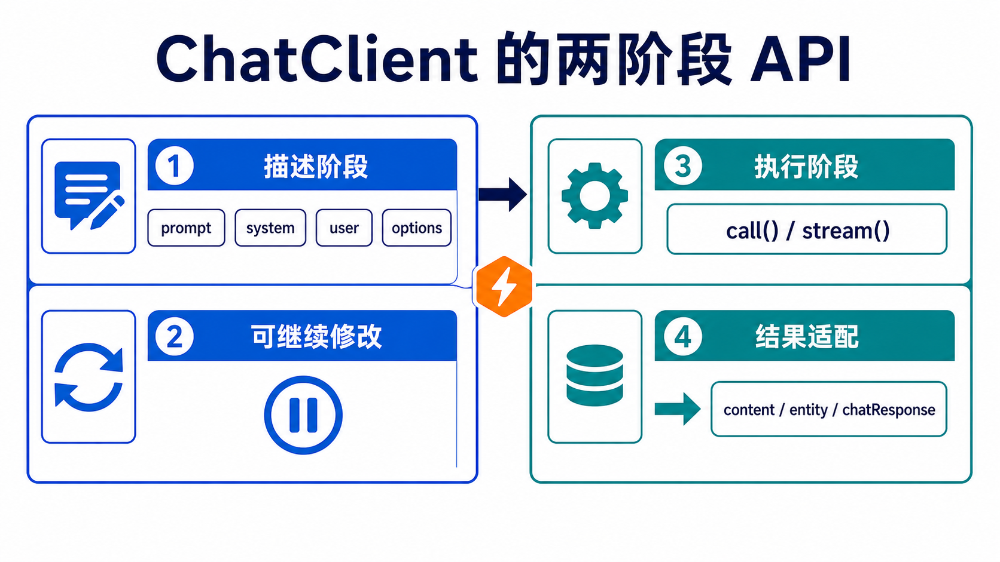
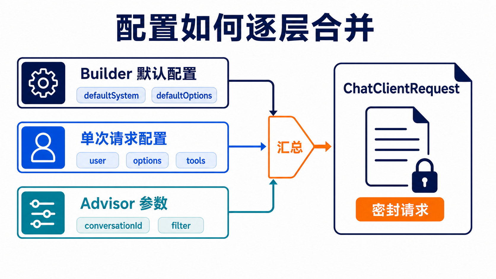
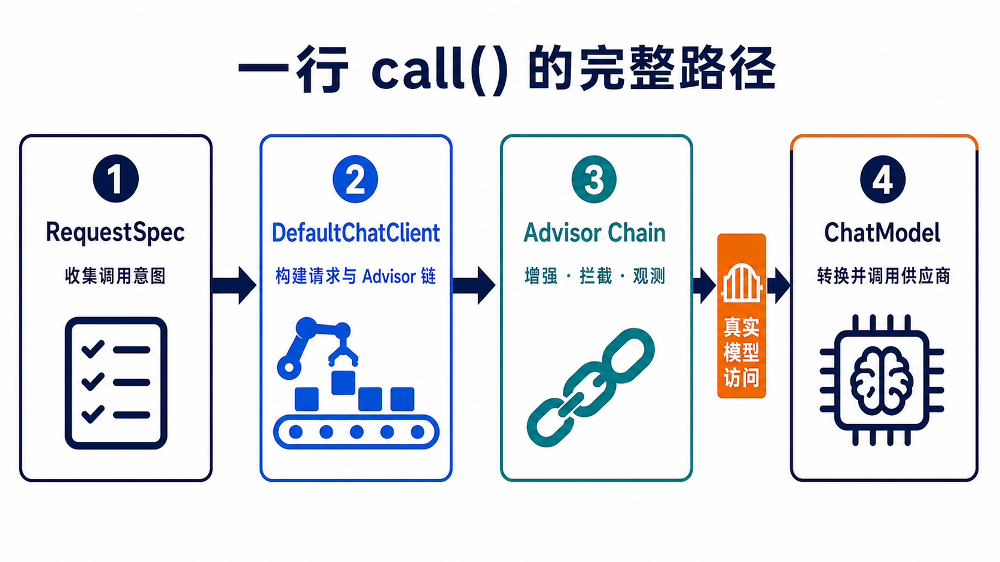
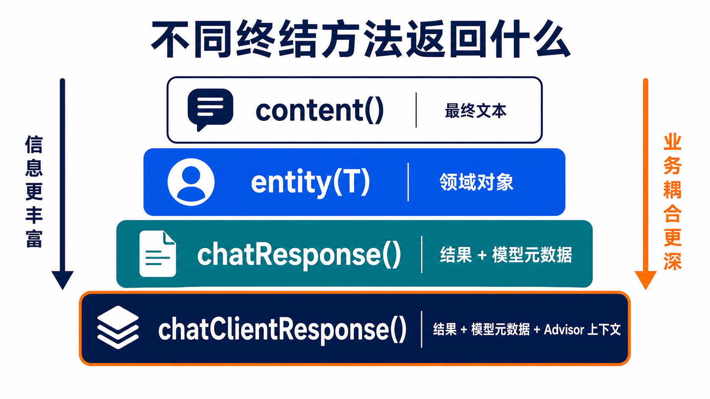

下面这段Spring AI代码，几乎短到看不出框架存在：

```java
String answer = chatClient.prompt()
    .user("解释一下Spring事务失效的常见原因")
    .call()
    .content();
```

直觉上，`.call()`应该是“现在向模型发请求”。但Spring AI 2.0.0官方文档专门提醒：`call()`本身并不真正触发模型执行，它只选择同步路径；实际调用发生在`content()`、`chatResponse()`、`entity()`等终结方法。

这不是一个无关紧要的API细节。它揭示了ChatClient真正的定位：**ChatClient不是ChatModel的短写法，而是一个分阶段的请求编排器。它先收集默认配置和单次意图，再密封请求、运行Advisor链、调用ChatModel，最后按业务需要适配结果。**

下面就沿着这行代码走完一次生命周期。

## ChatModel已经能调用模型，为什么还需要ChatClient？

低层`ChatModel`的职责很直接：

```java
ChatResponse response = chatModel.call(prompt);
```

应用准备完整`Prompt`，模型适配器执行调用，返回`ChatResponse`。如果业务只有一句问题，这已经足够。

但应用级对话通常还要处理：

- 默认System消息和模板变量；
- 单次模型Options；
- 对话记忆、RAG、日志等Advisor；
- 工具与工具上下文；
- 文本、Java实体、模型元数据等不同返回形态；
- 同步调用与流式调用。

如果每个Service都手动组装这些对象，代码很快会退化成重复的“AI请求脚手架”。ChatClient把组装过程拆成流式API，让业务先描述意图，再选择执行和返回形式。

官方文档把ChatClient类比为建立在`ChatModel`之上的高层客户端，类似Spring生态里基于底层能力提供便捷编排的`JdbcClient`、`RestClient`。类比的边界也要说清：ChatClient没有把模型变成确定性数据库，它只是让请求构造和横切能力组合更稳定。

这些默认值和单次值应该放在同一个对象里吗？ChatClient把它们刻意分到不同生命周期。

## Builder、ChatClient和RequestSpec分别保存什么？

创建ChatClient通常有两种方式：

```java
ChatClient client1 = ChatClient.create(chatModel);

ChatClient client2 = chatClientBuilder
    .defaultSystem("你是一名严谨的Java面试官")
    .defaultOptions(defaultOptions)
    .defaultAdvisors(loggingAdvisor)
    .build();
```

在Spring Boot自动配置场景中，框架提供的是`ChatClient.Builder` Bean。官方文档说明它是prototype作用域，注入后可以按业务用途构建不同客户端。

三个对象可以用“预设—成品—草稿”来理解：

1. `ChatClient.Builder`保存客户端级预设，例如默认System/User文本、默认Options、默认Advisor和默认工具；
2. `build()`根据这些预设创建可复用的ChatClient；
3. `chatClient.prompt()`返回一次请求的规格对象，随后`.user()`、`.system()`、`.options()`等调用继续补充本次意图。

这种类比只用于划分生命周期。真正实现并不是把一张可变纸条在多个线程间传来传去；每次`prompt()`都应该被视为一条独立的请求构建链，不要缓存RequestSpec后跨请求共享。

请求规格创建后会立刻访问网络吗？答案是否定的，接下来还有“描述”和“执行”两个阶段。

## 为什么说它是“两阶段API”？

观察下面的代码：

```java
var request = chatClient.prompt()
    .system("只回答Java相关问题")
    .user("volatile能保证复合操作原子性吗？")
    .options(runtimeOptions);

// 到这里仍在描述本次请求
String answer = request.call().content();
```

前半段是在声明消息、选项、Advisor参数和工具；后半段先用`call()`或`stream()`选择执行模型，再用终结方法选择结果形态。



图中有两个容易混淆的节点。

第一，`.call()`与`.stream()`是同步/流式路径的选择器。它们把请求规格转换成相应的响应规格，但官方文档指出，模型调用还未在这一刻发生。

第二，真正的终结点是`.content()`、`.chatResponse()`、`.chatClientResponse()`、`.entity()`等方法。此时已经没有更多请求配置可补，ChatClient才有足够信息执行整条链路。

这和SQL查询构造器有一点相似：先描述查询，再用获取结果的方法执行。不过模型调用还会经过Advisor，可能改写Prompt、注入检索文档、执行工具甚至递归调用，所以运行期行为比普通查询更复杂。

一个实用结果是：调试“为什么没有发请求”时，先看链尾是不是缺了终结方法；调试“为什么返回信息不够”时，则看是不是过早选择了`content()`。

等所有配置收集完，谁来决定它们的优先级和去向？这个问题不能只用“后者覆盖前者”一句话回答。

## 默认配置和单次配置怎样汇合？

设想一个面试题服务。所有请求都需要统一System规则和日志Advisor，只有某个接口要临时调整temperature并传入conversationId。

```java
ChatClient chatClient = builder
    .defaultSystem("你是一名Java面试官，答案必须可验证")
    .defaultOptions(ChatOptions.builder()
        .temperature(0.2)
        .maxTokens(1200)
        .build())
    .defaultAdvisors(loggingAdvisor, memoryAdvisor)
    .build();

String result = chatClient.prompt()
    .user("生成一道关于CompletableFuture的追问题")
    .options(ChatOptions.builder()
        .temperature(0.7)
        .build())
    .advisors(a -> a.param("conversationId", "candidate-42"))
    .call()
    .content();
```



这张图表达的是“在请求密封前汇总”，不是所有配置都采用同一种Map覆盖算法。

- 默认消息与单次消息共同形成最终消息上下文；
- ChatClient的单次Options以增量方式定制默认Options；
- 默认Advisor和请求级Advisor共同进入执行链；
- `.advisors(spec -> spec.param(...))`加入的是Advisor上下文参数，供Memory、RAG等组件读取，不等于把文本直接塞进Prompt；
- 工具、模板渲染器等配置也有各自的组合规则。

因此排查配置时，不要只打印最终Prompt文本。模型参数、Advisor上下文、工具定义可能都在文本之外，却同样改变执行结果。

还有一个边界值得强调：同一个概念在ChatClient与低层ChatModel处可能有不同合并语义。直接调用`ChatModel.call(Prompt)`时，官方文档要求Prompt里的运行时Options作为完整配置整体优先；ChatClient才提供面向调用者的增量式定制。混用这两层心智模型，会产生“默认字段为什么丢了”的问题。

## 终结方法触发后，请求经过哪些节点？

当`.content()`真正触发执行后，可以把主路径简化为四段：

1. 请求规格把消息模板、参数、Options、工具和Advisor配置整理成`ChatClientRequest`；
2. DefaultChatClient创建并启动对应的Call Advisor链；
3. Advisor按顺序处理请求，调用下一个节点，并在返回阶段处理`ChatClientResponse`；
4. 链尾调用`ChatModel`，供应商适配器把通用Prompt转成原生请求，再把原生响应转回`ChatResponse`。



图里最关键的一句话是：**真正访问模型的是Advisor链末端，而不是业务代码眼前的**`.call()`**。**

Advisor使用的是环绕调用模型。Spring AI 2.0.0同步接口可以简化成：

```java
// 简化示意，不是完整源码
interface CallAdvisor {
    ChatClientResponse adviseCall(
        ChatClientRequest request,
        CallAdvisorChain chain
    );
}
```

一个Advisor在调用`chain.nextCall(request)`之前可以增强或替换请求，在调用之后可以观察或包装响应。多个Advisor按`getOrder()`排序：数值小的先处理请求，却最后处理响应，整个结构像一组套在一起的括号。

例如顺序是Memory → RAG → Logger，请求方向依次向里走，响应方向则Logger → RAG → Memory向外返回。若两个Advisor使用相同order，官方文档说明其相对顺序不保证，因此有先后依赖时必须显式设定不同顺序。

Advisor还可以短路：不调用`nextCall`，而是直接返回结果；递归Advisor甚至可以多次进入下游链。于是“一次业务方法调用”不必然等于“一次供应商HTTP请求”，工具调用就是典型反例。

## content、entity和ChatClientResponse该选哪个？

同一条模型响应，ChatClient提供了不同信息密度的出口。



### `content()`：业务只关心文本

它返回最终文本，Controller直接展示回答时最省事。但停止原因、Token用量、多个Generation以及Advisor上下文都会被隐藏。

### `entity(T)`：业务需要领域对象

它用结构化输出转换器把模型文本解析成指定Java类型。适合生成题目、分类结果等场景，但要处理解析失败，并继续做业务校验。

### `chatResponse()`：需要模型级元数据

`ChatResponse`包含Generation和响应Metadata。计费统计、停止原因分析、模型侧信息留档通常需要这一层。

### `chatClientResponse()`：还需要编排上下文

`ChatClientResponse`同时持有`ChatResponse`与ChatClient执行上下文。RAG检索到的相关文档、Advisor附加的数据需要从这一层读取。

Spring AI 2.0.0还提供`responseEntity(...)`，允许同时获取完整`ChatResponse`与转换后的实体。选择规则很简单：**拿满足业务所需的最浅一层，但不要为了省一行代码丢掉必须观测的数据。**

## 哪些生命周期问题最容易在生产暴露？

### 把每次请求的值放进默认配置

用户ID、conversationId、租户过滤条件属于请求级数据。如果在共享ChatClient的默认配置里动态修改，容易形成状态串扰。正确方向是让ChatClient保存稳定预设，把变化值放在每次`prompt()`链路中。

### 误以为一条链只调用模型一次

普通Advisor可能只做一次环绕调用，但Tool Calling、重试、递归Advisor都可能增加模型访问次数。限流、预算和链路追踪应按真实模型调用计数，而不是按Controller请求数估算。

### 只记录最终content

最终字符串看似成功，却可能已经达到Token上限、经历了检索降级，或者由某个Advisor短路返回。生产诊断至少要关联请求ID、模型、耗时、Token用量、停止原因和关键Advisor上下文，同时避免记录敏感Prompt。

### 在Advisor中偷偷执行重阻塞操作

同步链中阻塞会直接增加端到端延迟；流式链还涉及Reactor线程边界。数据库查询、远程检索和工具执行都要有超时、隔离和失败策略，不能因为它们被藏在Advisor里就忽略。

### 把模板变量当成普通文本

ChatClient默认使用模板渲染器处理`.user()`、`.system()`里定义的模板。正文包含JSON花括号时，可能与默认占位符语法冲突。官方文档提供自定义分隔符和`NoOpTemplateRenderer`，遇到JSON模板应明确选择，而不是不断增加转义。

## 面试时怎样复述一次完整调用？

可以这样回答：

Spring AI 2.0.0的ChatClient采用分阶段流式API。Builder保存默认System、Options、Advisor和工具，build后得到可复用客户端；每次prompt()创建请求规格，再叠加单次消息、参数和选项。call()或stream()只选择执行模式，content()、chatResponse()、entity()等终结方法才真正触发调用。随后ChatClient构建ChatClientRequest，按order运行Advisor环绕链，链尾通过ChatModel调用供应商，返回时再经过Advisor，最后适配成业务选择的结果类型。

记忆时抓住四个动词：**预设、累积、执行、适配。**

如果只能再补一句边界，就说：一次ChatClient调用不保证只访问模型一次，Advisor可以短路、重试或递归，所以观测和成本控制要落到真实调用链上。

## 参考资料

- [Spring AI 2.0.0 Reference：Chat Client API](https://docs.spring.io/spring-ai/reference/api/chatclient.html)
- [Spring AI 2.0.0 Reference：Advisors API](https://docs.spring.io/spring-ai/reference/api/advisors.html)
- [Spring AI 2.0.0 Reference：Chat Model API](https://docs.spring.io/spring-ai/reference/api/chatmodel.html)
- [Spring AI 2.0.0 Javadoc：ChatClient](https://docs.spring.io/spring-ai/docs/current/api/org/springframework/ai/chat/client/ChatClient.html)
- [Spring AI 2.0.0 Javadoc：ChatClientRequest](https://docs.spring.io/spring-ai/docs/current/api/org/springframework/ai/chat/client/advisor/api/ChatClientRequest.html)
