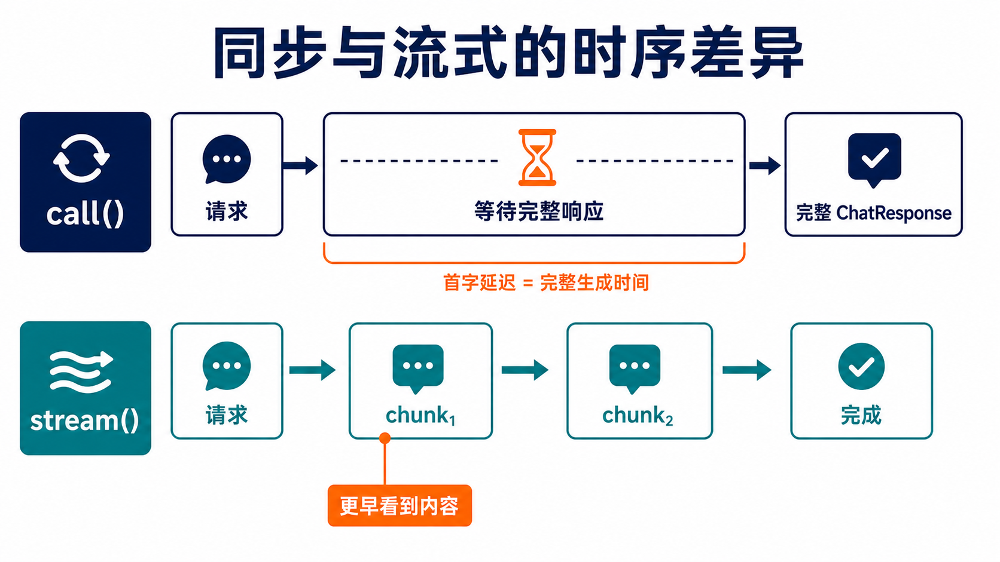
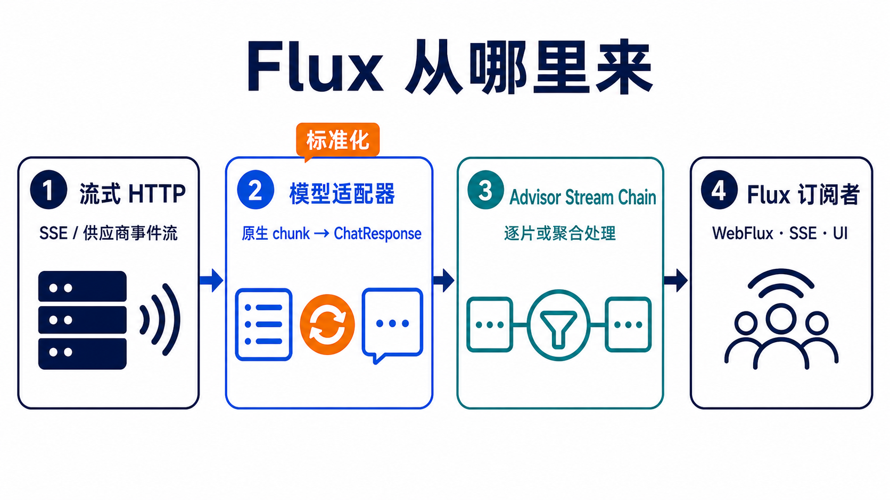
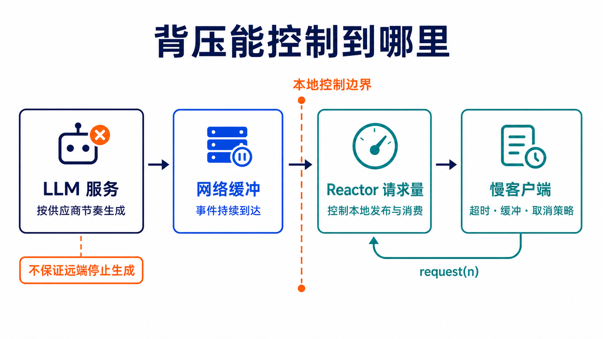
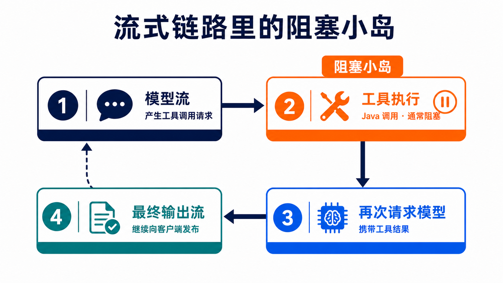

聊天页面上，模型一个字一个字地“打”出答案，用户会觉得它比等待完整结果快很多。

于是最常见的解释是：模型先生成完整字符串，Spring AI再把它切成若干小段返回。

这个解释在多数流式模型调用中恰好把因果关系说反了。**Spring AI 2.0.0的流式路径从供应商事件流开始，经模型适配器转换成**`Flux<ChatResponse>`**，再通过Stream Advisor链交给订阅者；它与同步**`call()`**共享领域对象，却拥有不同的协议、执行时序、取消与阻塞边界。**

所以选择`stream()`不是换一个返回类型那么简单。它会改变用户体验，也会改变服务端的线程模型、错误处理和观测方式。

## 首字为什么更快，完整时间也会更短吗？

先把两个指标分开：

- **首片段延迟**：发出请求到用户看到第一段有效内容；
- **完整响应延迟**：发出请求到全部内容生成完毕。

同步调用等待模型完成生成，再把完整`ChatResponse`交给业务：

```java
ChatResponse response = chatModel.call(prompt);
```

流式调用则在供应商持续产生片段时，逐步发布标准响应：

```java
Flux<ChatResponse> responses = chatModel.stream(prompt);
```



图中流式路径更早出现`chunk₁`，因此首片段延迟通常更低，页面可以提前展示内容。但最后一个chunk何时到达，仍取决于模型生成速度、网络、Advisor和客户端消费。

**流式优化的首先是“等待体验”，不保证减少模型的总生成时间。**某些场景甚至会因为逐片编码、转发和渲染增加应用侧开销，只是这些开销被更早的可见反馈掩盖了。

还要注意一个UI错觉：Spring AI返回的是内容片段，不保证每个片段恰好是一个汉字或一个完整Token。供应商事件可能携带空内容、工具调用增量或元数据；前端不应假设“一次onNext就是一个字”。

## Flux究竟从哪里来？

Spring AI的`StreamingChatModel`接口把流式能力定义为：

```java
// 根据官方接口简化，省略其他方法
interface StreamingChatModel {
    Flux<ChatResponse> stream(Prompt prompt);
}
```

这层通用API隐藏了供应商差异。底层可能是SSE，也可能是供应商自己的流式事件格式。模型适配器读取原生chunk，把文本增量、工具调用增量和元数据转换成Spring AI的`ChatResponse`片段。

随后，ChatClient的流式Advisor链接管标准对象：

```java
// 简化示意，不是完整源码
interface StreamAdvisor {
    Flux<ChatClientResponse> adviseStream(
        ChatClientRequest request,
        StreamAdvisorChain chain
    );
}
```

最终，业务选择自己需要的信息层级：

```java
Flux<String> text = chatClient.prompt()
    .user("解释一下Reactor背压")
    .stream()
    .content();

Flux<ChatResponse> responses = chatClient.prompt()
    .user("解释一下Reactor背压")
    .stream()
    .chatResponse();

Flux<ChatClientResponse> full = chatClient.prompt()
    .user("解释一下Reactor背压")
    .stream()
    .chatClientResponse();
```



这张图的核心是两次边界转换。

第一次发生在模型适配器：供应商原生事件被翻译成通用`ChatResponse`片段。第二次发生在ChatClient出口：业务按需只取文本，或保留模型元数据与Advisor上下文。

Spring AI 2.0.0官方文档还说明，流式只通过Reactive技术栈支持。因此即使整个应用是Spring MVC命令式应用，只要需要模型流式输出，也必须把Reactive栈加入运行环境，并同时关注底层模型实现对`WebClient`的配置。

## `call()`和`stream()`只是返回类型不同吗？

不是。至少有五处运行语义不同。

| 维度 | `call()` | `stream()` |
| --- | --- | --- |
| 模型结果 | 完整`ChatResponse` | `Flux<ChatResponse>`片段 |
| Advisor接口 | `CallAdvisor` | `StreamAdvisor` |
| 响应处理 | 围绕完整值处理 | 逐片处理，或显式聚合后处理 |
| 错误时机 | 方法执行中抛出或包装 | 可能在订阅后的流中发出error信号 |
| 取消 | 普通方法返回后已结束 | 订阅可被取消，并尝试向上游传播 |

同步Advisor可以在`chain.nextCall()`返回后直接查看完整响应。流式Advisor调用`chain.nextStream()`拿到的是Flux，真正的片段在后续到达，因此响应后处理通常写在`map`、`doOnNext`、`doOnComplete`等操作符里。

如果一个流式Advisor想在结束时记录完整回答，不能只看任意一个chunk。官方示例使用`ChatClientMessageAggregator`聚合流，并在完整结果可用时执行只读观察。

聚合也有代价：需要在内存中保存累积内容；如果Advisor在聚合完成前不向下游发布，就会重新引入“等完整答案”的延迟。因此“支持StreamAdvisor”不等于“处理过程天然逐片且无缓冲”。

## 背压能让远端模型慢一点生成吗？

Reactor中的背压表达下游需求：订阅者可以告诉上游自己暂时只能接收多少元素。这个机制对于本地Publisher、队列和操作符非常重要。

但从浏览器到大模型之间，不只有一段Reactor管道：

```latex
LLM服务 → HTTP事件流 → 网络/客户端缓冲 → 模型适配器 → Flux → Web接口 → 浏览器
```

下游减少request数量，能够影响本地发布、缓冲和消费节奏；却不能因此推导出远端模型一定暂停推理。供应商协议是否把流量控制、连接中断和生成取消真正传到模型执行层，取决于HTTP客户端、网络以及供应商实现。



图中蓝色箭头应该理解成“本地需求信号”，不是一根直连模型采样器的刹车线。

因此慢客户端仍需要显式工程策略：

- 设置总超时和长时间无片段的空闲超时；
- 限制可接受的缓冲大小，避免无界积压；
- 客户端断开时取消订阅并释放连接；
- 对每个用户和租户限制并发流数量；
- 记录取消、超时和供应商错误，而不是只统计正常完成。

取消也不保证立刻停止计费。取消信号能否及时中止远端生成、供应商按什么口径计费，都属于具体供应商行为，应查看对应协议并做验证，不能由`Flux.cancel()`这个本地动作直接推出结论。

## 为什么工具调用会让连续输出突然停住？

纯文本流可以近似理解成“模型持续生成，应用持续转发”。加入工具后，链路可能变成多阶段循环：

1. 模型先生成一条工具调用请求；
2. Spring AI解析工具名与参数；
3. Java侧执行数据库查询、HTTP调用或本地函数；
4. 工具结果作为`ToolResponseMessage`加入上下文；
5. 再次请求模型，让它组织最终答案；
6. 最终文本继续流向客户端。



图里的“阻塞小岛”不是说所有工具一定使用阻塞API，而是强调：**模型无法在拿到工具结果之前完成依赖该结果的后续回答。**即便工具内部完全异步，业务因果关系仍要求等待结果。

如果工具实现调用慢数据库，又没有超时，用户看到的现象往往是流到一半停住。若前端只设置“首字超时”，还会误判连接仍然健康。

Advisor也可能制造类似停顿。RAG需要先检索文档；内容安全组件可能聚合完整回答后再判断；日志Advisor若在事件循环线程上执行阻塞I/O，会拖慢所有共享该线程的流。

官方Advisor文档给出的流式实现示例，会把可能阻塞的前置处理调度到`Schedulers.boundedElastic()`。这是一种隔离手段，不是无限线程许可证：有界弹性线程池仍可能被慢任务占满，工具和检索依旧需要超时、并发上限与降级策略。

## 流式错误为什么比同步错误更难处理？

同步代码的失败通常出现在一个明确的调用栈里：

```java
try {
    return chatClient.prompt().user(input).call().content();
}
catch (Exception ex) {
    // 此时还没有把半个答案交给客户端
}
```

流式调用可能已经向用户发送了若干片段，然后才发生网络断开、解析失败、工具超时或供应商限流。HTTP响应头已经发出后，服务端通常不能再改成一个普通JSON错误响应。

因此流式接口需要定义自己的事件协议。例如SSE可以区分：

```latex
event: delta
data: {"text":"事务传播"}

event: error
data: {"code":"UPSTREAM_TIMEOUT","retryable":true}

event: done
data: {}
```

这段只是协议设计示例，不是Spring AI固定格式。重点是让客户端区分“正常结束”“带部分结果失败”“用户取消”和“服务端超时”。

重试也更棘手。同步请求失败后整体重试，用户只看到最终结果；流式输出已经发送一半后重试，可能把前缀重复一遍。除非供应商支持可靠的续传语义，否则常见选择是：

- 首片段前失败：允许有限自动重试；
- 已输出内容后失败：明确通知失败，让用户手动重试；
- 需要强一致结构化结果：优先使用同步调用。

## 什么场景不应该使用stream？

流式并不是更高级的默认答案。

下面几类场景通常更适合`call()`：

- 后端必须拿到完整JSON后才能校验并执行；
- 答案很短，首片段优势不足以覆盖链路复杂度；
- 下游是批处理、消息队列或定时任务，没有人等待屏幕反馈；
- 内容必须经过完整安全审查才能展示；
- 业务事务要求成功或失败整体可见，不能接受半段结果。

而这些场景更适合`stream()`：

- 长文本问答，用户关注首片段反馈；
- 聊天UI、代码解释、写作辅助等可以渐进展示；
- 客户端协议能处理delta、完成、错误和取消事件；
- 服务端已经具备Reactive链路、超时、背压和监控能力。

决定时不要只问“模型支持流式吗”，而要问：

业务是否允许部分结果？首片段反馈是否有价值？整条链能否正确处理取消、错误和慢消费者？

三个答案都比较明确，流式才真正值得。

还可以先做一个很小的验收：同时记录首片段、完整结束、取消和失败四类事件，再用慢客户端主动验证缓冲上限。若只能证明正常答案会逐步显示，却无法证明断开连接后资源会释放、半途失败能被前端识别，那么链路仍不具备生产条件。流式的完成标准不是“看见字符在动”，而是生命周期的每个出口都有明确结果。

## 面试时怎样讲清同步与流式？

可以这样回答：

Spring AI 2.0.0里，ChatModel.call(Prompt)等待完整ChatResponse；stream(Prompt)从供应商事件流开始，由适配器把原生chunk转换成Flux。ChatClient再通过CallAdvisor或StreamAdvisor链处理，并输出文本、ChatResponse或ChatClientResponse。流式通常降低首片段延迟，但不保证缩短完整生成时间。Reactor背压主要控制本地发布和消费，不能保证远端模型暂停；工具调用、RAG和需要聚合完整响应的Advisor还会形成等待点。因此生产上必须处理超时、缓冲、取消、部分结果错误和阻塞隔离。

记住三组对照：**完整值与事件流、完整后处理与逐片处理、本地背压与远端生成。**

如果业务只是为了让页面“看起来在打字”，却没有定义部分失败、取消和慢客户端策略，那不是完成了流式改造，只是把复杂度藏到了线上。

## 参考资料

- [Spring AI 2.0.0 Reference：Chat Model API](https://docs.spring.io/spring-ai/reference/api/chatmodel.html)
- [Spring AI 2.0.0 Reference：Chat Client API](https://docs.spring.io/spring-ai/reference/api/chatclient.html)
- [Spring AI 2.0.0 Reference：Advisors API](https://docs.spring.io/spring-ai/reference/api/advisors.html)
- [Spring AI 2.0.0 Reference：Tool Calling](https://docs.spring.io/spring-ai/reference/api/tools.html)
- [Project Reactor Reference：Backpressure](https://projectreactor.io/docs/core/release/reference/coreFeatures/simple-ways-to-create-a-flux-or-mono-and-subscribe-to-it.html)
- [Reactive Streams Specification](https://www.reactive-streams.org/)
