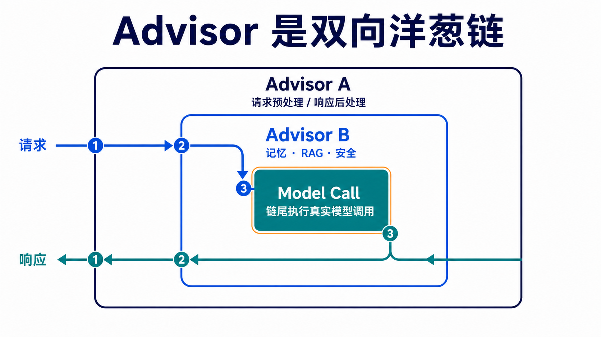
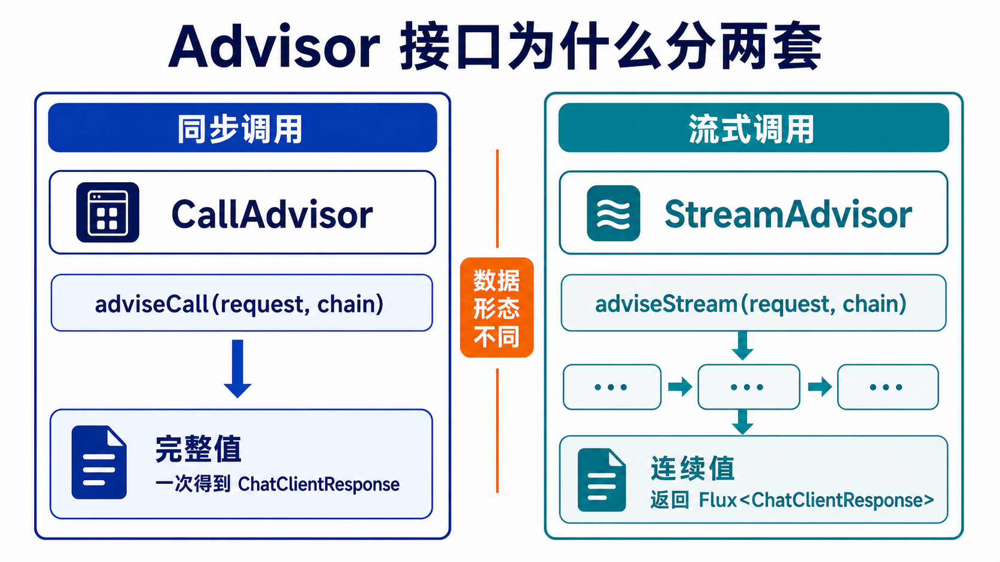
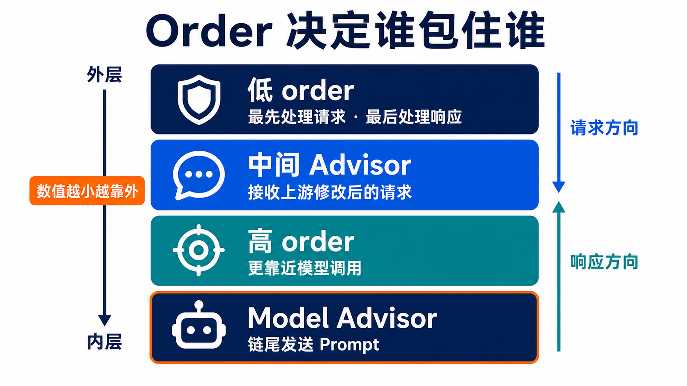
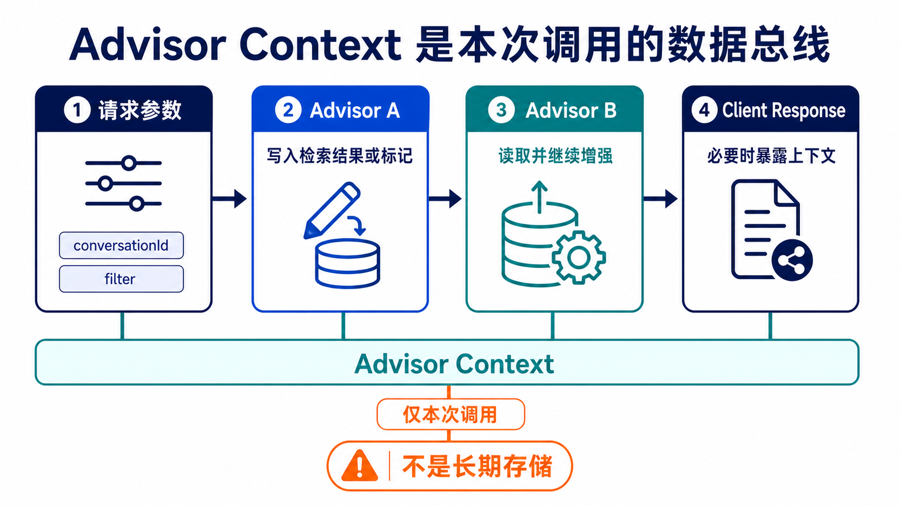

写过 Spring MVC 的人看到 `Advisor`，很容易先想到拦截器：请求来之前做点事，响应回来之后再做点事。

这个理解不能说错，但还不够。因为在 Spring AI 里，Advisor 不只是“围观”一次模型调用。它可以修改 Prompt、读取会话记忆、检索知识库、短路请求，甚至复制剩余调用链并再次请求模型。

于是问题来了：Memory、RAG、安全检查和 Tool Calling 明明是完全不同的能力，为什么都能接到同一个 `ChatClient` 上？多个 Advisor 同时存在时，谁先执行？响应又为什么按相反方向回来？

本文以 **Spring AI 2.0.0** 为基线，沿着一条请求把 Advisor 的接口、顺序、上下文和失败边界拆开。读完后，你应该能解释的不只是“Advisor 使用了责任链模式”，而是**它怎样用一条有序、双向、可复制的调用链，把横切能力组合到模型调用周围**。

## 一、Advisor解决的不是“加日志”，而是统一编排

假设一个客服请求在发送给模型前，需要依次完成四件事：

1. 从会话存储读取历史消息；
2. 根据问题从向量库检索产品资料；
3. 检查输入是否包含禁止内容；
4. 把最终 Prompt 交给 `ChatModel`。

如果这些逻辑全写进业务方法，代码很快会变成一条固定流水线。下一条业务链路想去掉 RAG、换一种 Memory 策略，或者把安全检查移到最外层，就得重新编排。

Advisor 提供的解法是：让每种能力都实现统一的“环绕调用”契约。每个 Advisor 收到当前请求和“剩余链”，先做请求侧工作，再主动调用剩余链，最后处理返回的响应。

**关键不是框架替你依次调用几个回调，而是每个 Advisor 都掌握着“是否继续、以什么请求继续、回来后怎样处理”的决定权。**



上图要抓住两条方向相反的路径。请求从 Advisor A 进入，再到 Advisor B，最终抵达链尾的模型调用；响应则沿 Java 调用栈从里向外返回。外层 Advisor 最先看到请求，却最后看到响应。

可以把它想成给模型调用套了几层包装盒。寄出时从外到内拆盒，寄回时从内到外封盒。不过类比到这里就该停：Advisor 不只是被动包装，它还可以换掉盒内的数据、阻断递交，递归 Advisor 甚至能复制其后的那部分链。

这套抽象带来三个直接结果：

- Memory、RAG、日志和安全检查可以按统一方式注册；
- 能力的组合顺序由 `order` 决定，而不是散落在业务代码里；
- 同一能力既能看到调用前的数据，也能看到调用后的结果。

## 二、为什么同步和流式要分成两套接口？

Spring AI 2.0.0 的公共契约以 `Advisor` 为父接口，它继承 Spring 的 `Ordered`。同步路径使用 `CallAdvisor`，流式路径使用 `StreamAdvisor`。官方 Javadoc 给出的核心签名可以简化为：

```java
// 按 Spring AI 2.0.0 公共接口简化，省略注解和文档
public interface CallAdvisor extends Advisor {
    ChatClientResponse adviseCall(
        ChatClientRequest request,
        CallAdvisorChain chain
    );
}

public interface StreamAdvisor extends Advisor {
    Flux<ChatClientResponse> adviseStream(
        ChatClientRequest request,
        StreamAdvisorChain chain
    );
}
```

这里有两个容易被忽略的细节。

第一，Advisor 处理的不是裸 `Prompt` 和裸 `ChatResponse`，而是 `ChatClientRequest`、`ChatClientResponse`。这让 Advisor 能够操作 ChatClient 层的请求数据和调用上下文，而不必挤进供应商特定的模型实现。

第二，同步接口返回一个完整响应，流式接口返回 `Flux<ChatClientResponse>`。流式响应的前置逻辑可能只执行一次，但响应侧逻辑可能对每个信号执行；订阅、取消、调度和阻塞也都会影响实际行为。



图中左侧的 `CallAdvisor` 面对完整值，适合对最终响应做一次校验或改写；右侧的 `StreamAdvisor` 面对连续值，必须考虑一个回答被拆成多个片段后，自己的逻辑应当逐片处理、聚合后处理，还是只观察终止信号。

因此，“给同步 Advisor 的返回类型外面套一个 Flux”通常不等于正确的流式实现。例如敏感词检查若只检查每个片段，违禁词可能恰好跨两个片段；若先把全部片段聚合再检查，安全性可能更容易保证，却会牺牲首字延迟和真正的流式体验。

官方建议希望同时支持两种调用方式的自定义 Advisor 实现同步与流式两条路径。如果两者共享大量前后处理逻辑，可以研究 `BaseAdvisor`，但仍要明确两种数据形态的差异，而不是假设它们完全相同。

## 三、一次请求是怎样穿过整条链的？

下面用一个简化的计时 Advisor 观察完整过程。代码展示的是公共接口用法，不是 Spring AI 内部源码：

```java
final class TimingAdvisor implements CallAdvisor {

    @Override
    public String getName() {
        return "timing-advisor";
    }

    @Override
    public int getOrder() {
        return 100;
    }

    @Override
    public ChatClientResponse adviseCall(
            ChatClientRequest request,
            CallAdvisorChain chain) {

        long start = System.nanoTime();

        // 请求在这里交给剩余链，最终才会抵达 ChatModel
        ChatClientResponse response = chain.nextCall(request);

        long elapsed = System.nanoTime() - start;
        // 此处可记录耗时，但生产环境不要直接记录敏感 Prompt
        return response;
    }
}
```

当业务代码执行：

```java
String answer = chatClient.prompt()
    .user("退款规则是什么？")
    .advisors(new TimingAdvisor())
    .call()
    .content();
```

概念上的执行顺序如下：

```latex
TimingAdvisor 请求前逻辑
  -> MemoryAdvisor 读取历史并增强请求
    -> RAG Advisor 检索资料并增强请求
      -> ChatModelCallAdvisor 调用模型
    <- RAG Advisor 响应后逻辑
  <- MemoryAdvisor 保存本轮消息
TimingAdvisor 记录整段耗时
```

链尾不是“什么都没有”。在 Spring AI 的实现体系里，`ChatModelCallAdvisor` 负责使用 `ChatModel` 生成同步响应；流式路径则有相应的模型 Advisor。也就是说，模型调用本身也被放在这套链式执行模型的末端。

为什么响应天然反向？因为 `chain.nextCall(request)` 是一个普通的方法调用。内层没有返回之前，外层方法会停在这一行；内层返回后，外层才继续执行后半段逻辑。它和 Servlet Filter、Spring AOP 环绕通知的直觉相近，本质上都是嵌套调用栈产生的“请求正向、响应反向”。

这也解释了短路为什么可行。安全 Advisor 发现输入违规后，可以直接构造响应或抛出受控异常，而不调用 `chain.nextCall`。一旦不把控制权交给剩余链，模型就不会收到请求。

不过，短路不是免费的。外层 Advisor 的响应后逻辑仍可能执行，内层 Advisor 则完全不会执行。监控、审计和异常映射放在哪一层，会直接决定它们是否看得到这次短路。

## 四、order不是美观排序，而是能力边界

所有 Advisor 都继承 `Ordered`。在一条普通链中，**较小的 order 数值更靠外：它更早处理请求，更晚处理响应；较大的数值更靠近模型调用。**



上图把链画成从低 order 到高 order 的路径。假设日志 Advisor 的 order 比 Memory Advisor 小，日志就能看到原始请求，并在最后看到完整响应；如果把日志放到 Memory 内侧，它看到的请求可能已经包含历史消息。

这不是纯粹的风格选择。顺序会改变语义：

- 安全检查放在 RAG 外侧，可以在检索前拒绝明显恶意输入，减少不必要的数据库访问；
- 日志放在 Memory 内侧，可能记录被注入的完整历史，增加敏感信息泄露风险；
- 缓存放在 RAG 外侧，命中时可以跳过检索和模型；放在内侧，缓存键看到的可能是增强后的请求；
- Memory 放在工具调用循环外侧时，只需在循环前加载一次历史，并在结束后保存最终交互。

Spring AI 2.0.0 把 `ToolCallingAdvisor` 做成可递归的 Advisor 后，order 还多了一层含义：它决定谁在递归循环外，谁会被包含在复制的下游子链中。

官方 Javadoc 说明，`CallAdvisorChain.copy(after)` 可以创建一条只包含指定 Advisor 之后节点的链。递归 Advisor 因此能在模型返回工具调用时，重新运行“自己之后”的部分，而不必让所有上游 Advisor 重复执行。

这时最危险的误解是“order 数字随便填，只要不重复即可”。数字即使不重复，语义也可能错。例如计费 Advisor 若处于工具循环外，只会看到一次业务请求；若处于循环内，则可能对每次模型往返都计数。两者都合理，但代表完全不同的指标。

工程上更稳妥的做法是把顺序当成架构设计：

1. 先列出每个 Advisor 需要看到原始数据还是增强数据；
2. 明确它应执行一次，还是每次递归都执行；
3. 明确异常或短路时它是否必须运行；
4. 最后再分配 order，并用集成测试断言调用顺序。

## 五、adviseContext为什么像一条本次调用的数据总线？

复杂编排经常需要在 Advisor 之间共享数据。例如入口层传入 `conversationId`，Memory Advisor 用它读取会话；RAG Advisor 把命中文档写入上下文；日志 Advisor 在响应阶段记录命中文档编号。

Spring AI 的 `ChatClientRequest` 携带 Advisor 上下文。调用方可以通过 Advisor 参数传入值，Advisor 也可以在处理过程中读取或扩充这些状态。



图里的数据从请求参数出发，先后经过多个 Advisor，最终还可以随 `ChatClientResponse` 暴露给调用方。**它更像一次调用内的行李标签，而不是数据库。**

典型调用可以写成：

```java
String answer = chatClient.prompt()
    .user("继续解释刚才的退款例子")
    .advisors(spec -> spec.param(
        ChatMemory.CONVERSATION_ID,
        "tenant-42:conversation-7"
    ))
    .call()
    .content();
```

这里的键值让 Memory Advisor 知道该读取哪组消息。实际项目还可以传元数据过滤条件、租户标识或追踪标记，但要遵守三个边界。

第一，键名是协作契约。两个 Advisor 若碰巧使用同一字符串却期望不同类型，错误可能直到运行时才出现。优先使用框架公开常量或项目统一定义的常量，并在自定义 Advisor 边界做类型检查。

第二，上下文的生命周期应限制在本次请求。不要把它当作跨轮记忆，也不要把大型文档、连接对象或可变全局状态无节制地塞进去。

第三，流式和并发场景要避免共享可变对象。一次调用的上下文本身不等于所有放进去的对象都线程安全。若多个订阅者或异步操作修改同一个集合，仍会产生竞态。

## 六、最常见的失败，不在接口而在组合

Advisor 单独看往往很简单，问题通常在多个 Advisor 叠加后出现。

### 1. 忘记调用剩余链

自定义 Advisor 在正常路径中没有调用 `nextCall` 或 `nextStream`，模型请求就会被短路。如果这是安全拦截，它是设计；如果只是写日志，就是缺陷。测试时要同时覆盖“允许通过”和“主动短路”两条路径。

### 2. 同步代码堵住流式链

在 `adviseStream` 里直接执行 JDBC、文件读取等阻塞操作，会占住响应式线程。官方示例会用 Reactor 调度器把可能阻塞的前置工作切到合适线程，但这也不是万能修复：线程切换、上下文传播和取消都需要一起验证。

### 3. 顺序造成敏感数据扩散

把日志 Advisor 放在 Memory 或 RAG 增强之后，可能把历史对话、检索原文甚至工具结果写进日志。可观测性不是“打印得越全越好”，生产环境应默认脱敏，并区分低基数指标与高敏感内容。

### 4. 重复注册语义相同的能力

两个 Memory Advisor 可能重复注入历史，两个 RAG Advisor 可能重复追加上下文。Spring AI 对工具 Advisor 有专门的标记与约束，但普通自定义 Advisor 的语义冲突仍要由应用负责。

### 5. 把异常吞成看似正常的答案

Advisor 捕获所有异常后返回“系统繁忙”，确实能让接口不报错，却可能让重试、熔断和监控都失去真实信号。更好的做法是只转换已知异常，同时保留原因、追踪标识和可观测状态。

还有一个重要边界：Advisor 是 `ChatClient` 层的编排机制，不等于模型供应商已经支持同样的原生能力。Advisor 可以统一请求前后处理，但无法抹平模型上下文窗口、工具协议、流式粒度和安全策略的供应商差异。

## 七、面试时怎样把Advisor讲清楚？

如果面试官问“Spring AI Advisor 的原理是什么”，可以先用这段话回答：

Spring AI 2.0.0 的 Advisor 是围绕 `ChatClient` 调用建立的有序双向责任链。同步路径由 `CallAdvisor` 处理完整的 `ChatClientRequest/Response`，流式路径由 `StreamAdvisor` 处理 `Flux`。请求按 order 从小到大进入，每个 Advisor 可修改请求、短路，或调用剩余链；响应沿调用栈反向返回。Advisor Context 用于在本次调用内共享状态。递归 Advisor 还能复制自身之后的子链，所以 Tool Calling 可以只重放循环内部的能力。

如果继续追问“order 为什么重要”，不要只说“决定先后顺序”，而要补上：

order 同时决定谁能看到原始或增强后的请求、谁在短路或异常时仍能运行，以及谁处于递归工具循环的内外侧。因此它是行为边界，不只是排序配置。

回到开头的问题：Memory、RAG 和 Tool 能插进同一次调用，并不是因为它们本质相同，而是因为它们都可以表达成“拿到当前请求和剩余链，做前置增强，决定是否继续，再处理返回结果”。

最后记住三点：

1. **Advisor 是环绕调用，不是两个互不相关的前后回调。**
2. **order 决定嵌套关系，也决定数据、异常和递归的可见范围。**
3. **Context 只承载本次调用协作状态，长期记忆和完整审计应交给专门存储。**

排查 Advisor 组合问题时，最有效的动作不是先读所有实现，而是画出一条链：标明每个节点的 order、请求侧变化、响应侧变化、短路条件和是否处于递归范围。大多数“为什么执行两次”或“为什么看不到上下文”的问题，会在这张图上直接暴露。

## 参考资料

- [Spring AI 2.0.0 Reference：Advisors API](https://docs.spring.io/spring-ai/reference/api/advisors.html)
- [Spring AI 2.0.0 Javadoc：Advisor](https://docs.spring.io/spring-ai/docs/current/api/org/springframework/ai/chat/client/advisor/api/Advisor.html)
- [Spring AI 2.0.0 Javadoc：CallAdvisor](https://docs.spring.io/spring-ai/docs/current/api/org/springframework/ai/chat/client/advisor/api/CallAdvisor.html)
- [Spring AI 2.0.0 Reference：Tool Calling](https://docs.spring.io/spring-ai/reference/api/tools.html)
