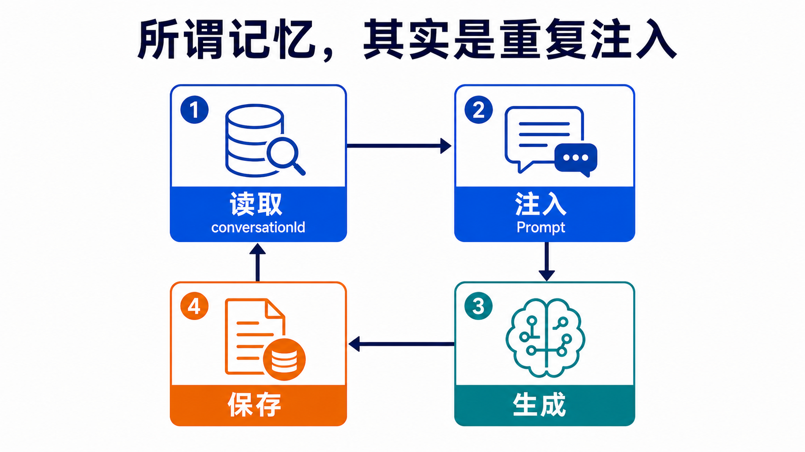
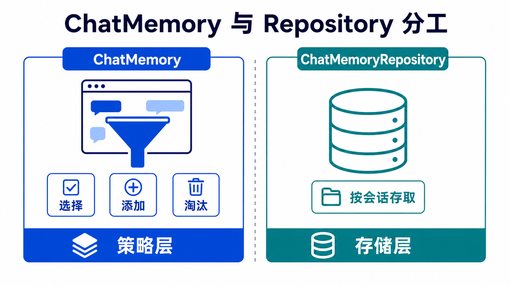
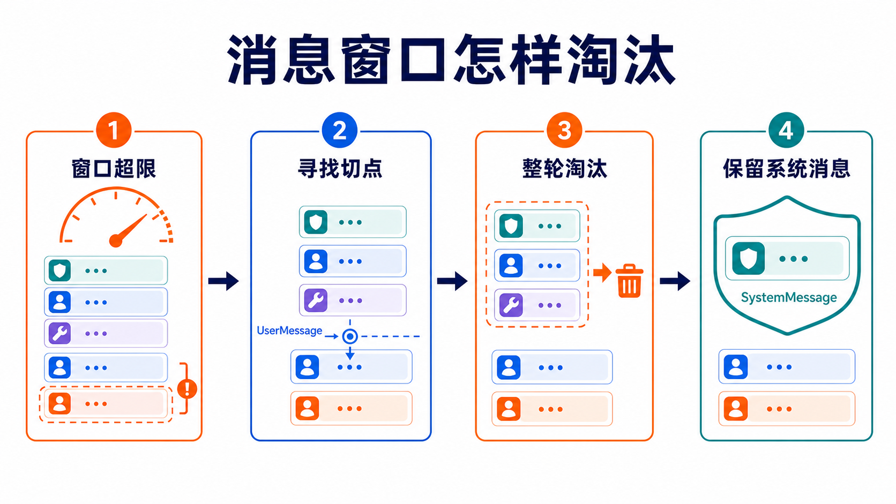
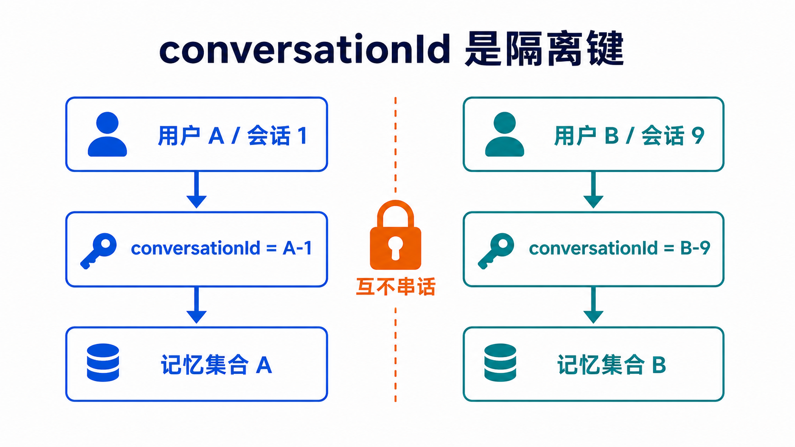

你先对聊天机器人说：“我叫小周，准备去上海出差。”

下一轮只问：“那边明天冷不冷？”

模型如果能理解“那边”是上海，看起来就像真的记住了上一轮。可官方文档又说，大语言模型本身是无状态的。两句话似乎矛盾：没有状态，记忆从哪里来？

答案其实没有玄学。**Spring AI 没有把模型改造成有状态服务，而是在每次调用前按** `conversationId` **读取相关消息，重新注入 Prompt，模型生成后再保存本轮消息。**“记住”是应用重复提供上下文产生的效果。

本文以 **Spring AI 2.0.0** 为基线，拆开 `ChatMemory`、`ChatMemoryRepository`、`MessageWindowChatMemory` 和 Memory Advisor 的分工。重点不是背配置，而是解释消息何时读取、怎样淘汰、如何隔离，以及为什么 Chat Memory 不能直接等同于完整聊天记录。

## 一、模型的“记得”，本质是每轮重新阅读

先做一个思想实验。假设第二次请求只向模型发送：

```latex
用户：那边明天冷不冷？
```

输入里没有上海，也没有小周。模型最多只能猜“那边”指哪里，不能可靠地从一次已经结束、又没有重新提供的调用中恢复信息。

若应用把请求改成：

```latex
用户：我叫小周，准备去上海出差。
助手：好的，小周。
用户：那边明天冷不冷？
```

指代关系就重新出现在当前上下文中。模型仍然只执行本轮推理，却能依据历史消息给出连贯回答。



上图展示了完整循环：应用先按 `conversationId` 读取记忆，再把历史消息并入 Prompt；模型完成一次无状态生成；最后把新的用户消息和回答保存起来，为下一轮做准备。

这里有一个很实用的判断方法：**如果某条信息没有进入本轮 Prompt，也没有通过模型供应商提供的其他状态机制可见，就不要期待模型“自己想起来”。**

这也说明 Chat Memory 并不等于模型训练。保存一条消息不会修改模型权重，不会让其他用户共享这条知识，也不保证很久以后仍保留。它只是应用侧上下文管理。

## 二、为什么要把Memory和Repository拆成两层？

Spring AI 官方文档明确区分两类职责：

- `ChatMemory` 决定哪些消息对当前对话有用、何时添加、何时移除；
- `ChatMemoryRepository` 只负责按会话存储和读取消息。



图左是策略层。它可以采取固定消息窗口、Token 上限、摘要等策略；图右是存储层，它关心的是数据放在内存、JDBC、Cassandra、Neo4j、MongoDB 还是 Redis。

为什么不直接把数据库 DAO 叫作 Memory？因为“存得下来”和“应该给模型看什么”是两个不同问题。

数据库可以保存十万条历史记录，但模型上下文窗口有限，输入越长还会带来更高成本和噪声。反过来，Memory 策略可能只保留最近十条消息，却仍然需要可靠持久化，以便服务重启或请求落到另一实例时继续对话。

可以用一段简化对象图理解：

```latex
MessageChatMemoryAdvisor
        |
        v
    ChatMemory                 决定保留和淘汰
        |
        v
ChatMemoryRepository          负责按 conversationId 存取
        |
        +-- InMemory
        +-- JDBC
        +-- Cassandra / Neo4j / MongoDB / Redis
```

Spring AI 2.0.0 默认自动配置的策略实现是 `MessageWindowChatMemory`，默认存储是 `InMemoryChatMemoryRepository`；如果应用已经配置其他 Repository，自动配置会使用它。

手动组装时可以写成：

```java
ChatMemoryRepository repository =
    new InMemoryChatMemoryRepository();

ChatMemory memory = MessageWindowChatMemory.builder()
    .chatMemoryRepository(repository)
    .maxMessages(20)
    .build();
```

这段代码最值得注意的不是 Builder，而是依赖方向：窗口 Memory 使用 Repository，Repository 不反过来理解窗口策略。于是你可以保留同一淘汰逻辑而更换数据库，也可以保留同一数据库而实现新的 Memory 策略。

## 三、MessageWindowChatMemory真的只是“删最老消息”吗？

直觉上，`maxMessages(20)` 像一个最多放 20 条记录的队列：第 21 条进来，就删第 1 条。

Spring AI 2.0.0 的行为更谨慎。官方文档说明，`MessageWindowChatMemory` 超限时会保留 `SystemMessage`，并按完整对话轮次推进淘汰切点，避免从一个工具调用往返的中间截断。



图中的四步是：窗口超限、寻找安全切点、整轮淘汰、保留系统消息。一个“轮次”从 `UserMessage` 开始，包含其后的助手回复、工具调用和工具响应，直到下一个 `UserMessage`。

假设消息序列是：

```latex
System: 你是售后助手
User: 查询订单 A
Assistant: 请求调用 getOrder
Tool: 订单 A 已发货
Assistant: 订单已经发货
User: 能否改地址？
```

如果原始数量切点恰好落在 `Tool` 前后，机械地删除最老 N 条会留下半段工具交互。下一轮模型可能看到工具结果，却不知道是谁、为什么调用了工具。

2.0.0 的轮次边界淘汰会把切点向前推进到下一个 `UserMessage`，让保留窗口从完整一轮开始。这意味着 `maxMessages` 是上限，不保证窗口总能恰好装满；为了保持语义完整，实际保存数量可能更少。

系统消息还有特殊规则。窗口淘汰会尽量保留 `SystemMessage`；当新的系统消息加入时，旧的系统消息会被移除，确保最新行为约束生效。不要因此把系统消息当作永不丢失的业务数据库：它仍是给模型的上下文组成部分，不是审计凭据。

还有一个边界很容易踩中：如果 `maxMessages` 小于一次典型的完整工具调用轮次，淘汰时可能移除所有非系统消息，直到新的 `UserMessage` 加入。窗口值不应凭感觉设成 5 或 10，而应根据真实会话中“最长代表性轮次”评估。

消息数上限也不等于 Token 上限。一条消息可能只有“好的”，也可能塞进几万字工具结果。`MessageWindowChatMemory` 解决的是消息数量边界，不保证一定不会超过模型上下文窗口。

## 四、Memory Advisor怎样把历史插回ChatClient？

`ChatMemory` 只是存取与策略抽象，它不会凭空参与每次 `ChatClient` 调用。真正把记忆接入请求链的是 Memory Advisor。

最常见的配置是：

```java
ChatMemory chatMemory = MessageWindowChatMemory.builder()
    .maxMessages(20)
    .build();

MessageChatMemoryAdvisor memoryAdvisor =
    MessageChatMemoryAdvisor.builder(chatMemory).build();

ChatClient chatClient = ChatClient.builder(chatModel)
    .defaultAdvisors(memoryAdvisor)
    .build();
```

一次调用再传入会话 ID：

```java
String answer = chatClient.prompt()
    .user("继续解释刚才那个例子")
    .advisors(spec -> spec.param(
        ChatMemory.CONVERSATION_ID,
        "tenant-42:conversation-7"
    ))
    .call()
    .content();
```

按同步调用路径简化，`MessageChatMemoryAdvisor` 会做四件事：

1. 从 Advisor Context 读取 `conversationId`；
2. 通过 `ChatMemory` 取回对应消息；
3. 把历史作为消息集合加入本次 Prompt；
4. 模型返回后，把新交互写回 Memory。

这里“作为消息集合加入”很关键。历史不是简单拼成一大段用户文本；消息角色仍然保留，模型能区分用户、助手和系统消息。`VectorStoreChatMemoryAdvisor` 则是相邻但不同的实现思路，它从 VectorStore 找相关记忆，并把内容增强到系统文本中。

Memory Advisor 默认处在 Tool Calling 循环外侧。Spring AI 2.0.0 官方文档给出的默认顺序中，Memory Advisor 的优先级位置早于 `ToolCallingAdvisor`：它在进入工具循环前加载一次历史，在循环结束后只保存最终用户/助手交互；工具调用循环中的中间消息由 `ToolCallingAdvisor` 自己维护。

这样做的好处是大多数 Repository 不必完整支持工具调用消息，也不会让一次工具循环的每个中间步骤反复触发 Memory Advisor。代价是：默认记忆中看不到完整工具过程。若业务需要审计工具参数与结果，应单独记录，或采用官方用户控制工具执行方案，而不是假设默认 Chat Memory 已保存一切。

## 五、conversationId怎样隔离用户和会话？

一套 Memory 可以服务许多会话，区分它们的核心键就是 `conversationId`。



图左的 `A-1` 只能读取记忆集合 A，图右的 `B-9` 只能读取集合 B。只要 ID 选择正确，同一存储中的消息不会在查询时混为一组。

但“有一个 conversationId 参数”不等于自动实现了安全隔离。下面几种生成方式都有风险：

```latex
conversationId = "default"        // 所有人共用，必然串话
conversationId = userInput        // 用户可能猜中或伪造他人会话
conversationId = conversationNo   // 若只在单租户内唯一，跨租户可能冲突
```

更稳妥的设计通常把已认证身份和服务端生成的会话标识绑定，例如：

```latex
tenantId + ":" + authenticatedUserId + ":" + serverConversationId
```

真正访问前还要校验当前身份是否拥有该会话。前缀组合只是降低冲突概率，不能代替授权。

在多实例部署中，默认内存 Repository 还有一个物理边界：消息只在当前进程内。第一次请求落到实例 A，第二次落到实例 B，即使 `conversationId` 相同，B 也可能读不到 A 的内存数据。生产环境需要共享持久化 Repository，或者明确配置会话黏性；服务重启后要保留记忆，也不能只用内存实现。

并发同一会话同样需要设计。用户快速提交两条消息时，两次调用可能读取到同一旧窗口，各自生成并写回，最终顺序取决于存储和应用协调。`conversationId` 解决“属于哪组”，不自动保证跨请求串行、事务隔离或业务顺序。

## 六、Chat Memory为什么不能当完整Chat History？

官方文档专门区分了 Chat Memory 和 Chat History：

- Chat Memory 是为了让模型维持当前上下文而挑选的相关信息；
- Chat History 是用户与模型交换过的完整记录。

两者目标不同。Memory 为推理效果、上下文长度和成本服务，所以允许淘汰、摘要或只召回相关消息；History 为审计、客服回放、合规或产品展示服务，通常要求完整、不可随窗口策略悄悄丢失。

因此，一个成熟系统常见的是双写：

```latex
业务聊天记录库：保存完整事件，用于展示、审计和追溯
ChatMemory：保存或选取下一轮模型真正需要的上下文
```

不要从 `MessageWindowChatMemory` 反推“历史一共有多少条”，也不要因为换了 Memory 策略而改变合规记录。

Spring AI 2.0.0 还有一个具体存储边界值得注意：官方文档说明 `JdbcChatMemoryRepository` 不支持工具调用消息，保存时会过滤包含工具调用的 `AssistantMessage` 和 `ToolResponseMessage`。与此同时，默认 Memory Advisor 位于工具循环外侧，只持久化最终交互，因此常规组合仍可工作。

如果你把 Memory Advisor 调到工具循环内，或直接往 JDBC Repository 写工具消息，就不能沿用“所有消息都会原样保存”的假设。版本升级时还要关注数据库迁移：2.0.0 的 JDBC schema 增加了用于消息排序的 `sequence_id` 列，已有库需要按升级说明迁移，而不是只替换依赖。

## 七、哪些失败会让机器人“突然失忆”或“莫名串话”？

### 1. 每次请求使用不同conversationId

前端新建一个随机 ID，却没有在后续请求复用，Memory 每次都读到空集合。表现是第一轮正常，第二轮立刻失忆。应在服务端日志或追踪信息中记录脱敏后的会话标识，确认连续请求是否一致。

### 2. 所有请求使用同一个默认ID

这是比失忆更严重的串话。不同用户共享同一集合，历史被互相注入。必须把身份校验放在会话 ID 解析之前，并写跨租户隔离测试。

### 3. 窗口按消息数够大，按Token却超限

工具返回大段 JSON 或 RAG 原文，一两条消息就可能耗尽上下文。解决方向不是无脑增大 `maxMessages`，而是限制工具结果、做摘要、按 Token 管理或把长期事实提取到专门存储。

### 4. 把模型回答当成可信事实写入长期记忆

模型可能产生幻觉。若把“用户地址是北京”这种未经确认的推断永久保存，错误会在后续轮次不断被重新注入。长期用户画像应区分用户明确提供、系统验证和模型推断，并允许更正、过期和删除。

### 5. 删除会话只清Memory，不清业务副本

如果系统同时维护 Chat History、向量记忆、缓存和监控日志，只调用 `ChatMemory.clear(conversationId)` 不代表所有副本都被删除。隐私删除应有完整数据清单和统一流程。

### 6. 系统提示词混进普通历史

系统规则的生命周期通常由应用版本和安全策略控制。若把临时或旧版本系统消息无区分地恢复，可能覆盖当前约束。应明确系统消息由谁生成、何时更新，并验证“新系统消息替换旧系统消息”的行为符合预期。

## 八、面试时怎样复述Chat Memory？

如果面试官问“无状态模型为什么能多轮对话”，可以这样回答：

大模型的一次推理仍然是无状态的。Spring AI 通过 Memory Advisor 在每轮请求前，从 `ChatMemory` 按 `conversationId` 读取相关消息并注入 Prompt；模型生成后，再把本轮交互写回。因此连续感来自应用重复提供上下文，不是模型跨请求保存了 Java 会话状态。

若追问 `ChatMemory` 与 `ChatMemoryRepository` 的区别：

`ChatMemory` 是策略层，决定保留哪些消息和何时淘汰；`ChatMemoryRepository` 是存储层，负责按会话存取。Spring AI 2.0.0 默认使用 `MessageWindowChatMemory`，默认窗口 20 条消息，超限时保留系统消息并按完整轮次推进淘汰切点。

若追问生产风险，再补三点：

1. `conversationId` 必须和认证身份绑定，避免跨租户串话；
2. Memory 不是完整 Chat History，审计记录要单独持久化；
3. 消息数不等于 Token 数，工具结果、并发会话和 Repository 能力都要单独评估。

回到开头：模型之所以知道“那边”是上海，不是因为它在某个隐秘角落记住了小周，而是应用在第二次请求中又把相关历史摆到了它面前。

排查“失忆”问题时，可以沿四个点检查：**ID 是否一致、历史是否读出、消息是否注入、写回是否成功。**这比先调温度、换模型或增大窗口更接近真正原因。

## 参考资料

- [Spring AI 2.0.0 Reference：Chat Memory](https://docs.spring.io/spring-ai/reference/api/chat-memory.html)
- [Spring AI 2.0.0 Reference：Chat Client API](https://docs.spring.io/spring-ai/reference/api/chatclient.html)
- [Spring AI 2.0.0 Javadoc：Chat Memory Package](https://docs.spring.io/spring-ai/docs/current/api/org/springframework/ai/chat/memory/package-summary.html)
- [Spring AI 2.0.0 Reference：Tool Calling Conversation History](https://docs.spring.io/spring-ai/reference/api/tools.html#_conversation_history_management)
