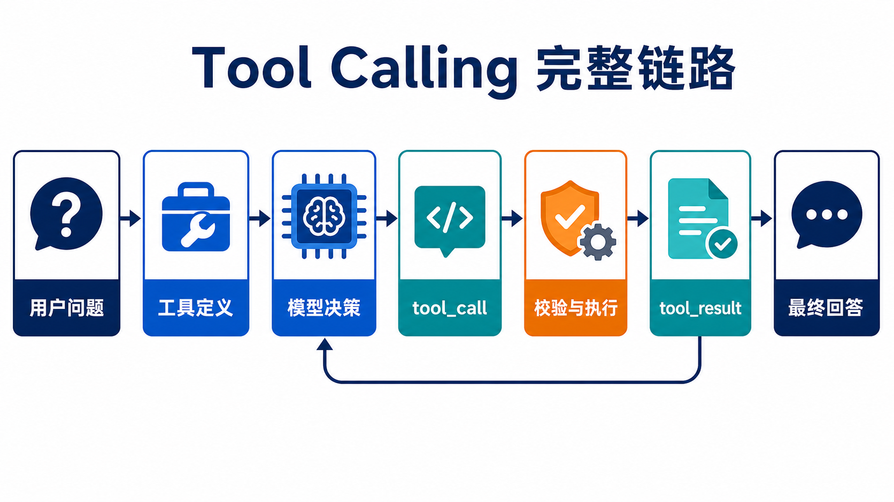
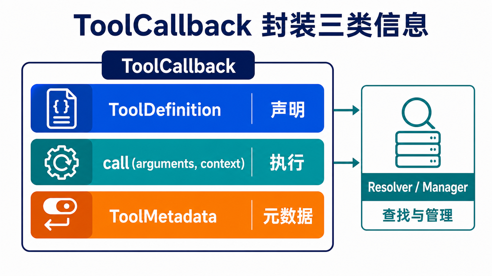
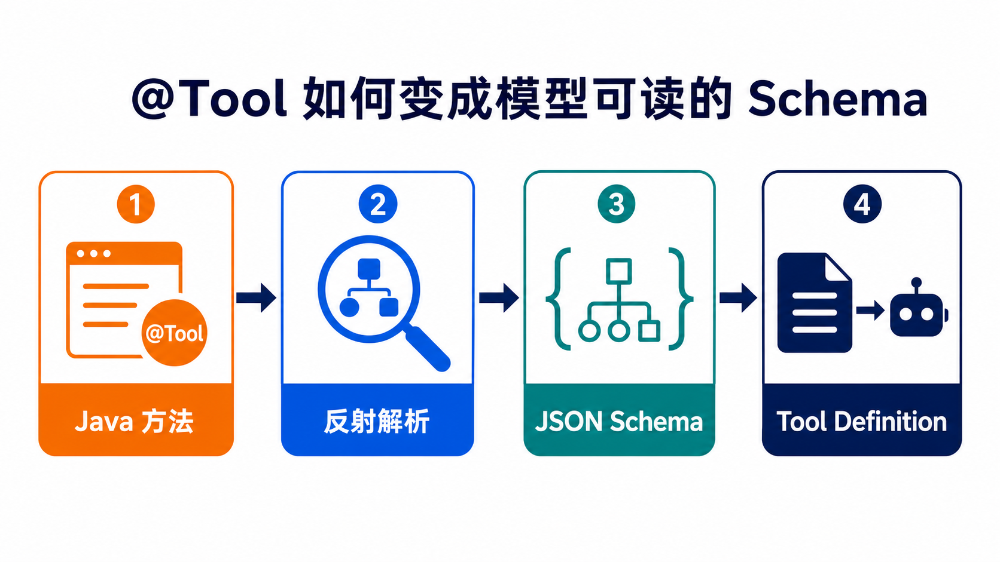
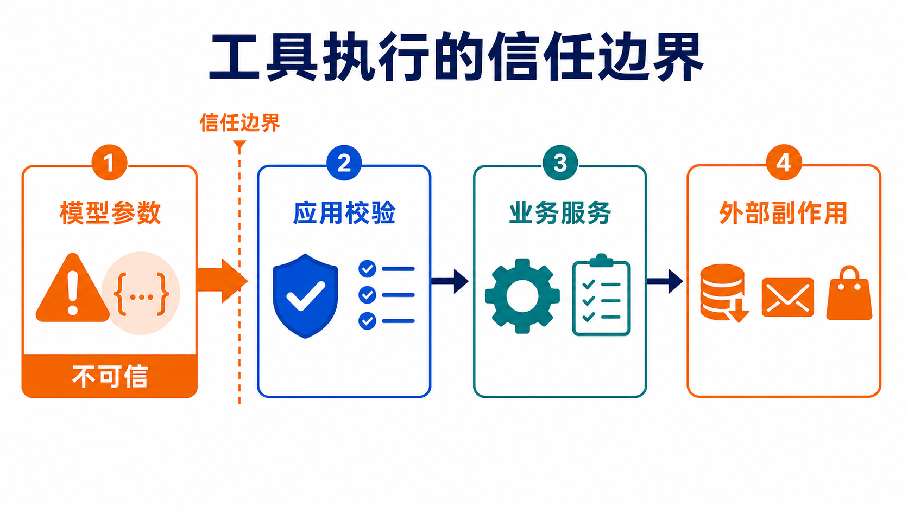

给模型注册一个 `getWeather` 方法后，你问：“上海明天要带伞吗？”

最终页面可能直接出现天气建议。整个过程流畅得像模型真的进入 JVM、找到对象并调用了 Java 方法。

但模型既拿不到 Spring 容器，也不能操作你的方法引用。它能做的只是根据工具描述，生成一份结构化的“调用意图”：调用哪个工具、参数是什么。查找工具、绑定参数、执行方法、捕获结果，再把结果送回模型，全部发生在应用侧。

**Tool Calling 的关键不是让模型获得执行权，而是建立一段受应用控制的协议往返：模型负责选择，Spring AI 负责解析和编排，Java 代码负责真正执行。**

那这段往返里，模型、框架和业务代码的责任边界究竟画在哪里？

本文以 **Spring AI 2.0.0** 为基线，从工具定义、`ToolCallback`、`@Tool` Schema 生成一路追踪到方法执行，并重点说明：参数符合 JSON Schema 为什么仍不代表安全，工具调用成功为什么也不一定得到正确答案。

## 一、究竟是谁调用了Java方法？

Spring AI 官方文档把一次 Tool Calling 拆成六步：

1. 应用把工具名称、描述和输入 Schema 随聊天请求发送给模型；
2. 模型决定是否使用工具，并返回工具名与参数；
3. 应用根据名称定位工具；
4. 应用执行工具并处理结果；
5. 应用把工具结果作为新消息发回模型；
6. 模型根据工具结果生成最终自然语言回答。



图中真正跨过模型边界的不是 Java 方法，而是两类数据：向前发送的工具定义，以及向后返回的工具调用请求。Java 方法始终留在应用进程里。

以天气工具为例，第一次模型请求在概念上接近：

```json
{
  "messages": [
    {"role": "user", "content": "上海明天要带伞吗？"}
  ],
  "tools": [
    {
      "name": "getWeather",
      "description": "查询指定城市和日期的天气",
      "inputSchema": {
        "type": "object",
        "properties": {
          "city": {"type": "string"},
          "date": {"type": "string"}
        },
        "required": ["city", "date"]
      }
    }
  ]
}
```

不同模型供应商的原生字段并不完全一样，上面只是帮助理解的简化示意。Spring AI 的模型适配器会把通用工具定义映射到供应商协议。

模型若认为需要查询，返回的也不是天气，而是类似：

```json
{
  "toolName": "getWeather",
  "arguments": {
    "city": "上海",
    "date": "2026-07-26"
  }
}
```

应用执行后得到“阵雨，25—31℃”，再把工具结果交给模型。第二次模型调用才把结构化结果整理成“建议带伞”的自然语言。

所以一次用户请求可能触发多次模型请求。Tool Calling 不是“模型响应里夹一次本地函数”，而是一个可以反复发生的选择—执行—回传循环。Spring AI 2.0.0 使用 `ChatClient` 时，由自动注册的 `ToolCallingAdvisor` 管理这个生命周期，真正的工具执行通过 `ToolCallingManager` 组织。

## 二、ToolCallback为什么是核心抽象？

模型要使用工具，应用至少要同时解决三个问题：

- 告诉模型这个工具叫什么、能做什么、参数长什么样；
- 模型选中后，能在应用里找到可执行逻辑；
- 定义工具结果是否直接返回等执行语义。

Spring AI 用 `ToolCallback` 把这些部分收拢到一个可注册对象中。

为什么不能只保存一个 Java `Method`，需要多出这一层抽象？



上图左上是 `ToolDefinition`，提供名称、描述、输入 Schema；右上是 `ToolCallback.call(...)`，接收模型参数并执行；左下是 `ToolMetadata`，承载 `returnDirect` 等执行语义；右下的 Resolver 和 Manager 分别负责按名字定位工具、管理执行流程。

官方文档给出的接口核心可以简化为：

```java
public interface ToolCallback {

    ToolDefinition getToolDefinition();

    ToolMetadata getToolMetadata();

    String call(String toolInput);

    String call(String toolInput, ToolContext toolContext);
}
```

`ToolDefinition` 面向模型，`call` 面向应用执行，`ToolMetadata` 面向框架编排。三者放在一起，才构成一个完整工具。

Spring AI 提供了多种构造来源：

- `@Tool` 把普通方法声明成工具；
- `MethodToolCallback` 以编程方式包装方法；
- `FunctionToolCallback` 包装 `Function`、`Supplier`、`Consumer` 等函数；
- MCP Client 也可以把远程 MCP 工具适配成 `ToolCallback`。

这说明 `ToolCallback` 不是“反射调用专用接口”。它是模型工具在 Spring AI 中的统一端口，底层执行既可以是本地方法，也可以是远程服务。

工具既可以直接传给本次 `ChatClient` 调用，也可以通过 `ToolCallbackResolver` 按名称动态解析。Spring Boot 自动配置会基于上下文中的 `ToolCallback` Bean 提供静态解析能力。无论哪种方式，工具名都必须能稳定、唯一地定位执行对象。

工具描述同样不是注释装饰。模型选择工具时主要依赖名称、描述和参数 Schema。若同时存在 `findOrder`、`searchOrder`、`queryOrder`，三者描述几乎一样，模型很难知道边界。好的描述应明确用途、必要前提和不适用场景，而不是写“用于查询订单”就结束。

## 三、`@Tool`怎样变成模型可读的JSON Schema？

最短的声明方式是给方法加 `@Tool`：

```java
class WeatherTools {

    @Tool(description = "查询指定城市和日期的天气；日期格式为 yyyy-MM-dd")
    WeatherResult getWeather(
            @ToolParam(description = "城市名称，例如上海") String city,
            @ToolParam(description = "查询日期，格式为 yyyy-MM-dd") String date) {

        return weatherService.query(city, LocalDate.parse(date));
    }
}
```

调用时注册对象：

```java
String answer = chatClient.prompt()
    .user("上海明天要带伞吗？")
    .tools(new WeatherTools())
    .call()
    .content();
```

`.tools(...)` 并不是把对象序列化后发送给模型。Spring AI 会检查被 `@Tool` 标记的方法，读取工具名称、描述、方法参数类型和参数说明，构造方法型 `ToolCallback`，再为参数生成模型可理解的 JSON Schema。



上图的路径是：Java 方法提供注解、方法名和类型；反射解析得到字段及描述；Schema 生成器形成输入约束；最终 `ToolDefinition` 随请求发送给模型。

如果没有显式指定工具名，默认可使用方法名。生产代码更应关注名字的稳定性：重构 Java 方法名可能同时改变模型看到的工具协议，影响旧 Prompt、评测集和监控维度。

复杂参数通常比一串基础类型更容易维护：

```java
record CreateTicketRequest(
    @ToolParam(description = "订单号") String orderId,
    @ToolParam(description = "问题类型：REFUND、DELIVERY、QUALITY")
    String category,
    @ToolParam(description = "用户对问题的描述") String description
) {}

@Tool(description = "创建售后工单；仅在用户明确确认提交后使用")
TicketResult createTicket(CreateTicketRequest request) {
    return ticketService.create(request);
}
```

记录类把相关字段收成一个对象，生成的 Schema 也更有层次。但要注意：Schema 主要帮助模型生成形状正确的参数，不等于完成所有 Java Bean Validation，更不等于业务授权。

例如 Schema 允许 `orderId` 是字符串，模型就可能给出别人的订单号；`category` 看起来像枚举，仍可能收到意外值；描述字段还可能包含由外部内容诱导出的恶意指令。类型转换只是第一道门。

返回值也要转换成字符串，才能作为工具结果回传模型。`@Tool` 支持指定 `ToolCallResultConverter`；默认转换器适合常见返回值，但大对象、二进制数据或包含敏感字段的实体不应直接完整交给模型。更稳妥的是返回专门 DTO，只保留回答所需字段。

## 四、一次完整调用在Spring AI 2.0.0中怎样流转？

把前面各个零件连起来，可以得到一条更接近框架运行时的链路：

```latex
ChatClient.prompt().tools(...)
  -> 工具对象转换为 ToolCallback
  -> Tool Definition 合并进 ChatOptions
  -> ChatClient 进入 Advisor 链
  -> ToolCallingAdvisor 调用下游 ChatModel
  -> 模型返回 tool calls？
       否：返回最终响应
       是：ToolCallingManager 解析并执行 ToolCallback
  -> 生成 ToolResponseMessage
  -> 携带已有消息和工具结果再次调用下游链
  -> 直到模型不再请求工具，或命中终止条件
```

这里要分清三种“结果”：

1. 模型第一次返回的工具调用意图；
2. Java 工具执行产生的业务结果；
3. 模型读取工具结果后生成的最终回答。

前两者都不一定直接展示给用户。模型可能连续调用多个工具，也可能在拿到一个结果后继续请求另一个工具。

Spring AI 2.0.0 有一个重要架构变化：过去由部分 `ChatModel` 实现内部处理工具执行的方式已经弃用，官方推荐使用 `ChatClient` 配合 `ToolCallingAdvisor`。这样工具循环成为 Advisor 链的一部分，Memory、日志、RAG 等能力能通过 order 明确放在循环内或循环外。

默认 `ToolCallingAdvisor` 会自动注册，除非应用显式关闭。若关闭自动工具执行，工具定义仍可以发送给模型，但应用要自己检查返回的工具调用，通过 `ToolCallingManager` 执行并组织下一轮请求。

为什么有人要自己控制？常见原因包括：

- 把每个中间步骤流式展示给前端；
- 工具执行前必须等待用户二次确认；
- 每轮之间要做自定义审批、限额或观测；
- 需要精确保存全部工具调用历史；
- 希望自行设置最大迭代次数与恢复策略。

这不是“自动模式高级，手动模式低级”的区别。自动模式减少样板代码，适合标准循环；用户控制模式把状态机暴露给应用，适合高风险或强交互流程。

另一个终止方式是 `returnDirect=true`。当工具结果本身就是最终输出时，`ToolCallingAdvisor` 可以停止循环，直接把工具结果包装成响应返回，模型不再看到该结果，也不会执行最后一次自然语言整理。它能减少一次模型调用，但同时失去模型润色、解释和二次判断。

## 五、信任边界为什么必须放在工具方法内部？

工具参数通常长得很规整，于是很容易产生一种错觉：既然 Schema 校验通过，它就是可信输入。

事实正好相反。**模型生成的每个工具名和参数都应当视为不可信外部输入。**它可能因为幻觉给错值，也可能受 Prompt Injection 影响，还可能组合出普通前端页面从未暴露过的调用方式。



图中副作用发生前有两道关键防线：应用校验类型、范围、身份和权限；业务服务继续负责幂等、审计、限流与领域约束。不要因为调用入口变成 AI，就绕过原有安全层。

下面这个工具很危险：

```java
@Tool(description = "删除订单")
void deleteOrder(String orderId) {
    orderRepository.deleteById(orderId);
}
```

它缺少至少五类保护：

- 当前认证用户是否拥有订单；
- 订单状态是否允许删除；
- 是否需要人工确认；
- 重复调用是否幂等；
- 操作是否进入审计记录。

更合理的结构是让工具只做协议适配，真正规则留在业务服务：

```java
@Tool(description = "申请取消订单；仅在用户明确确认取消后调用")
CancelResult requestCancellation(
        CancelOrderRequest input,
        ToolContext toolContext) {

    AuthenticatedUser user =
        requireAuthenticatedUser(toolContext);

    return orderApplicationService.requestCancellation(
        user.id(),
        input.orderId(),
        input.idempotencyKey()
    );
}
```

`ToolContext` 可以向工具传递模型不应看到的额外上下文，例如已认证用户标识或追踪信息。这类上下文不会作为工具定义暴露给模型，但仍需由服务端构造，不能从模型参数复制后就当成身份。

读取型工具也不是天然安全。一个“查询内部文档”工具可能把另一租户资料返回给模型；一个网页抓取工具可能读取到包含恶意指令的页面，诱导模型继续调用高权限工具。最小权限、数据过滤和输出净化同样适用于读操作。

## 六、Tool Calling最常见的失败发生在哪里？

### 1. 模型根本不选工具

可能是描述模糊、工具太多、问题本身不需要工具，也可能是供应商模型的工具选择能力有限。先检查发送给模型的工具定义，再用固定输入做评测，不要只靠修改 Prompt 猜原因。

### 2. 选对工具却生成错误参数

Schema 只能约束形状，不能保证城市、订单号或日期语义正确。工具方法应返回清晰、可恢复的错误，例如“日期必须是今天之后”，让模型有机会修正；对于不可恢复或高风险错误，应停止循环并交给用户。

### 3. 工具执行成功，最终答案却错

业务结果可能被转换器裁掉关键字段，工具描述可能让模型误解单位，或者模型在最后整理时产生幻觉。调试时必须分别观察“模型调用参数、工具原始结果、回传结果、最终答案”，不能只看页面最后一句话。

### 4. 循环不停止

模型可能反复请求同一工具，工具错误信息也可能诱发无限重试。应用应设置迭代上限、超时、重复调用检测和费用预算。自动编排降低了代码量，不代表可以省掉终止策略。

### 5. 并行工具带来竞态

模型一次可能请求多个工具。两个只读天气查询可并行，两个修改同一订单的工具却可能互相覆盖。是否并行执行要由工具副作用和业务事务决定，不能仅因协议允许多个调用就默认安全。

### 6. 把大结果原样塞回模型

数据库查询返回几万行、网页抓取返回整页 HTML，会迅速占满上下文并泄露无关信息。工具应分页、筛选、摘要，设置输出大小上限，并明确“没有足够信息”时的返回格式。

### 7. 工具名或Schema升级破坏兼容

重命名工具、改变必填字段或枚举值，会改变模型可见协议。应像管理 API 一样管理工具契约：做版本化评测，观察调用成功率，并在变更后回归常见 Prompt。

还要承认一个抽象边界：Spring AI 能统一 `ToolCallback` 和执行流程，但不同模型对并行工具、强制工具选择、Schema 方言、参数容错和流式工具调用的支持仍可能不同。跨供应商迁移不能只看 Java 代码能否编译。

## 七、面试时怎样把Tool Calling讲到机制层？

面试官问“模型怎样调用 Java 方法”，可以这样回答：

模型不会直接进入 JVM。应用先把工具名、描述和 JSON Schema 发给模型；模型只返回工具名与结构化参数。Spring AI 在应用侧通过 `ToolCallbackResolver` 定位 `ToolCallback`，由 `ToolCallingManager` 组织参数绑定和执行，再把工具结果作为消息交回模型，模型才生成最终回答。使用 `ChatClient` 时，Spring AI 2.0.0 默认由 `ToolCallingAdvisor` 管理这段循环。

若追问 `@Tool` 的作用：

`@Tool` 是声明入口。框架通过反射读取方法名、描述、参数类型与 `@ToolParam` 信息，生成 `ToolDefinition` 和输入 JSON Schema，并用 `MethodToolCallback` 一类对象封装实际方法调用。Schema 只约束输入形状，授权、业务校验、幂等和审计仍应在应用侧完成。

若追问为什么工具结果还要回给模型：

工具通常返回结构化事实，而用户需要结合原问题的自然语言答案。把结果回传后，模型能继续推理、组合多个工具结果并生成最终回答；若工具结果本身就是最终输出，也可用 `returnDirect` 跳过最后一次模型调用。

回到开头，“上海明天要带伞吗”背后不是一次神秘的方法调用，而是两次边界清晰的协作：模型先提出查询意图，应用在受控环境中执行，再由模型解释结果。

真正值得记住的是三点：

1. **模型拥有选择权，不拥有 Java 执行权。**
2. `ToolCallback` **同时连接模型可见定义与应用可执行逻辑。**
3. **Schema 不是安全边界，所有参数和副作用仍要经过身份、权限、校验、幂等与审计。**

调试 Tool Calling 时，按“定义是否发送—模型选择是否正确—参数是否有效—方法是否执行—结果是否回传—循环是否终止”逐段检查。只盯着最终回答，很容易把协议问题、业务问题和模型问题混在一起。

## 参考资料

- [Spring AI 2.0.0 Reference：Tool Calling](https://docs.spring.io/spring-ai/reference/api/tools.html)
- [Spring AI 2.0.0 Javadoc：ToolCallback](https://docs.spring.io/spring-ai/docs/current/api/org/springframework/ai/tool/ToolCallback.html)
- [Spring AI 2.0.0 Javadoc：Tool Annotation](https://docs.spring.io/spring-ai/docs/current/api/org/springframework/ai/tool/annotation/Tool.html)
- [Spring AI 2.0.0 Javadoc：MethodToolCallback](https://docs.spring.io/spring-ai/docs/current/api/org/springframework/ai/tool/method/MethodToolCallback.html)
- [Spring AI 2.0.0 Javadoc：FunctionToolCallback](https://docs.spring.io/spring-ai/docs/current/api/org/springframework/ai/tool/function/FunctionToolCallback.html)
