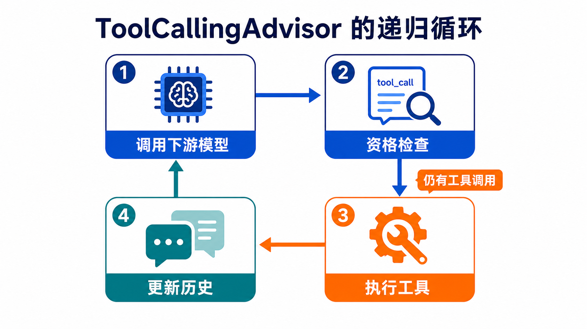
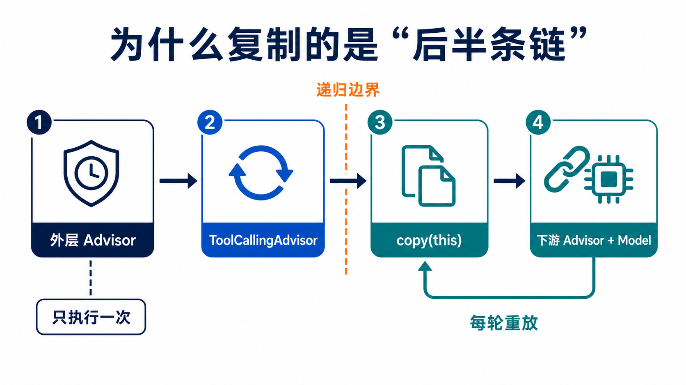
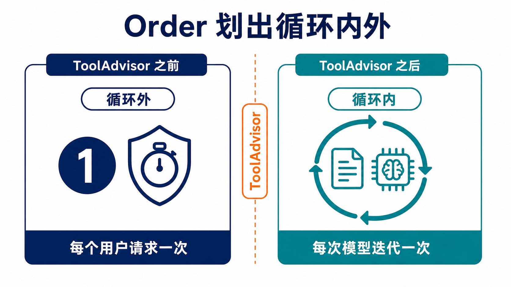
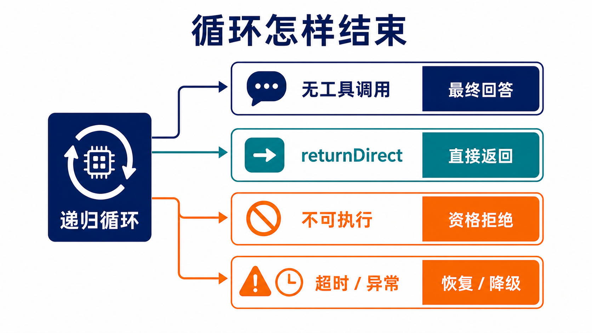

你调用的明明只是一次：

```java
chatClient.prompt("查一下上海天气，再按天气给出出行建议")
    .tools(new WeatherTools())
    .call()
    .content();
```

但看链路追踪，却可能出现两次甚至更多次模型请求。第一次响应没有最终答案，只有“调用天气工具”的结构化指令；应用执行工具以后，又把结果送回模型，第二次才得到自然语言回答。

如果把Advisor只理解成“请求前后各处理一次的拦截器”，这段行为就解释不通了。

**在Spring AI 2.0.0中，**`ToolCallingAdvisor`**是一个递归Advisor：只要模型响应仍包含需要执行的工具调用，它就执行工具、更新本轮会话历史，并再次进入自己后面的Advisor子链。**

这篇文章就沿着一次请求，把循环为什么存在、为什么只复制后半条链、`order`怎样划分循环内外，以及循环如何退出讲清楚。

## 为什么工具调用不能一次模型请求完成？

先看工具调用真正交换了什么。

模型收到工具的名称、描述与输入Schema之后，并不会进入JVM执行Java方法。它只能返回一段结构化意图，例如“调用`getWeather`，参数是`{"city":"上海"}`”。查数据库、访问HTTP接口或修改订单的动作，仍由应用侧完成。

因此，一个需要工具结果才能回答的问题，至少有两段模型推理：

1. 模型根据用户问题选择工具并生成参数；
2. 应用解析调用意图，执行真实工具；
3. 应用把工具结果作为`ToolResponseMessage`加入上下文；
4. 模型读到结果后，生成最终回答，或者继续请求另一个工具。

第四步很关键。一次工具结果不一定足够，例如“找出北京与上海更适合出游的城市”可能先查北京天气，再查上海天气，最后比较。应用事先并不知道模型会走几轮，所以不能把流程硬编码成“恰好调用模型两次”。



图中的闭环就是答案。`ToolCallingAdvisor`先调用下游模型，再检查响应是否包含可执行的工具调用；如果有，`ToolCallingManager`执行工具并生成工具响应消息，Advisor携带更新后的历史重新进入下游。直到模型不再发出工具调用，闭环才断开。

这里的“递归”描述的是**Advisor重新进入下游链**，不应该简单理解为业务代码无保护地调用自身。真正有意义的是每一轮的状态变化：

```latex
第1轮：用户问题
      -> 模型请求 getWeather("上海")

工具执行：getWeather("上海")
      -> "小雨，18℃"

第2轮：用户问题 + 模型的工具调用 + 工具结果
      -> 模型生成出行建议
```

模型每一轮看到的不是原封不动的同一个Prompt。新增的工具调用请求与工具执行结果，让下一轮具备了继续推理所需的证据。

那循环由谁控制，工具又由谁执行？这正是Advisor与Manager的职责分界。

## ToolCallingAdvisor在循环里分别负责什么？

Spring AI 2.0.0把过去藏在各个`ChatModel`实现内部的工具执行循环，提升成ChatClient Advisor链中的一等组件。官方文档说明，使用`ChatClient`时会自动注册`ToolCallingAdvisor`，除非应用显式关闭。

它同时实现`CallAdvisor`与`StreamAdvisor`，并带有`ToolAdvisor`标记。`DefaultChatClient`利用这个标记约束一条链中只能存在一个工具Advisor，避免两个循环同时争夺同一批工具调用。

一次阻塞调用可以抽象成下面这段伪代码。它用于解释流程，不是Spring AI完整源码：

```java
// 伪代码：省略流式路径、上下文合并和扩展钩子
ChatClientResponse runLoop(Request request, CallAdvisorChain chain) {
    var downstream = chain.copy(this);
    var current = request;

    while (true) {
        var response = downstream.nextCall(current);

        if (!eligibilityChecker.isEligible(current, response)) {
            return response;
        }

        var execution = toolCallingManager.executeToolCalls(
            current.prompt(), response.chatResponse());

        if (execution.returnDirect()) {
            return execution.asClientResponse();
        }

        current = appendToolExchange(current, response, execution);
    }
}
```

虽然真实实现还要处理初始化、每轮前后钩子、最终化、流式响应与上下文，但职责边界可以从这段示意里看出来：

- `ToolCallingAdvisor`拥有“是否继续循环”的控制权；
- `ToolCallingManager`解析模型请求，寻找`ToolCallback`并执行；
- 下游Advisor与`ChatModel`完成每一轮模型调用；
- 会话历史记录用户消息、模型工具请求和`ToolResponseMessage`；
- 资格检查器与`returnDirect`共同影响退出路径。

**Advisor不是工具本身，也不负责猜测工具参数。**参数由模型按照Schema生成；实际工具由`ToolCallingManager`解析和调用；Advisor负责把这些步骤编排成可重复的循环。

## 为什么递归只复制“后半条Advisor链”？

假设完整链按顺序是：

```latex
鉴权 -> 总请求计时 -> ToolCallingAdvisor -> 每轮日志 -> ChatModel
```

如果工具执行后从链头重新开始，鉴权与总请求计时也会再跑一遍。三轮模型调用就会被误算成三个用户请求，一次性上下文准备可能重复写入，某些有副作用的Advisor甚至会重复扣费或落库。

Spring AI的递归Advisor因此不是复制整条链，而是通过Advisor Chain的复制能力得到“当前Advisor之后”的子链。工具循环每次只重放下游部分。



图里要盯住`copy(this)`这道边界。外层Advisor在第一次进入时已经执行，工具循环不会回到它们；`ToolCallingAdvisor`后面的Advisor与模型则会在每轮继续执行。

这像办理一项需要补材料的业务：大厅取号与身份登记只做一次，窗口发现缺材料后，让你在窗口内部补齐并复核，而不是每补一张纸就回大门重新取号。

不过类比只能帮助理解“边界”。真实机制不是保存某个窗口工作人员，而是依据Advisor的排序复制下游调用链，并用新的请求状态再次执行它。

这项设计带来两个直接收益。

第一，外层可以围绕“一个用户请求”做审计、鉴权和总体指标。第二，内层可以围绕“每次模型迭代”做日志、观测、内容增强或结果校验。一次逻辑调用和多次物理模型请求，因此能够同时被准确描述。

接下来的问题自然是：一个Advisor究竟怎样进入外层或内层？答案不在注册代码的先后，而在它的`order`。

## order怎样决定谁在循环内、谁在循环外？

`ToolCallingAdvisor.DEFAULT_ORDER`在Spring AI 2.0.0中是`Ordered.HIGHEST_PRECEDENCE + 300`。排序值更靠前的Advisor先进入，位于工具循环外；排序值更靠后的Advisor在复制出的下游子链里，会跟着每一轮执行。



左侧的Advisor面向整个用户请求，只执行一次；右侧的Advisor面向每次模型迭代，可能执行多次。`order`不是单纯决定“日志先打印还是后打印”，它实际上划出了行为的生命周期边界。

可以按目标选择位置：

| 目标 | 建议位置 | 原因 |
| --- | --- | --- |
| 用户鉴权、租户识别 | 循环外 | 一个用户请求通常只需确认一次 |
| 整体SLA计时、总调用审计 | 循环外 | 需要统计完整工具链耗时 |
| 每轮模型请求与响应观测 | 循环内 | 必须看到中间工具调用 |
| 每轮动态注入上下文 | 循环内 | 新工具结果可能改变下一轮增强 |
| 只保存最终对话的Memory | 循环外 | 避免仓库处理工具消息 |
| 保存完整工具轨迹的Memory | 循环内 | 每轮都要持久化工具请求和结果 |

Memory是最容易踩坑的例子。官方说明，`MessageChatMemoryAdvisor`的默认顺序是`HIGHEST_PRECEDENCE + 200`，因此默认位于工具循环外，只加载一次历史，并保存最终的用户与助手消息。

如果把Memory调到工具循环内，它能看见完整工具轨迹，但必须同时处理两个问题：仓库要能序列化工具请求与`ToolResponseMessage`；内部会话历史要避免与Memory重复维护。官方文档提示，自动注册场景会检测循环内的Memory并禁用内部历史，手动构造`ToolCallingAdvisor`时则需要显式调用`disableInternalConversationHistory()`。

所以，不要为了“日志更全”随意调整所有Advisor的顺序。先问清楚：这个Advisor描述的是一次用户操作，还是一次模型迭代？

## 循环到底在什么条件下结束？

最常见的正常出口是：模型响应不再包含工具调用，而是给出最终文本。此时Advisor把最终响应返回外层链与调用者。

但它不是唯一出口。



这张图列出四类路径，含义需要分别看。

### 模型不再调用工具

这是“完成任务”的标准路径。模型已经拿到足够的工具结果，返回最终答案。对于多工具任务，可能经过若干轮才到达这里。

### 工具设置returnDirect

如果某个工具的输出已经是最终结果，不希望再让模型改写，可以把工具元数据设为`returnDirect=true`。Advisor执行工具后直接把结果交给客户端，省掉下一次模型调用，也避免模型篡改需要原样返回的内容。

需要注意并行工具调用的边界：官方Tools文档说明，如果模型一次请求多个工具，只有这些工具全部设置`returnDirect=true`时，结果才会整体直接返回；否则结果仍会送回模型。

### 资格检查不允许执行

`ToolExecutionEligibilityChecker`决定当前请求与响应是否适合进入工具执行。这里可以承载应用自定义策略，例如禁止某类调用或只允许特定上下文执行。

“不具备资格”不等于框架替你完成了降级答案。应用仍要明确设计：原响应能否返回、是否抛出业务异常、是否切换人工确认，以及怎样记录被拒绝的原因。

### 工具或模型发生异常

超时、参数绑定失败、工具名无法解析、远端接口异常、模型服务失败，都可能中断循环。它们不是一个统一的“正常结束条件”，而是要交给异常处理、重试、降级或上层错误映射。

工具具有副作用时尤其危险。假设“创建订单”执行成功，但响应在回传前超时，盲目重试可能创建两张订单。框架能重复流程，却无法凭空提供业务幂等性。此类工具应使用幂等键、操作状态查询或显式人工确认。

## 为什么生产环境还需要自己的循环护栏？

“直到没有工具调用为止”描述了正常算法，却不是完整的生产策略。

模型可能因为错误的工具描述在两个工具之间来回选择，也可能不断用略有差异的参数重试。即使每个组件都正常，循环仍可能消耗大量Token和外部调用额度。

实践中至少要考虑以下护栏：

- **总轮数或总模型调用上限**：超过阈值后结束并返回可诊断错误；
- **总体超时与单工具超时**：避免一个慢工具拖住整条链；
- **预算限制**：按Token、工具费用或外部API配额终止；
- **重复调用检测**：连续出现同名、同参数调用时提示模型修正或降级；
- **副作用审批**：支付、删除、发消息等动作在执行前由策略或用户确认；
- **工具结果裁剪**：避免超大结果把后续上下文迅速撑满；
- **全链路关联ID**：把一次用户请求和内部各轮模型调用串在一起。

这些能力并不一定全部由`ToolCallingAdvisor`内置替你完成。更准确的理解是：它提供可扩展的循环位置与钩子，应用根据风险等级补上终止策略。

流式场景还有一条边界。官方递归Advisor文档说明，`ToolCallingAdvisor`会过滤中间的工具调用片段，主调用者默认只收到最终答案；如果前端要展示“正在查天气”“工具已返回”这类中间进度，可以把观察Advisor放到循环内部，通过单独的侧通道发出事件，或者选择用户控制的工具执行。

## 自动控制、Advisor定制与手动循环怎么选？

Spring AI 2.0.0提供的不是唯一写法，而是不同控制强度。

普通业务优先使用`ChatClient`自动注册的`ToolCallingAdvisor`。它能处理标准工具循环，代码最少，也支持运行时动态加入工具。

需要改变Advisor顺序、观察每轮调用或覆盖循环钩子时，再显式构造或扩展`ToolCallingAdvisor`：

```java
var toolAdvisor = ToolCallingAdvisor.builder()
    .toolCallingManager(toolCallingManager)
    .advisorOrder(Ordered.HIGHEST_PRECEDENCE + 300)
    .build();

var chatClient = ChatClient.builder(chatModel)
    .defaultAdvisors(toolAdvisor)
    .build();
```

这段代码展示官方Builder的基本组织方式。实际项目使用自动配置时，不要再无意中添加第二个`ToolAdvisor`，否则会违反单工具Advisor约束。

只有当应用必须在每轮之间执行复杂审批、将中间状态持久化成自己的状态机，或让前端精确驱动下一步时，才值得关闭自动注册并手动使用`ToolCallingManager`控制循环。手动控制自由度最高，但你也要接管历史拼接、终止条件、异常、并发与可观测性。

选择标准可以压缩成一句话：**能用默认循环表达，就不要复制循环代码；需要改变循环内部决策时，再逐步下沉控制权。**

## 面试时怎样用一分钟讲清楚？

可以这样回答：

Spring AI 2.0.0把工具执行循环放进了ToolCallingAdvisor。模型第一次只返回工具名和参数，Advisor交给ToolCallingManager执行，再把ToolResponseMessage加入会话历史并重新调用下游链，直到模型不再请求工具，或者命中returnDirect、资格拒绝和异常等退出路径。递归时只复制当前Advisor之后的子链，因此上游Advisor只处理一次用户请求，下游Advisor能观察每次模型迭代。ToolCallingAdvisor默认order是HIGHEST_PRECEDENCE加300，Advisor放在它前后，就决定了自己位于循环外还是循环内。

再记住三个关键词：**子链递归、顺序边界、退出护栏。**

回到开头的问题：一次`.call()`之所以会出现多次模型请求，不是框架重复发送了同一个问题，而是工具结果改变了上下文，模型必须在新的证据上继续推理。真正决定系统是否可靠的，也不只是“能不能调工具”，而是循环边界、状态记录与终止策略是否清楚。

## 参考资料

- [Spring AI 2.0.0 Reference：Tool Calling](https://docs.spring.io/spring-ai/reference/api/tools.html)
- [Spring AI Reference：Recursive Advisors](https://docs.spring.io/spring-ai/reference/api/advisors-recursive.html)
- [Spring AI 2.0：Composable Tool Calling Architecture](https://spring.io/blog/2026/06/15/spring-ai-composable-tool-calling/)
- [Spring AI 2.0.0 Javadoc：ToolCallingAdvisor](https://docs.spring.io/spring-ai/docs/current/api/org/springframework/ai/chat/client/advisor/ToolCallingAdvisor.html)
