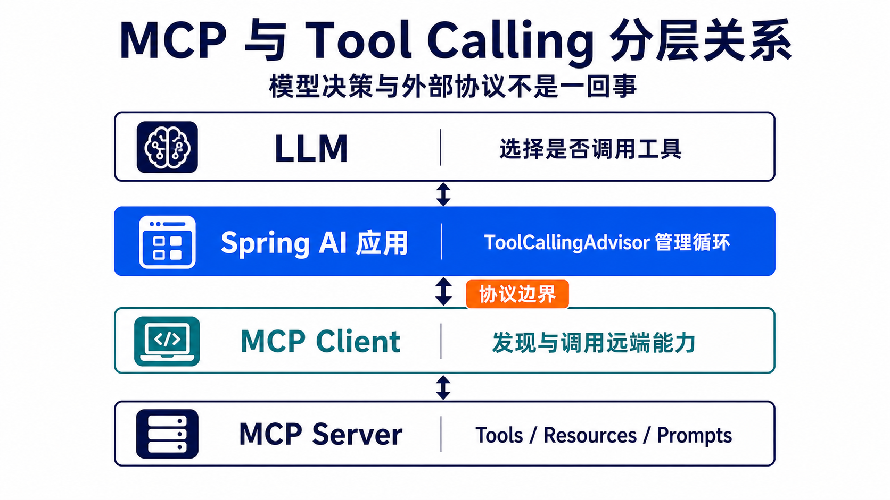
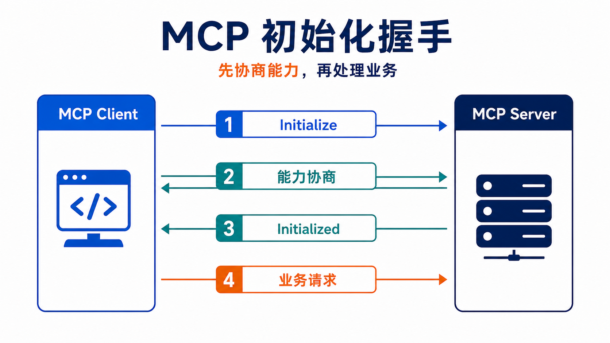
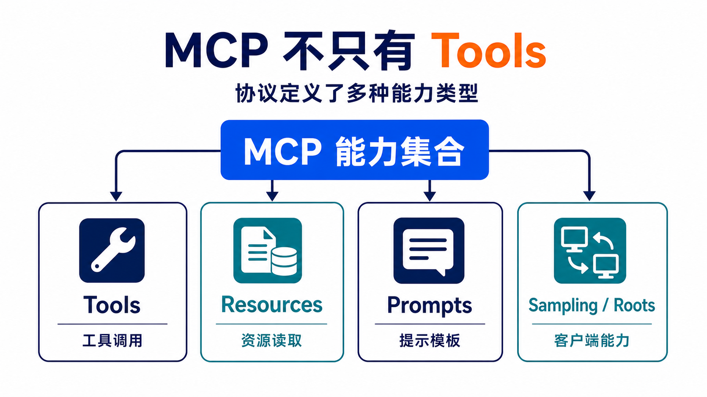
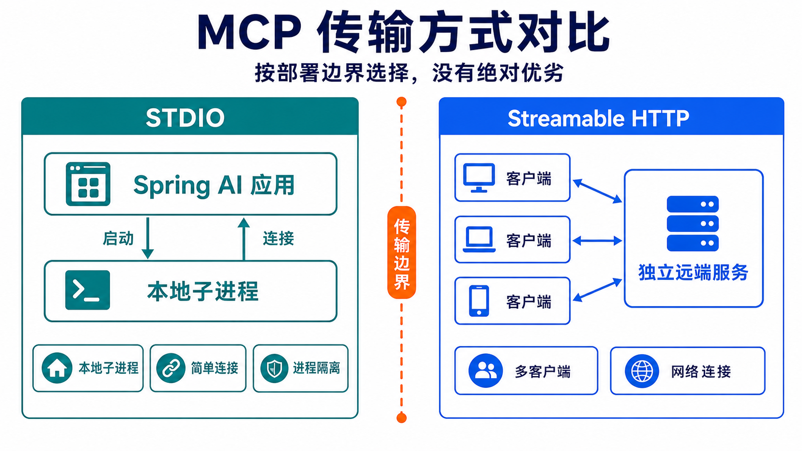

第一次在Spring AI里使用MCP，很容易产生一个疑问：本地`@Tool`已经能让模型调用Java方法，为什么还需要一套MCP Client、MCP Server和传输协议？

另一个常见误解恰好相反：接入MCP以后，是不是就不需要Tool Calling了？

**两者不在同一层。Tool Calling负责模型与AI应用之间的能力协商；MCP负责AI应用与外部能力提供方之间的标准通信。Spring AI把MCP发现的远端Tool适配成普通**`ToolCallback`**，再交给**`ToolCallingAdvisor`**完成模型侧循环。**

因此，MCP不是一种更高级的函数调用格式，也不是某个模型供应商的专属能力。它解决的是外部工具、资源与提示模板如何被统一发现、调用和治理。

本文以Spring AI 2.0.0为基线，从分层、初始化握手、能力类型、Spring AI适配路径与传输选择五个角度拆开这套机制。

## 本地Tool能用，MCP究竟多解决了什么？

假设一个客服应用需要查询订单。最直接的做法是在应用里写一个`OrderTools`，通过`@Tool`暴露Java方法。工具与应用一起编译、部署和升级，这在单体项目里非常合适。

问题出现在能力开始跨边界以后：

- 订单、物流、知识库分别由不同团队维护；
- 同一套工具需要被IDE助手、客服机器人和运维Agent复用；
- 工具用Python或Node.js实现，而AI应用使用Java；
- 工具清单会动态变化，不希望每次都重新发布AI应用；
- 除了“执行操作”，还希望统一读取资源、提供提示模板和发送变更通知。

如果每个AI应用都为每个能力编写一套私有HTTP协议，工具名称、Schema、发现方式、错误格式和生命周期就会重新碎片化。

MCP把这段边界标准化。能力提供方实现MCP Server；AI宿主里的MCP Client与它建立会话，协商版本与能力，列出工具或资源，再通过统一的JSON-RPC消息进行调用。



图中从上到下有四个角色：

1. LLM决定是否提出工具调用，输出工具名与参数；
2. Spring AI应用里的`ToolCallingAdvisor`维护模型调用循环；
3. MCP Client发现并调用远端能力；
4. MCP Server真正暴露Tools、Resources与Prompts。

可以把它类比成一家餐厅。模型像顾客，告诉服务员自己想点什么；Spring AI应用像前厅，负责理解点单并控制整个用餐流程；MCP则像前厅与多个标准化后厨档口之间的出餐协议。

类比到这里就要停下。真实系统没有一个“自动理解一切”的服务员：模型侧仍依赖工具Schema，应用侧仍要做权限与参数校验，MCP侧则通过明确的协议方法、会话状态与传输承载消息。

## MCP内部为什么还要分Client、Session和Transport？

MCP Java SDK的架构可以理解成三层。

最上面是Client/Server API。Client负责初始化连接、发现和调用能力；Server注册Tools、Resources、Prompts等处理器，并响应请求或发送通知。

中间是Session。它关联一次客户端与服务端会话，跟踪请求ID、等待响应、分发通知，并保证初始化之后双方只使用已经协商的能力。同步API让调用者阻塞等待结果，异步API则以响应式方式处理消息，但二者遵循同一协议语义。

最下面是Transport。它负责把协议对象序列化为JSON-RPC消息，并通过STDIO、Streamable HTTP或兼容的HTTP/SSE方式传输。

这三层分开以后，业务能力不必绑定部署方式。一个“查询物流”Tool既可以运行成客户端拉起的本地子进程，也可以部署成远端HTTP服务；上层仍然通过MCP的`tools/list`与`tools/call`交互。

同样，Transport通了不等于MCP已可用。TCP或子进程管道只提供消息通道，双方还必须完成初始化、协议版本协商和能力声明。

双方第一次见面时，怎样确认自己说的是同一种协议、支持的是同一组能力？这就是初始化握手存在的原因。

## 初始化握手为什么不能省？

MCP连接建立后，不会立刻调用`tools/list`。客户端先发送`initialize`请求，声明自己支持的协议版本、客户端信息和能力；服务端返回选定的协议版本、服务端信息与能力；客户端确认可以接受后，再发送`initialized`通知，双方才进入正常工作阶段。



图里的四步顺序很重要：`Initialize`不是普通业务请求，`Initialized`也不是服务端响应的另一种写法。前者是有请求ID、期待结果的JSON-RPC请求，后者是客户端发出的通知。

下面是只保留关键字段的简化示意，字段与能力会随协议版本演进：

```json
{
  "jsonrpc": "2.0",
  "id": 1,
  "method": "initialize",
  "params": {
    "protocolVersion": "双方支持的版本",
    "capabilities": {
      "roots": {},
      "sampling": {}
    },
    "clientInfo": {
      "name": "customer-assistant",
      "version": "1.0.0"
    }
  }
}
```

服务端的`InitializeResult`会返回它选择的协议版本、`serverInfo`与`ServerCapabilities`。如果客户端不能支持服务端选择的版本，协议要求它断开连接，而不是抱着“也许字段差不多”的心态继续调用。

握手解决两个问题。

第一是**兼容性**。双方明确使用哪个协议版本，避免把未知字段和方法误当成业务故障。

第二是**可用能力**。客户端只有看到服务端声明`tools`，才应该发起工具相关请求；服务端想请求客户端执行Sampling，也必须先看到客户端声明相应能力。

但要特别注意：**能力协商不是权限授权。**服务端声明“我支持Tools”，只说明协议功能存在，不表示当前用户有权调用每个Tool。认证、租户隔离、业务权限和高风险操作审批，仍需在传输层与业务层完成。

在Spring AI 2.0.0的MCP Client Starter中，客户端默认可在创建时自动初始化，也可以通过`spring.ai.mcp.client.initialized`控制；请求超时等生命周期参数也由Starter管理。生产环境不应把“Bean成功创建”直接等同于所有MCP Server健康，仍需监控初始化失败、能力变化与请求超时。

## Tools、Resources、Prompts为什么不能混成一种能力？

很多演示只展示MCP Tools，容易让人以为MCP就是“远程函数调用协议”。实际上，MCP对不同交互语义做了区分。



### Tools：执行可选择的操作

Tool拥有名称、描述与输入Schema。客户端先通过`tools/list`发现清单，再通过`tools/call`调用。对AI应用而言，它通常会被暴露给模型，由模型在需要时选择。

例如“查询订单”是只读Tool，“取消订单”是有副作用Tool。协议能描述并调用它们，却不会自动保证取消操作安全。客户端仍应过滤不可见工具，服务端仍应校验调用者权限与参数。

### Resources：按URI读取上下文

Resource更像可寻址的数据。它有URI、名称、可选MIME类型和描述，可以承载文本或二进制内容。客户端可以列出资源、读取指定URI，并在服务端支持时订阅变化。

例如`order://12345/status`或`file:///project/README.md`适合建模为Resource。它强调“读取一份上下文”，而不是“执行一个任意动作”。

不能因为模型最终也会读到Resource内容，就把Resource等价成无参数Tool。两者的发现、缓存、展示、权限提示和变更通知语义不同。

### Prompts：由服务端提供可复用模板

Prompt能力让服务端列出并获取提示模板，模板可以带参数。它适合把领域工作流的起始提示与能力提供方一起维护，例如“生成订单异常分析报告”模板。

通常由用户或宿主应用选择Prompt，再将结果交给模型，而不是让模型像选择Tool一样任意执行所有Prompt。这种区分让客户端能够用不同UI与审批逻辑呈现能力。

### Sampling与Roots：方向相反的客户端能力

Tools、Resources、Prompts主要由Server提供。Sampling与Roots则提醒我们，MCP不是单向RPC。

Sampling允许MCP Server请求Client使用其掌握的模型进行生成。这样服务端不必持有模型API Key，但客户端仍掌握模型选择、权限和用户确认。

Roots让Client向Server声明可操作的文件系统根范围。它表达边界，不应被理解为一个天然安全沙箱；服务端实现仍必须验证路径，避免目录穿越和越权读取。

图中把这些能力分开，是为了强调**所有权和调用方向**。能力类型不是给同一份JSON换个名字，而是让双方知道谁提供、谁选择、怎样展示以及应在哪一侧做控制。

## MCP Tool怎样进入Spring AI的工具循环？

这是MCP与Tool Calling真正接上的位置。

Spring AI的MCP Client连接服务端并发现Tool以后，会通过同步或异步的MCP Tool Callback Provider，把远端Tool适配为Spring AI认识的`ToolCallback`。对`ToolCallingAdvisor`而言，它与本地`@Tool`生成的Callback遵循同一个工具抽象。

一次完整路径可以写成：

```latex
MCP Client初始化
  -> tools/list发现远端工具
  -> 适配成ToolCallback
  -> ChatClient把工具定义发给模型
  -> 模型返回工具名和参数
  -> ToolCallingManager定位ToolCallback
  -> Callback通过MCP发送tools/call
  -> MCP Server执行真实能力并返回结果
  -> ToolCallingAdvisor把结果送回模型
```

所以，模型并不需要“懂MCP”。它只需要支持模型供应商的Tool Calling格式。MCP消息发生在应用与MCP Server之间，Spring AI负责把两边的工具抽象接起来。

Spring AI 2.0.0的MCP Client Starter默认可以启用这层Tool Callback集成，并支持`McpToolFilter`过滤发现到的工具，也能为工具名增加前缀以避免多个Server出现同名工具。

这两个功能不是美化配置。假设三个Server都暴露`search`，模型只凭名字可能无法稳定区分；假设某租户不应看到“删除客户”工具，仅在真正执行时拒绝还不够，工具清单本身也可能泄露能力信息。更稳妥的做法是在暴露给模型之前就完成命名治理与最小权限过滤，并在Server执行时再次鉴权。

一个最小的STDIO客户端配置可以类似这样：

```yaml
spring:
  ai:
    mcp:
      client:
        stdio:
          connections:
            order-server:
              command: /opt/mcp/order-server
              args:
                - --mode=production
```

这段配置只说明客户端怎样启动并连接进程。工具是否自动暴露、使用同步还是异步Client、超时多久，以及子进程需要哪些环境变量，还应根据Spring AI 2.0.0 Starter配置逐项确定。

## STDIO与Streamable HTTP应该怎样选？

MCP上层语义相同，不代表传输方式可以无差别替换。部署位置、进程生命周期、并发与安全边界都不同。



### STDIO适合本地受控子进程

使用STDIO时，Client启动MCP Server子进程，通过它的标准输入发送JSON-RPC消息，从标准输出读取响应。它不需要监听网络端口，很适合桌面应用、本地开发工具和与宿主一起分发的小型能力。

协议有一个很容易忽略的约束：Server的`stdout`只能输出有效MCP消息，普通日志应该写到`stderr`。一行调试文本混进`stdout`，就可能让客户端把它当成损坏的协议帧。

STDIO的简单也有边界。Server生命周期通常绑定发起它的Client，不适合天然地被大量远端客户端共享；可执行文件分发、环境变量、工作目录和子进程权限也需要治理。

### Streamable HTTP适合独立远端服务

Streamable HTTP让Server作为独立服务运行，通过统一MCP端点处理HTTP POST/GET，并可借助SSE流承载服务端消息。它更适合多客户端、容器化部署、集中扩缩容、网关认证和跨主机访问。

代价是网络服务该有的问题一个都不会消失：TLS、认证、超时、反向代理、连接管理、跨租户隔离和观测都要明确配置。MCP标准化了消息，不会替代服务治理。

Spring AI 2.0.0的客户端Starter同时支持STDIO、Streamable HTTP以及HTTP/SSE。MCP规范中Streamable HTTP已取代早期HTTP+SSE传输，但实际系统可能为了兼容旧Server继续支持SSE。新项目优先考虑STDIO或Streamable HTTP，存量兼容再使用对应SSE配置。

一个实用判断是：

| 场景 | 优先选择 |
| --- | --- |
| 本地CLI、IDE插件、单个宿主拉起工具 | STDIO |
| 多个AI应用共享同一能力 | Streamable HTTP |
| 需要独立扩缩容、网关和集中审计 | Streamable HTTP |
| 必须兼容旧版HTTP+SSE Server | HTTP/SSE兼容传输 |

图中两边真正的差异不在“谁更先进”，而在**能力进程由谁启动、连接被谁共享、故障由谁恢复**。

## MCP最容易失败和越界的地方在哪里？

把连接配置好只是第一步。MCP把外部能力引入AI应用，同时也扩大了信任边界。

第一类风险是**发现成功、调用失败**。工具清单会变化，模型可能引用已下线的Tool；参数符合JSON Schema，也可能不满足业务规则；网络超时后，远端操作还可能已经成功。调用方要区分协议错误、业务错误和不确定结果，对有副作用的Tool使用幂等键。

第二类风险是**工具描述注入与过度授权**。来自外部Server的工具名称、描述和Resource内容最终可能进入模型上下文。不要因为Server完成了MCP握手就默认信任所有文本。应固定可信Server来源、过滤工具、限制结果大小，并把高风险操作放在模型之外的确定性策略和人工确认之后。

第三类风险是**传输配置泄露**。STDIO凭据通常通过受控环境传递，不应把密钥直接提交到配置文件；HTTP连接需要正确认证和TLS。MCP官方传输规范还特别要求Streamable HTTP Server验证`Origin`以防DNS Rebinding，本地运行时优先只绑定回环地址。

第四类风险是**把能力声明当权限**。`capabilities.tools`只表明Server实现了工具协议，不代表某个用户可以调用所有工具。权限应至少在Client暴露前过滤一次，在Server真正执行前再校验一次。

第五类风险是**无限扩大上下文**。聚合多个MCP Server后，几百个Tool Schema可能占用大量Token并降低模型选择准确率。此时可使用工具过滤、命名前缀、按租户建立清单，或者使用Spring AI 2.0.0的动态工具搜索Advisor渐进披露工具，而不是把所有定义一次性交给模型。

**MCP解决互操作性，不自动解决可信性、幂等性和成本控制。**这条边界如果没讲清楚，接入越方便，系统反而越容易把风险扩散到更多外部能力。

## 面试时怎样用一分钟讲清楚？

可以这样回答：

Tool Calling与MCP处在不同层。Tool Calling发生在模型与Spring AI应用之间，模型输出工具名和参数，ToolCallingAdvisor负责执行并把结果送回模型。MCP发生在应用与外部能力提供方之间，MCP Client和Server先通过initialize协商协议版本与capabilities，再用JSON-RPC发现和调用Tools、Resources、Prompts等能力。Spring AI会把MCP远端Tool适配成ToolCallback，所以它能进入普通工具循环。STDIO适合本地子进程，Streamable HTTP适合独立远端服务。MCP只统一协议，认证、权限、幂等与高风险审批仍要由应用负责。

用三个词记忆：**分层、协商、适配。**

回到开头：有了MCP，不代表Tool Calling消失；它只是让工具循环的“执行端”可以从本地Java方法扩展到标准化外部服务。真正完整的链路是：模型选择能力，Spring AI编排循环，MCP跨进程调用，服务端执行并返回结果。

## 参考资料

- [Spring AI 2.0.0 Reference：Model Context Protocol](https://docs.spring.io/spring-ai/reference/api/mcp/mcp-overview.html)
- [Spring AI 2.0.0 Reference：MCP Client Boot Starter](https://docs.spring.io/spring-ai/reference/api/mcp/mcp-client-boot-starter-docs.html)
- [Spring AI 2.0.0 Reference：Tool Calling](https://docs.spring.io/spring-ai/reference/api/tools.html)
- [Model Context Protocol Specification：Lifecycle](https://modelcontextprotocol.io/specification/2025-11-25/basic/lifecycle)
- [Model Context Protocol Specification：Transports](https://modelcontextprotocol.io/specification/2025-11-25/basic/transports)
- [Model Context Protocol Specification：Server Features](https://modelcontextprotocol.io/specification/2025-11-25/server/index)
