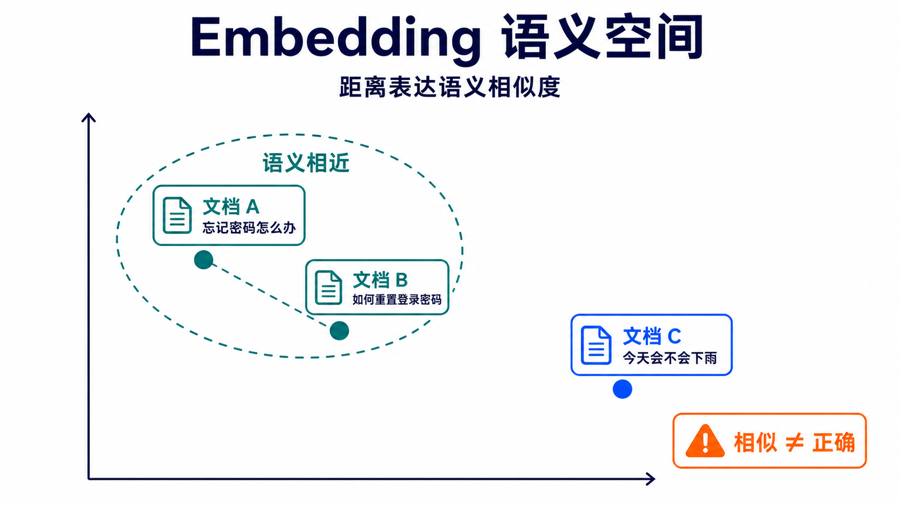
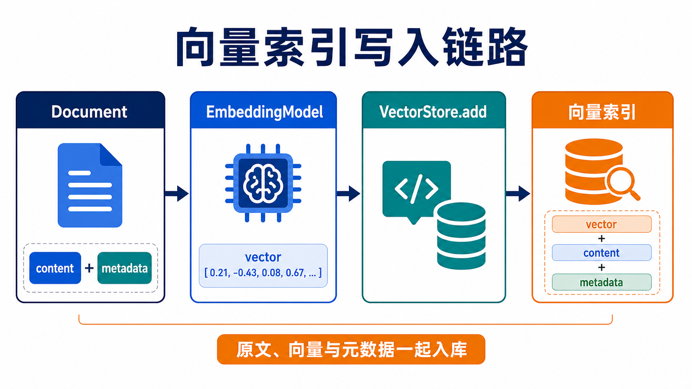
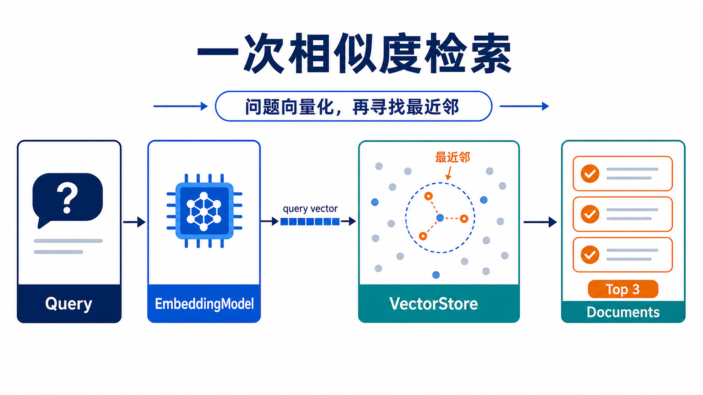
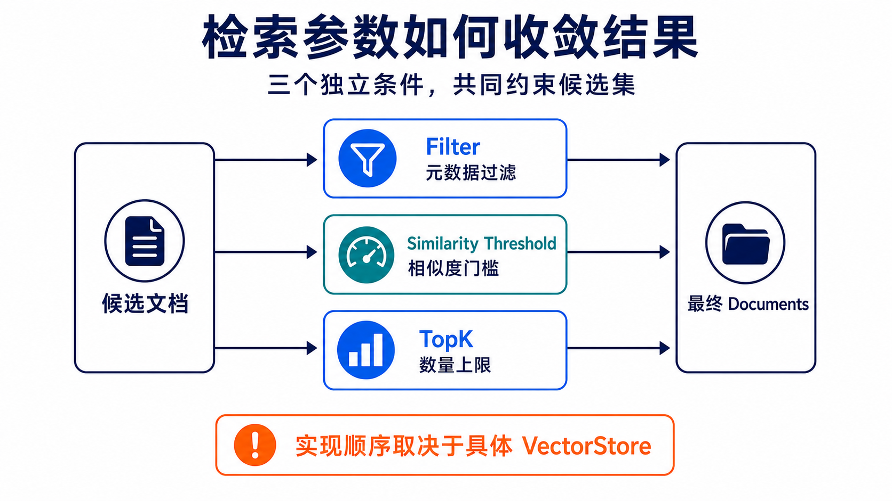

在普通数据库里找“忘记密码”，很容易漏掉一篇标题叫《账号凭证重置指南》的文档。

字面几乎不同，意思却很接近。全文检索可以通过分词、同义词和排序算法缓解这个问题，但当表达越来越自由时，维护词表会越来越吃力。

向量检索换了一个思路：先把文本转换成一串数字，再到数字空间里寻找距离较近的内容。

这句话听起来像魔法，也很容易让人产生另一个误解：只要向量距离近，答案就一定正确。

文本为什么能变成可比较的数字？查询参数里的topK、阈值与元数据过滤，又分别在筛选什么？

**Embedding负责把内容投影到可比较的语义空间，VectorStore负责保存、过滤并检索这些向量；它找到的是“模型认为相似的候选”，不是经过事实验证的答案。**

本文以Spring AI 2.0.0的`EmbeddingModel`、`VectorStoreRetriever`与`VectorStore`为主线，拆开整个过程。

## 文本为什么能变成一个向量？

Embedding模型接收文本，输出固定维度的浮点数数组。例如下面只是帮助理解的缩短示意：

```latex
“忘记密码怎么办”
        ↓ EmbeddingModel
[0.12, -0.07, 0.81, ...]
```

真实向量通常有更多维度，单独观察某个数字也很难给它贴上“密码”或“账号”的人类标签。真正有用的是向量之间的相对位置。

如果Embedding模型在训练中学到“忘记密码”和“重置登录凭证”经常出现在类似语义环境里，它们的向量就可能更接近；“今天北京气温”则可能位于较远区域。



这张图表达的是相对距离，不是现实中真的存在一个二维语义平面。为了显示，图会把高维空间压缩成二维；真实检索直接在高维向量上计算。

还要注意三条边界：

- 相似是相对于某个Embedding模型而言；
- 模型训练数据、语言能力和输入截断都会影响位置；
- 距离近只说明语义模式相似，不证明内容真实、最新或有权限被当前用户读取。

## EmbeddingModel统一了哪些操作？

Spring AI中的`EmbeddingModel`建立在通用Model API之上。它的核心方法接收`EmbeddingRequest`并返回`EmbeddingResponse`，同时提供便捷方法：

```java
float[] queryVector = embeddingModel.embed("忘记密码怎么办");

List<float[]> vectors = embeddingModel.embed(List.of(
    "账号凭证重置指南",
    "北京天气预报"
));
```

官方接口还支持`embed(Document)`和批量响应。`EmbeddingResponse`除了向量结果，也可以携带模型响应元数据。

为什么既需要`embed(String)`，又需要完整的`call(EmbeddingRequest)`？

便捷方法适合只关心单个向量的场景；完整请求—响应形式支持批量输入与`EmbeddingOptions`，并通过`EmbeddingResponse`保留响应元数据。这和`ChatModel.call("你好")`与`call(Prompt)`的关系相似。

Spring AI 2.0.0还定义了`getEmbeddingContent(Document)`。默认取`Document.getText()`；支持`MetadataMode`的实现可以把指定元数据格式化后一起送去Embedding。这会影响向量表达，因此不能把“元数据是否参与Embedding”和“元数据是否仅用于过滤”混为一谈。

## 文档写入向量库时发生了什么？

一个可检索条目通常不只有向量。它还需要原始文本、文档ID和元数据，否则检索命中以后，应用只拿到一串浮点数，根本无法把内容交给模型。



Spring AI用`Document`表达这个单元：

```java
Document document = new Document(
    "进入安全中心，验证身份后可以重置登录密码。",
    Map.of(
        "tenantId", "acme",
        "category", "account",
        "version", "2026-07"
    )
);

vectorStore.add(List.of(document));
```

从接口看只是`add`。具体VectorStore实现通常需要：

1. 提取Document中用于Embedding的内容；
2. 调用EmbeddingModel生成向量；
3. 把向量、原文、ID与元数据映射成底层存储格式；
4. 写入数据库及其向量索引。

不同向量数据库的批处理、索引类型和一致性行为并不相同。`VectorStore`统一的是业务调用面，不承诺所有后端拥有相同的性能与事务语义。

这也是为什么生产导入不应把几万篇文档一次塞进Controller请求。更合适的是独立ETL任务，控制批次、重试、幂等、版本与失败补偿。

## 查询为什么也必须使用EmbeddingModel？

数据库里存的是文档向量，而用户输入仍是文本。要比较两者，查询也必须投影到兼容的语义空间。



完整过程可以概括为：

1. 用户提交自然语言查询；
2. 与建库兼容的EmbeddingModel生成查询向量；
3. 向量数据库执行近邻搜索；
4. 返回相似文档、分数及元数据。

Spring AI 2.0.0提供只读的`VectorStoreRetriever`：

```java
@FunctionalInterface
public interface VectorStoreRetriever {

    List<Document> similaritySearch(SearchRequest request);
}
```

`VectorStore`在它的基础上增加`add`和`delete`等写操作，同时还实现`DocumentWriter`。

这个接口拆分很有工程价值。如果问答服务只需要搜索，就依赖`VectorStoreRetriever`，不必获得删除和写入权限。它既表达职责，也减少误操作面。

## “距离近”到底怎样计算？

常见方式包括余弦相似度、点积和欧氏距离。具体使用哪一种，取决于Embedding模型建议以及向量数据库配置。

余弦相似度关注两个向量方向是否接近，可以写成：

```latex
cosine(A, B) = (A · B) / (|A| × |B|)
```

但在Spring AI业务代码中，通常不会手写这个公式。`similaritySearch`把查询交给具体VectorStore，底层数据库利用近似最近邻索引搜索候选。

“近似”意味着它以更低延迟换取可能的召回误差。数据量很小时可以精确比较全部向量；数据达到百万、千万级以后，全量扫描通常太贵，HNSW、IVF等索引会减少搜索范围。

Spring AI没有用一个公共接口抹平所有索引参数。因为这些参数与具体数据库强绑定，仍需要在对应实现中配置和压测。

还要确认分数方向。某些底层系统返回“相似度”，越大越相似；另一些返回“距离”，越小越接近。Spring AI的具体VectorStore实现会适配公共搜索语义，但在查看原生客户端、数据库控制台或混合多个检索器时，不能拿两个方向相反的分数直接排序。

当查询包含产品编号、异常码或人名时，纯语义向量也可能不如关键词检索稳定。例如`ERR_CONN_1042`与一段错误说明在语义空间里未必足够接近。生产RAG常把向量召回与关键词召回合并，再通过重排器决定最终顺序。这不是否定Embedding，而是让不同检索方式各自处理擅长的信号。

### topK、阈值和Filter怎样一起工作？

`SearchRequest`用于表达查询文本、`topK`、相似度阈值与元数据过滤。示例：

```java
SearchRequest request = SearchRequest.builder()
    .query("怎样重置密码？")
    .topK(5)
    .similarityThreshold(0.72)
    .filterExpression("""
        tenantId == 'acme' && category == 'account'
        """)
    .build();

List<Document> documents = retriever.similaritySearch(request);
```



图里的漏斗表示三类约束逐步缩小“最终可返回的结果集合”，并不代表所有VectorStore都按图中顺序执行：

- **Filter**限定哪些文档有资格参与，例如租户、权限、版本和时间；
- **Similarity Threshold**拒绝相关性太低的候选；
- **TopK**限制最终返回数量，控制上下文长度与后续成本。

它们不能相互替代。把`topK`从5改成50，不会自动解决跨租户数据泄露；阈值设得很高，也不能保证留下的文档事实正确。

Spring AI统一的是参数语义，不保证后端的物理执行顺序。Filter能否下推、何时截取topK由具体VectorStore决定；Spring AI 2.0.0的`SearchRequest`文档还说明相似度阈值过滤属于客户端后处理。涉及性能与权限时，应核对所选实现，而不是从这张概念图推断执行计划。

参数还存在典型权衡：

- topK太小，可能漏掉分散在不同片段的证据；
- topK太大，引入噪声并增加Prompt Token；
- 阈值太高，用户换一种说法就可能无结果；
- 阈值太低，模型容易被不相关上下文带偏。

因此阈值不能照抄网上的固定值。应该用自己的查询集，根据召回率、准确率和最终回答质量调优。

## 为什么更换Embedding模型常常需要重建索引？

因为新旧模型产生的向量通常不处于同一个语义空间。

即使维度恰好相同，也不能假设坐标含义兼容。如果数据库里的文档向量来自模型A，查询向量来自模型B，计算出来的距离往往没有可靠意义。

生产上至少要记录：

- Embedding供应商和模型名；
- 模型版本或可识别的部署版本；
- 向量维度；
- 文档切片规则版本；
- 索引构建批次。

迁移时可以建立新索引，完成回填和评估后再切换查询流量，而不是直接修改线上EmbeddingModel。

维度也是硬约束。底层向量列或索引通常在创建时确定维度，新模型输出长度不同会直接导致写入失败，或者要求创建新表/新集合。

更稳妥的迁移流程是“双写—回填—对比—切流”：新文档同时写入新旧索引，历史文档后台回填，用固定查询集比较召回结果，最后把一小部分线上查询切到新索引。确认质量和延迟后再扩大流量，并保留能够退回旧索引的开关。

这里需要评估的不只是平均相似度，还包括正确证据是否进入topK、不同语言和长尾表达的召回率、权限Filter是否一致以及索引成本。Embedding升级本质上是一次检索系统迁移，而不是修改一个配置字符串。

## 相似度高，为什么RAG仍然可能答错？

可能的原因很多：

1. 文档本身过期或错误；
2. 切片把关键条件拆散；
3. 查询过于模糊，最相似片段并非真正证据；
4. 权限过滤遗漏；
5. 多个候选相互冲突；
6. 模型没有忠实使用检索内容；
7. 向量检索擅长语义相似，却不擅长精确编号、日期或代码符号。

这意味着向量检索只是RAG中的检索器之一。精确关键词、数据库查询、图检索、重排器和规则过滤都可能参与完整系统。

一个实用原则是：**先评估“检索是否找到证据”，再评估“模型是否根据证据回答”。**把两个问题混在一个最终正确率里，出了错就很难定位。

缓存也要绑定这些版本条件。只用查询文本作为缓存Key，可能在权限、文档版本或Embedding模型变化后返回旧结果。至少应把租户、过滤条件、索引版本和检索参数纳入缓存隔离，并在知识更新时设计失效策略。

## 面试时怎样回答Embedding与VectorStore的关系？

可以这样说：

EmbeddingModel把文本或Document转换成固定维度向量，使语义相似内容在向量空间中更接近。VectorStore保存向量、原文和元数据，并通过SearchRequest执行相似度检索、topK、阈值与元数据过滤。查询时必须使用与建库兼容的Embedding模型生成查询向量。检索结果只是相似候选，不等于事实正确，因此还需要权限过滤、重排、评估和生成约束。

第二天只要记住三个边界：

- **同一语义空间才能比较；**
- **Filter解决资格，相似度解决相关；**
- **相似不是事实证明。**

## 参考资料

- [Spring AI 2.0.0 Reference：Embeddings Model API](https://docs.spring.io/spring-ai/reference/api/embeddings.html)
- [Spring AI 2.0.0 Reference：Vector Databases](https://docs.spring.io/spring-ai/reference/api/vectordbs.html)
- [Spring AI 2.0.0 Javadoc：EmbeddingModel](https://docs.spring.io/spring-ai/docs/current/api/org/springframework/ai/embedding/EmbeddingModel.html)
- [Spring AI 2.0.0 Javadoc：VectorStore包](https://docs.spring.io/spring-ai/docs/current/api/org/springframework/ai/vectorstore/package-summary.html)
