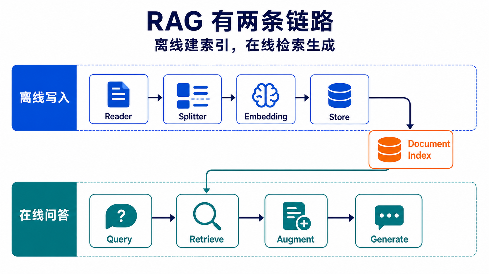
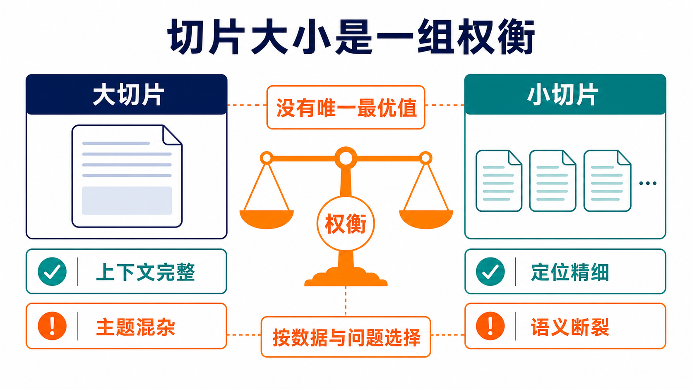
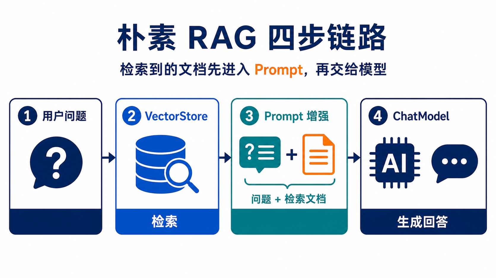
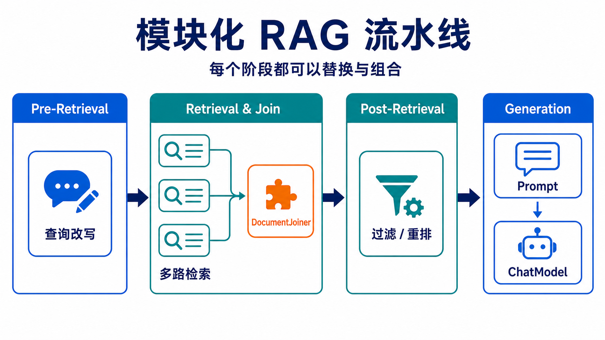

很多RAG教程看起来只有三行：

```java
vectorStore.add(documents);

String answer = chatClient.prompt(question)
    .advisors(QuestionAnswerAdvisor.builder(vectorStore).build())
    .call()
    .content();
```

代码确实能跑，但它很容易造成一种错觉：接上向量数据库，模型就自动拥有企业知识了。

真正上线以后，问题通常出在这三行之外：PDF表格被读乱、文档切得太碎、旧版本没有删除、用户问题不适合直接检索、topK片段互相冲突，或者检索正确但模型仍然发挥。

这些问题应该从哪里开始查？是继续改Prompt，还是先确认正确证据到底有没有进入检索结果？

**RAG不是一个“向量库功能”，而是离线知识加工与在线检索生成衔接起来的一条数据链。任何一段失真，最终答案都会受影响。**

更关键的问题是：怎样把这条长链拆成可以单独验证和替换的组件？

本文以Spring AI 2.0.0的ETL API、`QuestionAnswerAdvisor`和模块化RAG组件为主线，从原始文档一直追到最终回答。

## RAG为什么要分成离线与在线两条链？

用户提出问题时再临时读取全部PDF、切片并生成Embedding，延迟和成本都不可接受。

因此RAG通常先离线建立可检索索引，再在线按问题寻找少量相关片段。



离线链负责：

1. 从文件、网页或其他数据源读取内容；
2. 转换成统一`Document`；
3. 清洗、补充元数据并切片；
4. 生成Embedding并写入VectorStore。

在线链负责：

1. 接收用户Query；
2. 必要时改写或扩展Query；
3. 检索候选文档；
4. 重排、过滤或压缩候选；
5. 把上下文加入Prompt；
6. 请求ChatModel生成回答。

两条链通过Document索引衔接。离线链决定“可以找到什么”，在线链决定“这次找到什么、怎样交给模型”。

## Spring AI为什么把ETL设计成三个函数式接口？

Spring AI的ETL管道围绕`Document`工作，并把职责拆成Reader、Transformer和Writer。

下面是官方接口的核心形态：

```java
public interface DocumentReader extends Supplier<List<Document>> {
    default List<Document> read() {
        return get();
    }
}

public interface DocumentTransformer
        extends Function<List<Document>, List<Document>> {
    default List<Document> transform(List<Document> documents) {
        return apply(documents);
    }
}

public interface DocumentWriter extends Consumer<List<Document>> {
    default void write(List<Document> documents) {
        accept(documents);
    }
}
```

这个设计让组件可以像普通函数一样组合：

```java
List<Document> sourceDocuments = pdfReader.read();
List<Document> chunks = tokenTextSplitter.transform(sourceDocuments);
vectorStore.write(chunks);
```

或者写成紧凑链式调用：

```java
vectorStore.write(tokenTextSplitter.split(pdfReader.read()));
```

`VectorStore`本身实现`DocumentWriter`，所以ETL输出可以直接进入向量库。

接口简单不代表生产任务简单。真实管道还要处理批次、失败重试、重复导入、版本切换、权限元数据、坏文件隔离和可观测性。这些属于应用的任务编排责任，不能期待三个接口自动解决。

**ETL接口解决的是组件组合，不是生产任务的一致性与恢复。**

## Document为什么既要有文本，也要有元数据？

RAG的`Document`不是Word文档或PDF文件句柄，而是知识管道中的标准数据单元。它包含文本、ID和元数据，也可以表示媒体内容。

文本用于Embedding与最终上下文；元数据则承担来源追踪和检索约束，例如：

```java
Map<String, Object> metadata = Map.of(
    "source", "employee-handbook.pdf",
    "page", 18,
    "tenantId", "acme",
    "department", "finance",
    "version", "2026-07"
);
```

如果只保存文本，系统可能可以回答，却无法说明答案来自哪一页，也难以按租户、部门和版本过滤。

元数据设计必须发生在写入前。等到数据已经被切成几十万个没有来源和权限标签的片段，再补救通常代价很高。

还要区分两件事：

- 用于VectorStore过滤的元数据；
- 被格式化后参与Embedding的元数据。

前者控制检索资格，后者会改变向量语义。并非所有字段都适合送进Embedding，例如内部ID可能只增加噪声。

## 为什么切片是RAG最容易被低估的一步？

模型和向量检索都不能高质量处理任意长度的整本资料。切片把大文档变成适合Embedding、检索和Prompt拼接的较小单元。

问题在于，切片大小没有一个对所有内容都正确的数字。



大切片的优点是上下文完整，但一个片段可能混入多个主题，查询向量被平均后不够聚焦；命中以后还会占用更多Token。

小切片定位精细，却容易把定义与例子、规则与例外、方法签名与实现拆开。检索只命中其中一半时，模型看到的证据不完整。

Spring AI 2.0.0提供`TokenTextSplitter`。官方文档给出的默认行为包括按Token目标大小拆分、在可能时寻找标点边界，并保留原Document的元数据。对于中文内容，应根据资料类型考虑配置中文标点：

```java
TokenTextSplitter splitter = TokenTextSplitter.builder()
    .withEncodingType(EncodingType.O200K_BASE)
    .withChunkSize(800)
    .withMinChunkSizeChars(350)
    .withPunctuationMarks(List.of('。', '？', '！', '；', '\n'))
    .build();
```

这些参数只是起点，不是最佳实践认证。合同、代码、表格、FAQ和教程的语义边界不同，可能需要专用Splitter或先做结构化解析。

### 怎样判断切片策略是否合适？

不要只看“成功生成了多少chunk”，而要用真实查询检查证据是否可检索。

可以准备一个小型评估集，每条包含：

- 用户可能怎样问；
- 正确答案需要哪些原文片段；
- 必须满足的租户、版本或权限条件；
- 可接受的无答案场景。

然后分别观察：

1. 正确证据是否进入topK；
2. 片段是否包含回答所需的完整条件；
3. 返回片段是否重复；
4. 无关片段是否挤占上下文；
5. 旧版本是否被过滤。

如果正确片段从未被召回，先修读取、切片、Embedding或检索；不要急着改生成Prompt。生成模型无法引用它根本没有看到的证据。

## QuestionAnswerAdvisor怎样完成朴素RAG？

假设VectorStore已经装有Document，`QuestionAnswerAdvisor`会在ChatClient调用链中执行一次典型的朴素RAG。

它需要`spring-ai-vector-store-advisor`依赖；后文的`RetrievalAugmentationAdvisor`则来自`spring-ai-rag`。两者解决的抽象层次不同，不要因为都以Advisor形式使用就混为同一个模块。



简化流程如下：

1. 取得用户问题；
2. 使用VectorStore执行相似度检索；
3. 把返回Document内容加入用户文本或上下文模板；
4. 将增强后的Prompt交给ChatModel；
5. 模型根据问题和上下文生成回答。

示例：

```java
QuestionAnswerAdvisor advisor =
    QuestionAnswerAdvisor.builder(vectorStore).build();

String answer = ChatClient.builder(chatModel)
    .build()
    .prompt()
    .user("公司的差旅报销时限是多少？")
    .advisors(advisor)
    .call()
    .content();
```

如果需要按租户过滤，可以通过Advisor参数为本次请求提供过滤表达式：

```java
.advisors(spec -> spec
    .advisors(advisor)
    .param(VectorStoreDocumentRetriever.FILTER_EXPRESSION,
        "tenantId == 'acme'"))
```

过滤值必须来自可信的服务端身份上下文，而不是直接接受用户在问题里声明“我是管理员”。

朴素RAG适合流程简单、问题表达清楚、知识片段相对独立的场景。它的优点是路径短、容易调试；限制是对多轮省略、复杂问题和噪声文档的处理能力有限。

## 为什么复杂系统需要模块化RAG？

假设用户在第三轮只问：“那上海分公司呢？”

直接把这句话向量化，检索器可能不知道“那”指的是差旅标准还是请假制度。又或者一个问题同时包含两个子问题，单个查询向量只能覆盖其中一部分。

Spring AI的`RetrievalAugmentationAdvisor`把RAG拆成可组合阶段。



四个阶段分别承担：

### Pre-Retrieval

在检索前处理Query。例如：

- `CompressionQueryTransformer`把多轮历史和追问压缩成独立查询；
- 查询重写器改善措辞；
- `MultiQueryExpander`生成多个检索角度。

查询变换本身也可能调用LLM。官方文档建议为这类任务使用较低temperature，以获得更确定的结果。

### Retrieval

通过`DocumentRetriever`查找文档。`VectorStoreDocumentRetriever`支持VectorStore、topK、阈值和元数据过滤。复杂系统也可以组合全文检索、数据库或知识图谱。

当`MultiQueryExpander`产生多个Query，或者多个Retriever分别返回候选时，流程还需要`DocumentJoiner`把`Map<Query, List<List<Document>>>`合成最终文档列表。Spring AI提供的默认拼接实现是`ConcatenationDocumentJoiner`。没有这一步，多查询只是产生了多组结果，并没有形成可交给后处理与生成阶段的统一上下文。

### Post-Retrieval

对候选文档做重排、去重、压缩或过滤。它解决的不是“找不到”，而是“找到的太多、顺序不好、噪声太大”。

### Generation

`QueryAugmenter`把处理后的文档加入查询上下文，再交给模型生成。默认`ContextualQueryAugmenter`会在上下文为空时要求模型不要回答；需要改变时，应显式使用`ContextualQueryAugmenter.builder().allowEmptyContext(true)`。

模块化的价值不是组件越多越高级，而是每一段可以独立观测和替换。只有当评估证明确实存在某类失败时，才值得增加对应模块。

## RAG失败应该从哪一层排查？

可以把问题分成四类：

### 读取失败

表现为原文缺页、乱码、表格顺序错。检查Reader输出，不要先怪向量库。

### 索引失败

表现为正确内容存在，但检索永远找不到。检查切片、Embedding模型、维度、索引版本和写入状态。

### 检索失败

表现为候选相关性低或权限错误。检查Query改写、Filter、topK、阈值与混合检索。

### 生成失败

表现为证据已经进入上下文，回答仍然忽略、曲解或编造。检查上下文模板、文档顺序、冲突处理、模型能力和输出评估。

这种分层比只看最终答案有效得多。它能回答“证据没找到”还是“找到了却没用好”。

**排障顺序应该沿数据流前进：先验证读取和索引，再验证检索，最后检查生成。**

### 上线前至少要建立哪些保护？

RAG把企业数据带进模型，也把新的安全与质量风险带进系统。

最低限度应考虑：

- 服务端生成租户与权限Filter；
- 记录Document来源和版本，支持删除与重建；
- 把检索文本当作不可信数据进行隔离和标注，授权仍由确定性代码执行；
- 对Prompt、检索内容和模型输出设置敏感信息策略；
- 分别观测检索耗时、模型耗时、Token和空结果率；
- 用固定评估集回归检索相关性与回答事实性；
- 上下文为空或证据冲突时允许明确回答“不知道”。

Spring AI提供可观测性与Evaluator API，但框架不会替业务定义什么叫“正确答案”。评估数据与准入阈值仍要由业务建立。

评估最好至少拆成两张成绩单。检索成绩单关注正确证据是否进入topK、元数据过滤是否正确和空结果率；生成成绩单关注回答与证据的一致性、引用准确性以及是否在无证据时拒答。

线上观测也应保留这种分层。一次请求可以记录检索耗时、命中文档ID与版本、进入Prompt的文档数量、模型耗时和Token，但对原文、Prompt和回答内容要默认谨慎，因为它们可能包含个人信息或商业秘密。

当质量回归时，这些数据能帮助判断是某次文档发布污染了索引、Embedding或切片版本变化，还是模型端行为发生变化。没有版本与链路信息，团队往往只能反复调整Prompt，碰运气等待结果变好。

## 面试时怎样讲清完整RAG链路？

可以这样回答：

Spring AI的RAG分为离线索引和在线问答。离线通过DocumentReader读取数据，DocumentTransformer清洗和切片，VectorStore作为DocumentWriter生成并保存向量、原文和元数据。在线由DocumentRetriever查询候选；以VectorStore为例，这一步会把Query向量化后执行相似度检索。随后系统将上下文增强到Prompt并调用ChatModel。简单场景可用QuestionAnswerAdvisor；复杂场景使用RetrievalAugmentationAdvisor，把查询变换、检索与合并、后处理和生成拆成可替换模块。排障时应区分读取、索引、检索和生成，不能把最终答错都归因于模型。

最后记住一句话：**RAG的上限往往在知识加工与检索链路里决定，LLM只是最后一棒。**

## 参考资料

- [Spring AI 2.0.0 Reference：ETL Pipeline](https://docs.spring.io/spring-ai/reference/api/etl-pipeline.html)
- [Spring AI 2.0.0 Reference：Vector Databases](https://docs.spring.io/spring-ai/reference/api/vectordbs.html)
- [Spring AI 2.0.0 Reference：Retrieval Augmented Generation](https://docs.spring.io/spring-ai/reference/api/retrieval-augmented-generation.html)
- [Spring AI 2.0.0 Reference：Advisors API](https://docs.spring.io/spring-ai/reference/api/advisors.html)
- [Spring AI 2.0.0 Reference：Evaluation Testing](https://docs.spring.io/spring-ai/reference/api/testing.html)
