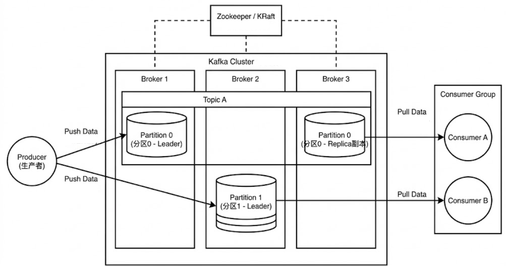
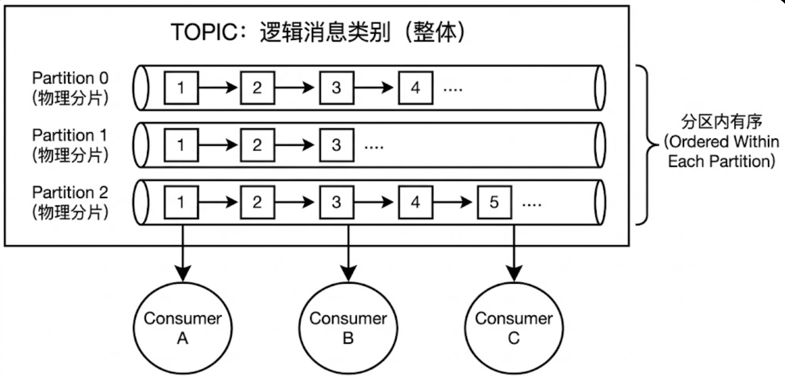
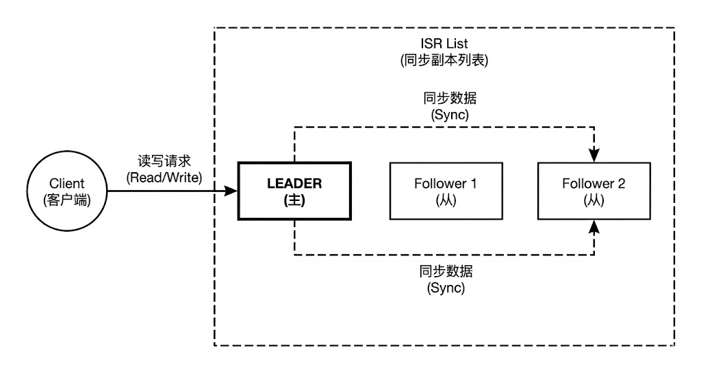
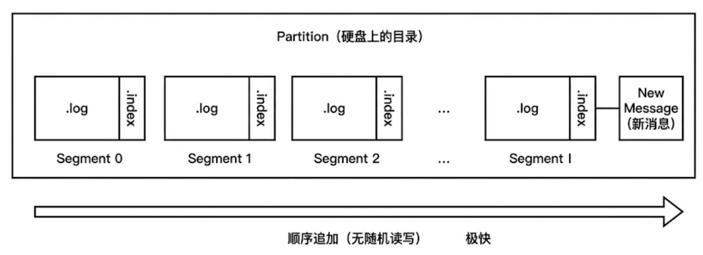

### 一、 知识点讲解

Kafka 的架构本质上是一个**分布式****的、分区的、多副本**的提交日志服务。

它在物理上由多个服务器（Broker）组成集群；在逻辑上，数据按 Topic（主题） 分类，每个 Topic 又被切分成多个 Partition（分区） 分散在不同的 Broker 上。这种设计同时保证了水平扩展性（通过增加 Partition 和 Broker 提高吞吐）和高可用性（通过 Replica 副本机制防止数据丢失）。

#### **核心组件**

- **Producer（生产者）：** 推送数据的一方。它负责将消息发送到 Broker，并根据策略（Hash、轮询等）决定消息落入哪个 Partition。
- **Broker（代理/节点）：** Kafka 集群中的一台服务器。它负责接收和存储消息。
- **Consumer（消费者）：** 拉取数据的一方。**Consumer Group****（****消费者组****）** 是 Kafka 的一大特色，组内的消费者共同分担一个 Topic 的消费任务（负载均衡），组与组之间互不影响（广播）。
- **Zookeeper** **/ KRaft：** 负责管理集群元数据（如谁是 Leader，有哪些 Topic）。*注：**Kafka* *2.8+ 引入了 KRaft 模式，正逐渐移除对 Zookeeper 的依赖。*

#### Topic 与 Partition

这是 Kafka 架构的灵魂。

- **Topic：** 逻辑上的消息类别
- **Partition（物理分片）：** 只要涉及到分布式大数据，必然有分片。
    - 一个 Topic 可以分为 N 个 Partition。
    - Partition 是 **“有序的”**（分区内有序），但 Topic 整体是无序的。
    - Partition 是 **并发的最小单元**。如果你想提高吞吐量，就增加 Partition 的数量，这样就可以有更多的 Consumer 并行消费。

#### 高可用机制：Replication（副本）

为了防止 Broker 宕机导致数据丢失，每个 Partition 都有多个副本。

- **Leader：** 负责处理所有的**读写请求**。
- **Follower：** **只负责从 Leader 同步数据**，不处理客户端请求。
- **ISR ：** 这是一个包含 Leader 和所有“跟得上 Leader 更新进度”的 Follower 的列表。只有写入 ISR 中所有节点，才算“强的一致性”写入。

#### 存储层：Segment（段）

在硬盘上，Partition 表现为一个目录，里面是一堆 Segment 文件（.log 和 .index）。Kafka 所有的写入都是顺序追加（Append Only），这是它写盘速度极快的根本原因。

### 二、 面试标准回答

Kafka 的架构设计是为了满足高吞吐、可扩展和高可用的需求。从宏观上看，它是一个基于 ZooKeeper（或 KRaft）协调的分布式系统，包含 Producer、Broker、Consumer 三个核心角色。

**第一，数据模型的核心是 Partition。**

这是 Kafka 实现高性能和水平扩展的关键。

Kafka 将一个逻辑上的 Topic 切分为多个物理上的 Partition，并将它们分散存储在不同的 Broker 节点上。

- **写性能：** Producer 可以并行向不同 Partition 写入，打破了单机的 I/O 限制。
- **读性能：** 配合 Consumer Group，不同的消费者可以并行消费不同的 Partition，极大地提升了处理能力。

**第二，高可用机制依赖于 副本**

每个 Partition 都有多个副本，分为 Leader 和 Follower。

- **Leader** 负责处理所有的读写请求，保证数据的一致性。
- **Follower** 负责从 Leader 异步拉取日志进行同步。
- 这里必须提到 **ISR**机制：它维护了当前“存活且同步”的副本列表。只有 ISR 中的节点才有资格在 Leader 挂掉后被选举为新 Leader，这在可用性和一致性之间做了很好的权衡。

**第三，物理存储**

在底层，Kafka 采用了 顺序写和 零拷贝技术。这使得 Kafka 即使在处理海量数据积压时，依然能保持极高的吞吐量。
