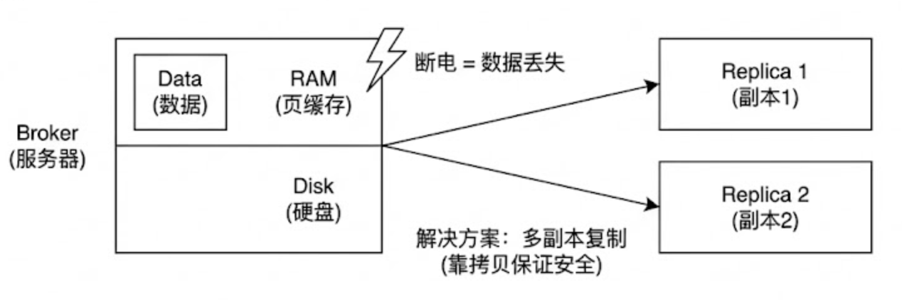
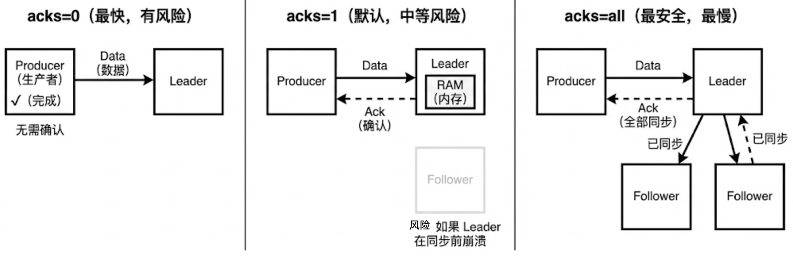
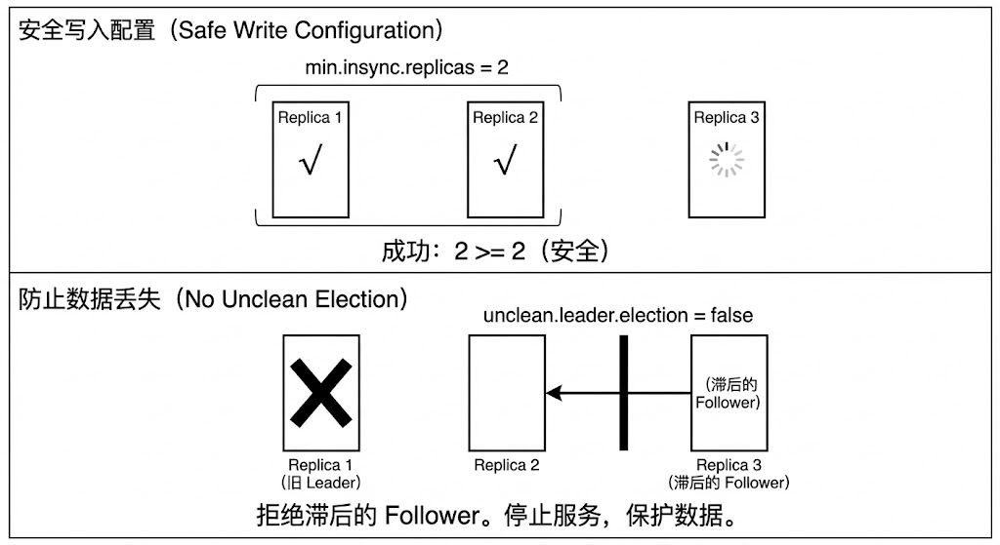
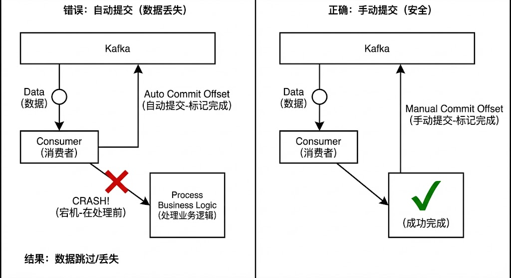

### 一、 知识点讲解

Kafka 的高性能是建立在**“页缓存”和“异步刷盘”**基础上的。这意味着数据写入 Broker 后，默认是先在内存里的，如果此时机器断电，内存数据就丢了。

因此，Kafka 并不是靠“立刻存硬盘”来保证不丢数据，而是靠**“多副本复制”**。只要数据被复制到了足够多的机器上，坏一台也无所谓。

全链路的数据丢失主要发生在三个阶段：发送没成功、存储没存好、消费没处理完。

#### 生产者端（Producer）：发出去，还要听到回响

生产者丢数据，通常是因为“发后即忘”或者网络抖动。

- **核心参数** `**acks**`**：**
    - `acks=0`：我只要发出去就不管了。性能最高，丢数据风险最大。
    - `acks=1`（默认）：只要 Leader 收到并写入内存，就返回成功。如果 Leader 刚写完还没同步给 Follower 就挂了，数据丢失。
    - `**acks=all**` **(或 -1)：** Leader 必须等待所有 ISR（同步副本集合）中的 Follower 都写入成功，才向生产者返回成功。这是最安全的。
- **重试机制：** 网络是不可靠的。如果发送失败，必须配置 `retries > 0`，让它自动重试，而不是直接抛弃。

#### 服务端（Broker）：副本要多，还要同步

Broker 丢数据，通常是因为 Leader 挂了，而新的 Leader 没有旧 Leader 的全部数据。

- **复制因子（Replication Factor）：** 至少设置为 3。即一份数据存 3 份。
- `**min.insync.replicas**`**（关键）：** 这个参数配合 `acks=all` 使用。它规定了“至少有多少个副本写入成功，才算成功”。
    - *陷阱：* 如果你设了 `acks=all`，但 ISR 里只有 Leader 自己（Follower 全挂了），那还是相当于单点存储。
    - *推荐：* 设置为 2（在 3 副本的情况下）。保证至少有 2 台机器有数据。
- `**unclean.leader.election.enable=false**`**：** 禁止“脏选举”。如果 Leader 挂了，绝对不允许那些落后太多的 Follower 变成 Leader。宁可服务不可用，也不能丢数据。

#### 消费者端（Consumer）：处理完再提交

消费者丢数据，通常是因为“自动提交 offset”。

- **场景：** 开启了 `enable.auto.commit=true`。
    - 消费者拉取了一批消息。
    - Kafka 自动提交了 offset（认为你消费了）。
    - 消费者还没来得及处理业务逻辑，机器宕机了。

**结果：** 重启后，消费者从新的 offset 开始拉取，刚才那批未处理的消息就永久跳过了。

**解决：** 关闭自动提交，改为**手动提交**，并且必须在业务逻辑执行成功**之后**再提交。

---

### 二、 面试标准回答

Kafka 要保证消息不丢失，必须实现Producer、Broker、Consumer三端的协同配置。简单来说就是：生产者不丢、服务端多存、消费者不漏。

**第一，Producer 端（确保消息落盘）。**

我们将 acks 设置为 all (或 -1)。这意味着 Leader 在收到消息后，必须等待 ISR 列表中所有的 Follower 都同步写入成功，才会给客户端发送确认。同时，我们将 retries 设置为一个较大的值（如 Integer.MAX_VALUE），配合 delivery.timeout.ms，确保在网络抖动或 Leader 切换期间，生产者能自动重试，而不是丢弃消息。

**第二，Broker 端（确保副本冗余）。**

仅仅设置 acks=all 是不够的。如果 ISR 里只有 Leader 一个节点，那还是单点。

我们需要配置 min.insync.replicas > 1（生产环境通常 3 副本设为 2）。这强制要求至少有 2 个副本确认写入，才能向生产者返回成功。

此外，必须将 unclean.leader.election.enable 设为 false，禁止非 ISR 节点竞选 Leader，防止数据回滚或丢失。

**第三，Consumer 端（确保消费完成）。**

一定要关闭 自动提交 (enable.auto.commit=false)。

在业务代码中，采用**手动提交**的方式。只有当我们的业务逻辑完全执行成功（比如数据写入了数据库）之后，才去提交 Offset。这避免了“消息拿到了但没处理完就挂了”导致的丢失。
