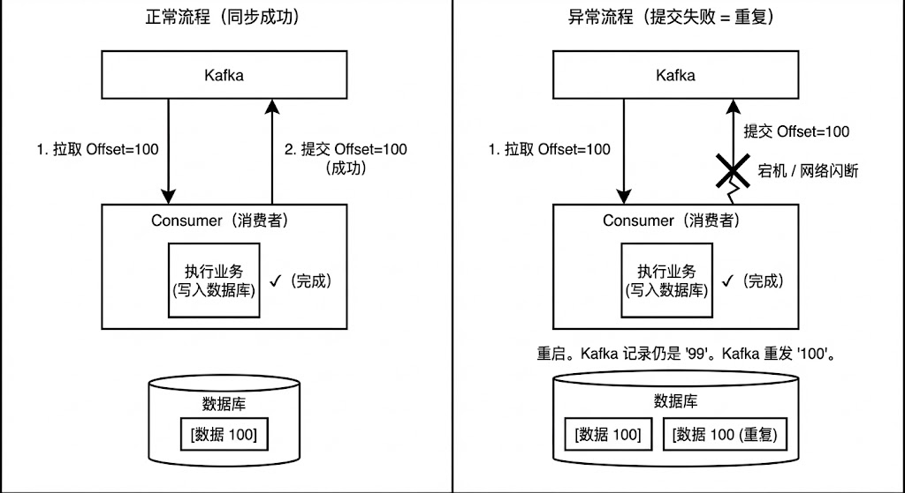
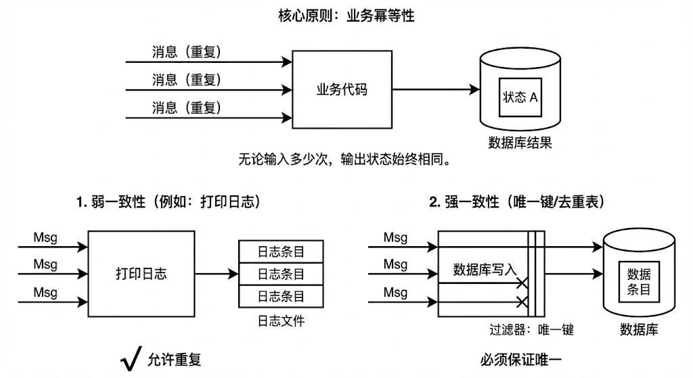

### 一、 知识点讲解

在分布式系统中，由于网络的不确定性，我们很难实现“Exactly Once”（精确一次）的传输语义，通常能做到的都是“At Least Once”（至少一次）。

重复消费的本质是：数据处理了，但在提交“已完成标记”（Offset）之前，程序挂了或发生了 Rebalance。

这就导致 Kafka 不知道你已经消费过了，下次它还会把这条消息给你，或者给接替你的消费者。

#### **重复消费的源头：Offset 提交失败**

- **正常流程：** 拉取消息 -> 执行业务代码 -> 提交 Offset。
- **异常流程：**
    - 消费者拉取了 Offset=100 的消息。
    - 消费者成功把数据写入了数据库（业务完成）。
    - **就在这时，机器宕机了，或者网络闪断，导致“提交 Offset=100”的请求发不出去。**
    - 消费者重启，Kafka 查到的记录依然是“上次消费到 99”。
    - Kafka 再次投递 Offset=100 的消息。
    - 业务代码再次执行，导致数据库里插入了两条一样的数据。

#### 核心解法：业务幂等性

既然我们阻止不了网络抖动带来的重复投递，那就让业务代码“不怕重复”。

无论这条消息被消费多少次，数据库里的结果都是一样的。

- **弱一致性：** 比如仅仅是打印日志，重复了也就重复了。
- **强一致性：** 必须引入“去重表”或者“唯一键”来保证。

---

### 二、 面试标准回答

在 Kafka 中，由于网络波动、服务宕机或 Rebalance，消息的重复消费几乎是不可避免的。要解决这个问题，我们不能寄希望于 Kafka 不发重复消息，而是要在消费端的业务逻辑中实现幂等性。

**第一，利用数据库的唯一约束**

如果业务逻辑是“插入数据”，我们可以在数据库中为关键业务字段建立唯一索引

当消费者重复消费时，第一次插入成功；第二次插入会因为违反唯一约束而报错。我们可以捕获这个异常，直接忽略，从而实现幂等。

**第二，利用 Redis 构建前置去重**

在执行耗时的业务逻辑之前，先去 Redis 查一下。

- **逻辑：** 消息来了，用消息的唯一 ID或业务 ID 去 Redis Set 里查一下是否存在。
- **流程：** 如果存在，说明消费过了，直接丢弃；如果不存在，则将 ID 写入 Redis，并设置一个过期时间，然后继续处理业务。

**第三，利用数据库的“多版本控制”或“去重表”。**

- **乐观锁：** 如果是更新操作，可以使用 `UPDATE table SET status=2 WHERE id=1 AND status=1`。如果这条消息被重复消费，第二次执行时 `status` 已经是 2 了，SQL 语句影响行数为 0，数据不会乱。
- **去重表：** 专门建立一张 `message_log` 表。在本地事务中，既执行业务 SQL，也向 `message_log` 插入消息 ID。如果消息重复，插入日志表就会报错回滚，保证原子性。
