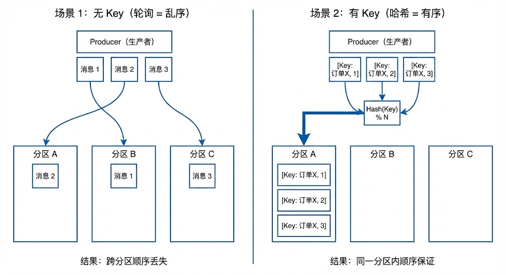
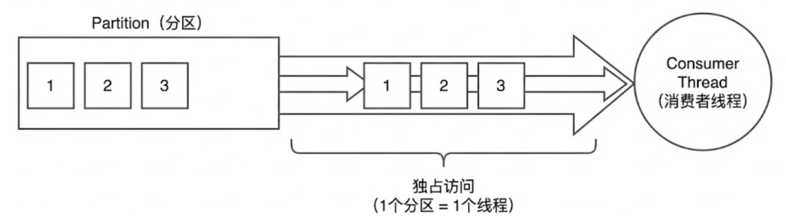
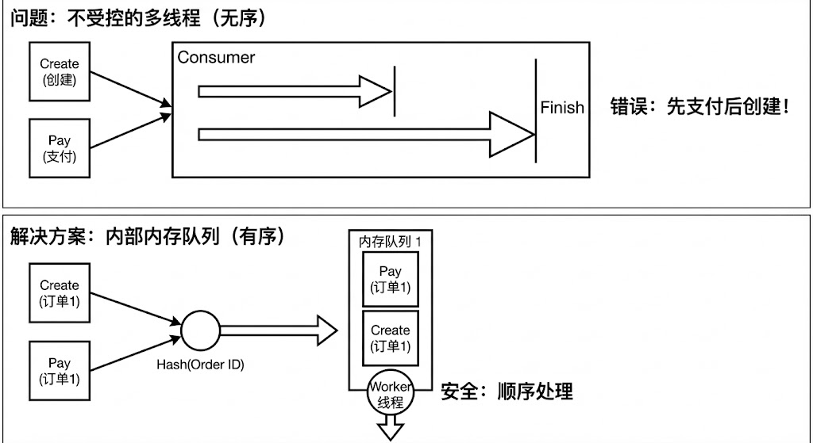

### 一、 知识点讲解

Kafka 并不是一个先进先出（FIFO）的全局队列。

它的架构核心是 Topic（主题） -> Partition（分区）。

Kafka 只能保证一个 Partition 内部的消息是有序的（通过 Offset 顺序追加写入）。但是，它无法保证跨 Partition 的消息顺序。

如果你的业务要求所有消息必须按时间顺序排队（比如 001 号消息在 Partition A，002 号在 Partition B，消费者要先消 001 再消 002），Kafka 原生是做不到的。

#### 发送端如何保证顺序

既然只能保证分区内有序，那我们必须想办法把“需要有序的一组消息”发到“同一个分区”里。

Kafka 的 Producer 允许我们指定消息的 Key（比如订单 ID）。

- 如果不传 Key：Kafka 会采用轮询策略，把消息随机分发到各个 Partition，顺序就乱了。
- **如果传了 Key：** Kafka 会通过 `Hash(Key) % Partition数量` 算出分区号。这样，所有 Key 相同的消息（比如同一个订单的创建、支付、发货）就一定会落入同一个 Partition，从而保证了写入的顺序。

#### 消费端如何保证顺序

Kafka 的 Consumer Group 机制规定：一个 Partition 在同一时刻只能被组内的一个消费者线程消费。

这意味着，只要数据在 Partition 里面是有序的，消费者单线程拉取出来自然也是有序的。

#### 消费者内部的多线程

如果消费者拉取消息后，为了提升处理速度，开启了多线程去并行处理业务逻辑，顺序立马就乱了。

- 例如：线程 A 拿了“订单创建”，线程 B 拿了“订单支付”。如果线程 B 跑得快，先执行了支付，系统就报错了。

**因此，** 必须在消费者内部搞“内存队列”。把拉取到的一批消息，再次根据 Key（订单 ID）进行 Hash，分发到不同的内存队列中，每个内存队列由一个独立的 Worker 线程消费。

---

### 二、 面试标准回答

关于 Kafka 的顺序性，一句话总结就是：Kafka 只能保证 Partition（分区）级别的有序性，不能保证 Topic（主题）级别的全局有序性。

在生产环境中，要实现严格的业务顺序消费，我们需要从发送端、服务端和消费端三个层面来控制。

**第一，发送端（Producer）：利用 Key 实现定向路由。**

这是保证顺序的前提。我们需要将消息设定相同的 Key。

Producer 在发送时，会对 Key 进行 Hash 计算，确保相同 Key 的所有消息都路由到同一个 Partition 中。这样，这些业务相关的消息在物理存储上就是连续追加的，保证了写入顺序。

**第二，服务端（Broker）：注意重试机制导致的乱序。**

这里有一个非常容易被忽略的配置坑。

如果 Producer 开启了重试（retries > 0）且 max.in.flight.requests.per.connection > 1，可能会出现“消息 A 发送失败，消息 B 发送成功，消息 A 重试成功”的情况，导致 B 跑到了 A 前面。

解决方案： 必须开启幂等性生产者 enable.idempotence=true。这就要求 Broker 保证在重试期间依然维持序列号的顺序，或者强制将 max.in.flight.requests.per.connection 设为 1（但这会降低吞吐）。

**第三，消费端（Consumer）：单线程或内存 Hash。**

Kafka 默认保证一个 Partition 只能被一个 Consumer 线程消费，所以单线程消费天然就是有序的。

但是，如果为了提升性能，在 Consumer 内部使用了多线程并发处理（比如拉取一批数据后扔进线程池），顺序就被打乱了。

解决方案： 在 Consumer 内部维护 N 个内存队列。拉取到消息后，根据 Key（OrderID）再次 Hash，将同一笔订单的消息分发到同一个内存队列中，然后由专职的 Worker 线程去消费这个队列。这相当于在内存里又做了一次 Partition，既保证了顺序，又提升了并发度。
