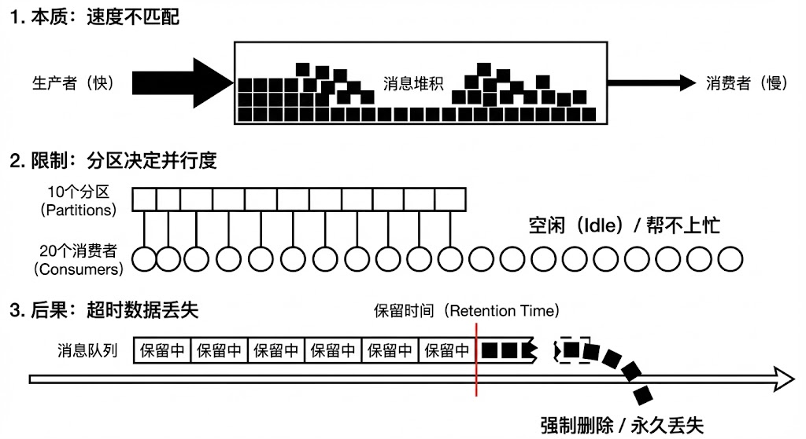

### 一、 知识点讲解

消息堆积的本质很简单：**生产者的发送速度 > 消费者的处理速度**。

但这不仅仅是“慢”的问题。在 Kafka 中，消费者的并行度是受限于 Partition（分区） 数量的。

如果你有 10 个分区，但部署了 20 个消费者，那么有 10 个消费者是空闲的（Idle），完全帮不上忙。这是 Kafka 独有的机制限制。

同时，Kafka 的数据是有生命周期的。如果堆积的时间超过了配置的保留时间，旧消息就会被强制删除，导致数据永久丢失。

#### **堆积的后果**

- **业务停滞：** 实时报表不更新、用户下了单看不到状态、监控报警延迟。
- **数据丢失：** Kafka 的 `log.retention.hours` 默认通常是 7天。如果你的消费端挂了或者极慢，积压了 8 天的数据，那么第 1 天的数据就会被静悄悄地删掉。这是不可恢复的灾难。
- **Rebalance 死循环：** 严重的堆积往往伴随着消费者处理超时。如果处理一条消息耗时太长，超过 `max.poll.interval.ms`，消费者会被踢出组，触发 Rebalance。Rebalance 期间大家都不消费，导致堆积更严重，形成恶性循环。

#### 瓶颈在哪？

解决堆积不能盲目加机器。

- **场景 A：消费者数量 &lt; 分区数量。** 这时候加消费者机器有用。
- **场景 B：消费者数量 = 分区数量。** 这时候加机器**完全没用**。因为多出来的消费者分配不到分区。
    - 这时候必须使用**“临时 Topic 分流法”**

#### 消费端内部优化

除了加机器，更常见的是消费者逻辑太慢。比如每消费一条消息都要去查一次数据库。

这时候需要在消费者内部搞多线程，或者使用批量插入数据库，减少 I/O 次数。

---

### 二、 面试标准回答

Kafka 消息堆积是生产环境中比较严重的故障。它的主要危害在于导致业务实时性受损（如订单状态更新延迟），如果不及时处理，甚至会导致消息超过保留期限被自动清理，造成数据永久丢失。

**第一，应急方案：临时扩容分流**

当积压量达到数亿级别，且消费者数量已经等于分区数量时，直接加机器无效。如果不及时处理，数据可能过期。我们采用**“中转分流”**策略：

1. 创建一个**新的 Topic**，其 Partition 数量是原来的 N 倍（比如原来 10 个，现在建一个 100 个的）。
2. 临时写一个**转发程序**，部署在原来的消费端。它不做任何业务逻辑，只负责快速读取积压消息，并轮询写入到新的 Topic 中。
3. 部署一组**新的消费者集群**（100 个节点）去消费新的 Topic。
4. 通过这种方式，利用 100 个分区的并行度，迅速消化掉积压的数据。等积压消费完，再切回原链路。

**第二，根本治理：优化消费逻辑与配置。**

如果是日常的缓慢堆积，我们需要排查瓶颈：

1. **增加每次拉取的数据量：** 适当调大 `fetch.max.bytes` 和 `max.poll.records`，提高吞吐。
2. **业务逻辑优化：** 检查消费逻辑中是否有慢 SQL 或频繁的外部 API 调用。尽量将单条处理改为**批量处理**（如数据库批量 Insert）。
3. **消费者内并发：** 如果 Kafka 分区数固定无法扩展，我们可以在消费者内部维护一个**线程池**。拉取到消息后，多线程并发处理业务逻辑，处理完再手动提交 Offset。
