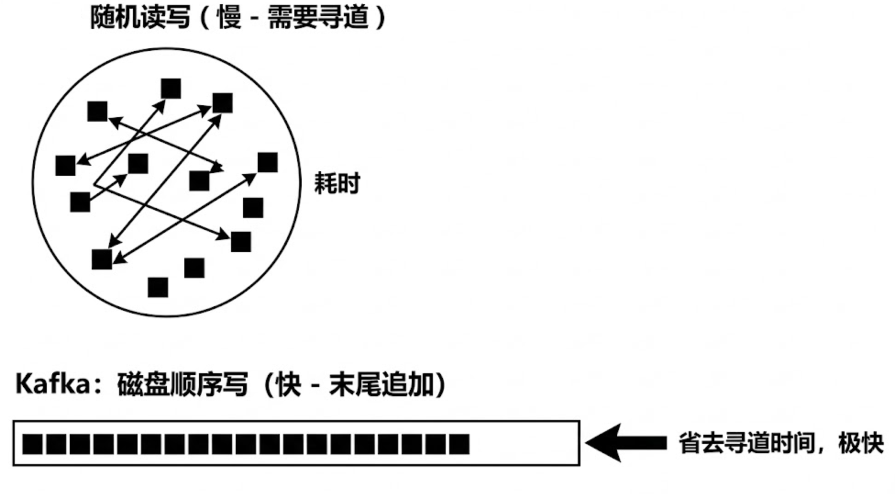
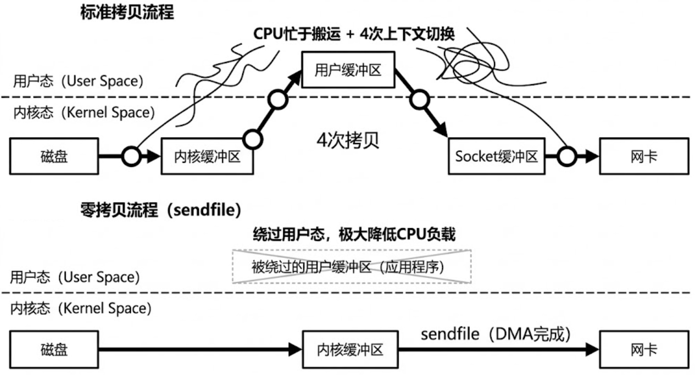
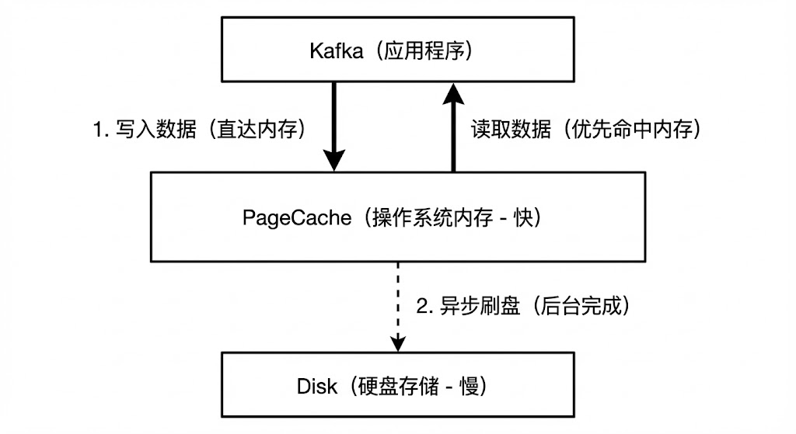
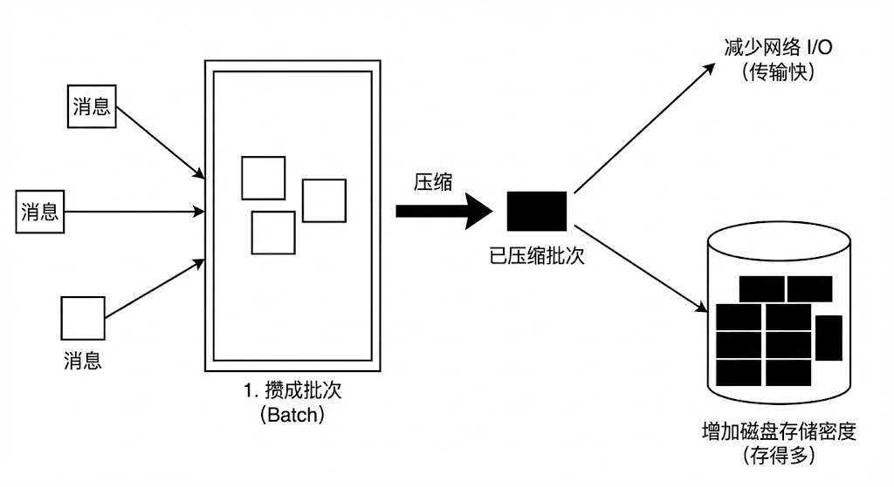

### 一、 知识点讲解

Kafka 的高吞吐量并非单纯靠堆硬件，而是因为它将操作系统的底层 IO 机制压榨到了极致。

核心秘诀只有四字真言：顺序读写、零拷贝、页缓存、批量处理。

它避开了磁盘最慢的“寻道”操作，避开了 CPU 最慢的“上下文切换”和“数据拷贝”操作。

#### **磁盘顺序写**

**误区：** 大家觉得磁盘慢，是因为**随机读写**慢。磁头需要不断移动（寻道），这非常耗时。

**实际上** Kafka 采用了**Log****（日志）结构，写数据永远只是在文件末尾追加。这种顺序写**的方式，省去了磁头寻道的时间。在现代 HDD 甚至 SSD 上，顺序写的速度可以达到几百 MB/s。

#### **零拷贝**

- **传统模式：** 消费者拉取消息时，数据要经历 4 次拷贝：磁盘 -> 内核缓冲区 -> 用户缓冲区（应用层） -> 内核 Socket 缓冲区 -> 网卡。这期间 CPU 要一直忙着搬运数据，还要进行 4 次上下文切换。
- **Kafka 模式：** 利用 Linux 的 `sendfile` 系统调用。数据直接从 **磁盘 -> 内核缓冲区 -> 网卡**。
- **结果：** 数据根本不经过应用程序（用户态），CPU 也不用搬运数据（由 DMA 完成），直接极大降低了 CPU 负载。

#### **PageCache（页缓存）**

- Kafka 直接利用操作系统的 **PageCache**。所有写入的数据先写入 PageCache（内存），然后由操作系统异步刷盘。读取时也优先命中 PageCache。
- 这相当于 Kafka 虽然把数据存磁盘，但在读写活跃的场景下，本质上是在操作内存。

#### **批量发送与压缩**

- Kafka 允许 Producer 把多条消息攒成一个 **Batch（批次）** 再发送。
- 同时支持对这个 Batch 进行压缩。这不仅减少了网络 I/O，还变相增加了磁盘的存储密度。

---

### 二、 面试标准回答

Kafka 之所以能达到单机百万级的 TPS，是因为它在设计上极大程度地避免了磁盘随机 I/O 和 CPU 数据拷贝 的开销。核心原因可以归纳为以下四点。

**第一，磁盘顺序写（核心基础）。**

Kafka 的存储层设计是基于 Partition 的 Log 文件。所有的写入操作都是 追加写。

这利用了磁盘的物理特性：顺序写的性能远远高于随机写。通过避免磁头频繁寻道，Kafka 将磁盘的写性能提升非常高的水平。

**第二，零拷贝技术**

在消费者消费数据（读取）时，Kafka 利用了 Linux 内核的 sendfile 系统调用。

它允许数据直接从PageCache 传输到 Socket 缓冲区（也就是网卡），全程不需要将数据拷贝到用户态。这不仅减少了 2 次数据拷贝，还减少了 2 次 CPU 上下文切换，极大降低了 CPU 的负载。

**第三，深度利用 PageCache。**

Kafka 并没有自己管理内存缓存，而是完全依赖操作系统的 PageCache。

写入时，直接写入 PageCache 即返回（异步刷盘）；读取时，利用操作系统的预读机制，热点数据基本都能在内存中命中。这使得 Kafka 虽为磁盘存储，却拥有内存级别的响应速度。

**第四，批量处理与压缩。**

Kafka 的 Producer 和 Consumer 都支持**批量**操作。配合高效的压缩算法，这极大地减少了网络 I/O 的交互次数和带宽占用，进一步提升了吞吐量。
